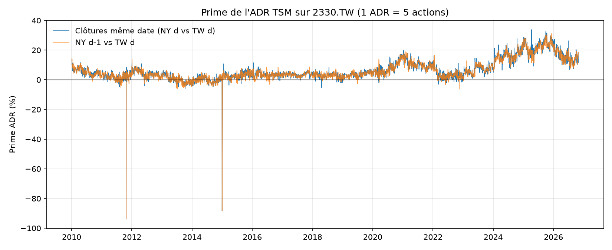
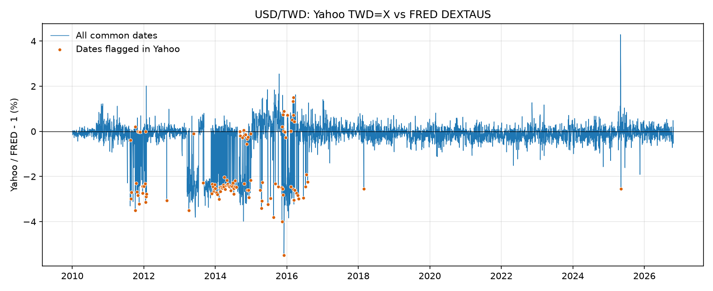
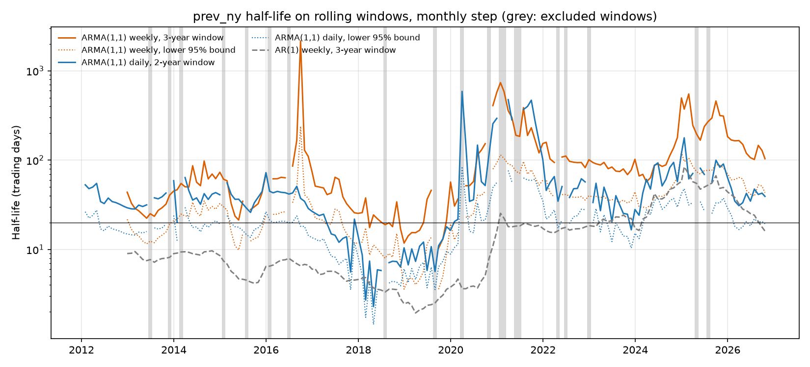
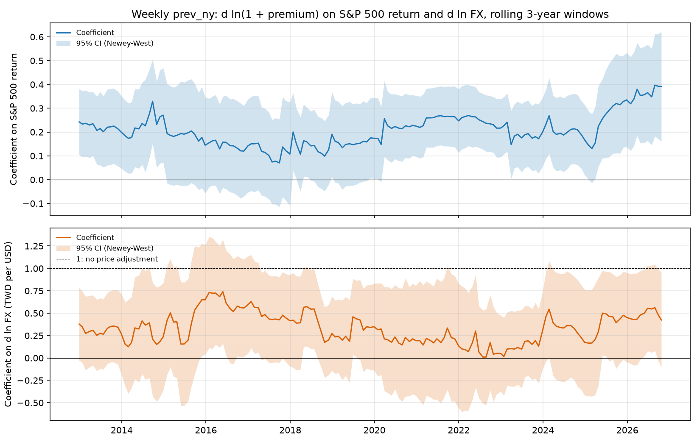
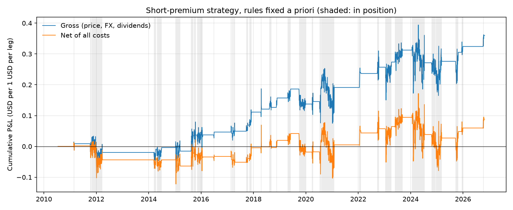
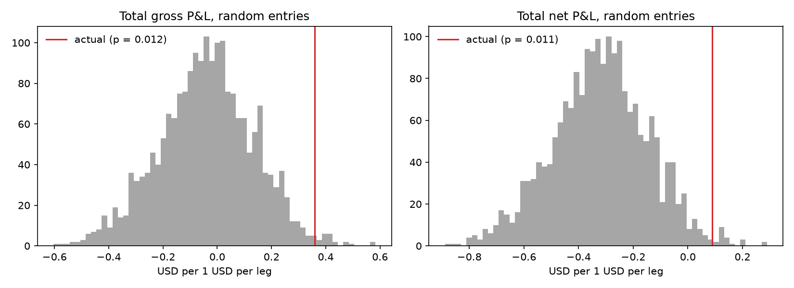

# TSMC ADR Premium

Measuring and modelling the premium of TSMC's NYSE-listed ADR (TSM) over its
Taiwan-listed shares (2330.TW), and asking why arbitrage does not close it.

**Status:** work in progress. Data pipeline, mean reversion, explanatory factors and
trading strategy done; extension to other Taiwanese ADRs next. Target completion:
February 2027.

## Research questions
1. What drives the premium?
2. Does it mean-revert, and how fast?
3. Does a strategy trading it survive transaction costs?
4. What limits arbitrage (conversion constraints, foreign ownership rules, short-selling)?

## Results so far
- **Measurement.** The two markets never trade at the same time; this asynchrony
  adds noise that reverses the next day (daily change autocorrelation -0.44 to -0.45).
  Yahoo's exchange rate has gross errors and persistent shifts, so FRED is used.
- **Mean reversion.** The premium is not stationary over 2010-2026 (it moves between
  level regimes). Corrected for asynchrony noise, its half-life is roughly 30 to 70
  trading days, against about 9 for a naive AR(1).
- **Factors.** The ADR has a higher US market beta than the local share (1.06 against
  0.85), so the premium rises with the S&P 500 and a long local / short ADR pair has
  a beta of about -0.20. FX is only partly passed to the premium; volumes, lagged
  factors and foreign flows give nothing conclusive.
- **Strategy.** A short-premium trade with rules fixed a priori earns 0.360 gross but
  0.088 net (USD per 1 USD per leg over 2010-2026, 33 trades); the net weekly Sharpe is
  0.05 [-0.19, 0.29]. Its timing beats random entries (p = 0.01), but costs of 82 bp per
  round trip, 39% of them Taiwan's transaction tax, absorb most of a 109 bp gross edge,
  and a one-day execution delay turns the net result negative.

## Key methodological issue: non-synchronous prices
Taipei closes at 05:30 UTC, New York at 20:00/21:00 UTC, so no pair of closing
prices is observed at the same time. The premium is built under two alignments
(same calendar date vs. previous NY close) and the measurement noise induced by
asynchrony is quantified before any modelling.

Diagnostics with the FRED exchange rate, 2010-01-04 to 2026-10-23:

| Definition | Observations | Mean premium | Premium std | Daily change std | Daily change autocorrelation (lag 1) |
|---|---:|---:|---:|---:|---:|
| `same_day` | 3,975 | 6.65% | 6.44% | 2.24% | -0.436 |
| `prev_ny` | 4,107 | 6.54% | 6.30% | 1.97% | -0.452 |

Daily changes have an autocorrelation of -0.44 to -0.45 under both definitions, a
sign of measurement noise: a gap caused by asynchrony reverses the next day. It is
unchanged by the FX source (-0.441 and -0.453 with cleaned Yahoo data), so this
noise comes from the non-synchronous closes and not from the exchange rate.

`prev_ny` is the reference definition:

1. It is the only one observable in real time at the Taipei close, when the previous
   NY close is already known, so the only one usable without look-ahead in a
   backtest executed at the Taipei close.
2. It is less noisy: the daily change std is 1.97%, against 2.24% for `same_day`.
3. Its time gap is shorter: about 8.5 hours, against about 15 hours.

`same_day` is kept as a robustness check.

## Data
- Prices: daily unadjusted closes from Yahoo Finance via `yfinance` (unofficial
  API) for TSM (USD) and 2330.TW (TWD).
- Exchange rate: FRED series DEXTAUS (Federal Reserve H.10, TWD per USD), recorded
  at noon New York time.
- Yahoo TWD=X is kept for comparison only (`scripts/compare_fx.py`).
- Dividends: ex-date cash dividends from Yahoo Finance via `yfinance`, for the
  backtest.
- S&P 500 and Nasdaq-100 closes from Yahoo Finance, for the factors and the hedge.

Raw data is not redistributed.

## Data cleaning
Yahoo's TWD=X series contains two gross errors, 1.8015 on 2011-10-25 and 3.67 on
2014-12-31, against 30.11 and 31.60 in FRED. They create premiums of about -94%
and -88%.

Comparing the two sources reveals a less visible problem. Between 2011 and 2016,
Yahoo often departs from FRED: the gap exceeds 1% on 12% of dates in 2011, 52% in
2013, 41% in 2014, 24% in 2015 and 20% in 2016, against about 1% in most years
since 2017. From 2013 to 2016 this includes nine persistent shifts of 10 to 48
consecutive dates at about -2.5%, such as 2013-09-09 to 2013-11-18. A rolling median
cannot detect them, since the neighbouring values are shifted too: only 87 of the
406 dates with a gap above 1% are flagged by the 2% rule on Yahoo's own series.
Of the 124 flagged dates, 115 can be compared directly (9 have no FRED value on that
day), and FRED shows the same move on just 1 of them. The rule flags none of FRED's
own values.

FRED is therefore used for the premium. The alignment rule takes the rate on the
NY date of the ADR used, so it is never later than the ADR price:

- `same_day`: FRED rate of day d.
- `prev_ny`: FRED rate of `adr_date`, the previous NY session.

The rate is recorded 4 hours before the ADR close. Missing values are forward-filled
for at most 3 business days, and never past the last published value.
`scripts/build_premium.py --fx-source yahoo` reproduces the earlier Yahoo version,
and `--no-clean` rebuilds the raw figure above.

## Mean reversion
Reference definition `prev_ny` with the FRED exchange rate, 2010-01-04 to
2026-10-23. Half-lives are in trading days; weekly data are sampled on Fridays and
converted at 5 trading days per week. Code: `scripts/mean_reversion.py`.

**The full sample is not stationary.** ADF does not reject a unit root (p = 0.23
daily, 0.18 weekly) and KPSS rejects level stationarity (p at or below 0.01, the
bound of its table). The premium moves between level regimes: a weekly mean of
3.1% in 2010-2019, 7.3% in 2020-2023, 19.2% from 2024 to April 2026 and 14.1%
since May 2026. Full-sample half-lives mix mean reversion with these level shifts
and are not used.

**A naive AR(1) is biased by asynchrony.** Within sub-periods, AR(1) half-lives
range from 2 to 17 trading days, and daily estimates are about 4 times shorter
than weekly ones. Their residuals remain autocorrelated (lag 1: -0.19 to -0.39).
A simulated AR(1) with a true half-life of 34.3 days, plus white noise calibrated
on the observed -0.44 autocorrelation of daily changes, reproduces the bias: the
AR(1) estimates 4.2 days daily and 14 days weekly.

**Signal plus noise: ARMA(1,1).** An AR(1) signal observed with white noise is an
ARMA(1,1). In simulation it recovers the true half-life at both frequencies. On the
premium, daily and weekly estimates agree at about 55 to 70 trading days within each
sub-period, theta is negative (-0.63 to -0.76 daily, -0.44 to -0.59 weekly), and
weekly residuals are white except in 2020-2023.

| Period | Weeks | Mean premium | AR(1) daily | AR(1) weekly | ARMA daily [95% CI] | ARMA weekly [95% CI] | Theta weekly | Ljung-Box p, weekly ARMA |
|---|---:|---:|---:|---:|---:|---:|---:|---:|
| 2010-2019 | 514 | 3.1% | 2.2 | 7.8 | 61.9 [44.9, 99.4] | 63.1 [40.4, 137.9] | -0.59 | 0.28 |
| 2020-2023 | 206 | 7.3% | 4.1 | 17.0 | 54.6 [30.1, 279.5] | 63.9 [33.1, 551.5] | -0.49 | 0.003 |
| 2024 to April 2026 | 119 | 19.2% | 4.0 | 12.2 | 53.4 [26.9, 2103] | 69.1 [29.6, inf] | -0.44 | 0.72 |

**Rolling windows, without a manual split.** On 3-year windows with a monthly step,
the weekly ARMA half-life has a median of 70 trading days (interquartile range 35 to
122). It exceeds 20 days in 92% of the 160 windows kept, and its lower 95% bound
exceeds 20 days in 68% of them; the weekly AR(1) has a median of 9 days. The level
is not stable, however: windows ending in 2017-2019 have a median of 25 days, with
values below 20 days for windows ending between March 2018 and October 2019, while
windows ending in 2024-2026 have a median of 158 days. The daily ARMA on 2-year
windows has a median of 38 days and is usually shorter than the weekly estimate
(median ratio 1.9).

These rolling estimates have two biases of opposite sign. A window that contains a
change of level inflates phi: across windows, the rank correlation between the level
shift (mean of the last year minus mean of the first year) and the half-life is 0.86.
Part of this correlation is mechanical: a simulated AR(1) plus noise without any
regime change, calibrated on the real series, gives 0.35 for a true half-life of 32
days and 0.48 for 70 days, but never 0.86 in 100 replications, so level shifts also
contribute. In the 70 windows where the level moves by less than 2 points, the median
half-life is 32.3 days, but selecting such windows favours fast reversions: in the
simulation, a true half-life of 32 days gives a stable-window median at least that
high in only 2% of replications. Code: `scripts/simulate_level_shift.py`.

**Conclusion.** Corrected for asynchrony noise, the half-life is clearly longer than
the about 9 days of the naive AR(1). The rolling estimates give a range rather than a
point: roughly 30 to 70 trading days, about 1.5 to 3.3 months. The lower end (32.3
days in windows without a marked level shift) is probably a lower bound; the upper end
(69.6 days over all windows) is inflated by level shifts but depressed by the short
windows, so it is an indication rather than a strict upper bound. Even in stable
windows, the lower 95% bound exceeds 20 days in only 27% of cases, so a half-life above
20 trading days cannot be asserted with confidence. Untested observation: the variation
of the half-life across windows may reflect level shifts inside the windows rather
than a genuine change in the speed of reversion; any link with the level of the
premium is confounded with this effect.

**Limitations.**
- The sub-periods were chosen after looking at the data, hence the rolling window
  above, which confirms the order of magnitude but not a stable level.
- Rolling half-lives are inflated by level shifts inside the windows and biased
  downwards by short windows and by the selection of stable windows; the half-life is
  therefore given as a range.
- Upper bounds of the confidence intervals are unreliable: they come from a Wald
  interval on phi close to 1 and are often very large or infinite.
- Daily ARMA residuals are not white (Ljung-Box p below 0.001 in 2010-2019 and
  2020-2023) although their lag-1 autocorrelation is close to zero: the
  measurement noise is not purely white, so weekly estimates are preferred.
- Since May 2026 there are only 26 weeks of data, too few to estimate a half-life.

### What did not work
- **Chow test.** At the candidate dates of April and May 2026 the test rejects
  stability (p around 1e-6), but it also rejects at every placebo date from 2013 to
  2025 (p from 1e-14 to 3e-4): the pooled "before" regime spans premiums from 1% to
  20%, and the AR(1) residuals are autocorrelated. The results are not conclusive.
- **Dating the level drop.** On data since 2024, the test is already significant at
  2026-01-02 (p = 0.001), so the level drop starts in January 2026. On 23 April 2026,
  Taiwan's Financial Supervisory Commission announced that the cap on a single
  stock in an equity fund would be raised from 10% to 25% (Bloomberg, 23 April 2026;
  Focus Taiwan, 24 April 2026). The exact effective date was not verified. The drop
  therefore began before this announcement; the decision may have accentuated it,
  but these tests cannot isolate its effect.

### References
- Lamont, O. A. (2024). TSMC: Totally Stupid Market Chaos. Acadian Asset Management,
  October 2024:
  https://acadian-asset.com/investment-insights/owenomics/tsmc-totally-stupid-market-chaos
  The ADR and the underlying shares are not fully fungible in the short term;
  regulations have prevented the creation of new U.S. shares; shorting the ADR was
  cheap and easy at the time of writing, but the arbitrage is a risky bet on the speed
  of convergence.
- Shleifer, A. and Vishny, R. W. (1997). The Limits of Arbitrage. *The Journal of
  Finance*, 52(1), 35-55. Arbitrage is conducted by a relatively small number of
  specialised investors who take large positions with other people's money, and it can
  become ineffective when prices diverge far from fundamental values.
- Bloomberg, 23 April 2026:
  https://www.bloomberg.com/news/articles/2026-04-23/taiwan-to-ease-limits-on-active-funds-investments-in-tsmc
- Focus Taiwan, 24 April 2026: https://focustaiwan.tw/business/202604240013

## Explanatory factors
Weekly data (Fridays), reference definition `prev_ny` with the FRED exchange rate,
2010-01-04 to 2026-10-23, 852 weeks. The dependent variable is the weekly change of
q = ln(1 + premium). The main model, specified before estimation, regresses it on the
S&P 500 log return (read on the ADR's NY date) and the change in log FX (TWD per USD).
All standard errors are Newey-West. These are contemporaneous regressions: they
describe co-movement within the week, not forecasts. Code: `scripts/factors.py`,
results in `data/factor_results.csv`.

**Robust: the ADR carries more US market risk than the local share.** The S&P 500
beta is 1.06 for the ADR against 0.85 for the local share in USD. In the main model,
the premium's S&P 500 coefficient is 0.24 [0.17, 0.31]. It is 0.21 to 0.37 in the
three sub-periods up to April 2026, with 95% intervals excluding 0, and positive in
all 167 rolling 3-year windows (interval excluding 0 in 66% of them); the 26 weeks
since May 2026 are too few to conclude. A long local / short ADR pair trade with
equal dollar legs therefore has an S&P 500 beta of about -0.20 [-0.27, -0.14],
negative in all rolling windows, which a strategy will have to hedge.

**Partial: FX changes are not passed to the premium one for one.** A full
pass-through (coefficient 1) is rejected (p = 2.4e-12 univariate, 2.4e-07 in the main
model), but the size of the pass-through is not established: the coefficient is 0.10
univariate (not different from 0), 0.36 in the main model and -0.29 on monthly data,
and the rolling interval excludes 0 in only 17% of windows.

**Not conclusive.**
- Traded volumes: the change in the ADR / local traded-value ratio is endogenous (it
  moves with the premium) and not significant (p = 0.19 univariate, 0.28 added to
  the main model); it is kept out of the main model.
- Predictive version: with factors lagged one week, R² is at most 1.4%.
- Foreign investor flows: no documented official historical source was found.

**Choice of index.** The S&P 500 was chosen a priori as the broad US market. The
Nasdaq-100 is a robustness check: it gives the same univariate beta (0.20) and a
slightly higher R² (5.7% against 4.3%), so the conclusions do not depend on the
index.

## Trading strategy
Backtest of a simple mean-reversion trade on the premium, 2010-07-16 (first valid
signal) to 2026-10-30. Code: `src/adr_premium/backtest.py`, `scripts/backtest.py`
(results in `data/backtest_results.csv` and `data/backtest_trades.csv`),
`src/adr_premium/robustness.py` and `scripts/backtest_robustness.py` (results in
`data/backtest_robustness.csv`).

**Rules, fixed a priori.** They were chosen before any backtest was run and are never
tuned; the sensitivity grids below are reported without selection.
- Signal: z-score of q = ln(1 + premium), `prev_ny` premium with the FRED rate,
  sampled on the last Taipei date of each week; the mean and standard deviation come
  from the 26 previous weeks only.
- Entry when z > 1.5: "short premium", long the local share and short the ADR, with
  1 USD in each leg.
- Exit when z < 0, or after 26 weeks.
- One direction only: short selling in Taiwan is more constrained (not verified),
  while shorting the ADR is easy according to Lamont (2024).

**Execution and P&L.** The signal is known at the Taipei close of the decision date.
Each leg trades at the first close strictly after that moment: the ADR at the NY close
of the same calendar date, the local share at the next Taipei close. The local leg is
converted at the FRED rate of its own execution dates. The P&L is computed on these
execution prices and on each leg's daily closes, never on changes of the `prev_ny`
premium, which pairs a Taipei close with an ADR close already in the past and carries
the asynchrony noise. P&L is in USD per 1 USD per leg, without compounding. Tests
check that no decision uses later data (the bug was reintroduced to confirm the test
fails) and that every leg trades after its decision.

**Costs.** All are assumptions, not verified against an official source.

| Item | Default | Source |
|---|---:|---|
| ADR commission | 5 bp per trade | assumption |
| Local commission | 10 bp per trade | regulatory ceiling 0.1425%, discounts common (Taipei Times, 2000) |
| Taiwan securities transaction tax | 30 bp on sales only | 0.3% of the sale amount (PwC; Kaizen CPA; Interactive Brokers) |
| FX conversion | 5 bp per conversion | assumption |
| ADR borrow fee | 0.5% a year, pro rata | assumption |
| Withholding on local dividends | 21% | non-resident rate since 2018, 20% before (EY; Investment Taiwan) |

Dividends come from Yahoo at their ex-dates; each ADR dividend matches 5 times the
local one in USD within 4.4%. The short pays the gross ADR dividend; paying it net of
withholding raises the net P&L from 0.088 to 0.105. Financing: the short-sale proceeds
fund the local purchase, and no interest income or financing cost is modelled apart
from the borrow fee.

**Results.** 33 trades, 6.4 weeks on average, in position 26% of the time; 32 exits
on z < 0, one at 26 weeks. Sharpe ratios are annualised from weekly P&L, since the
daily marks of the two legs are asynchronous.

| | Total P&L | Annual return | Sharpe (weekly) [95% CI] | Max drawdown | Winning trades |
|---|---:|---:|---:|---:|---:|
| Gross | 0.360 | 2.21% | 0.21 [-0.04, 0.47] | -0.23 | 79% |
| Net | 0.088 | 0.54% | 0.05 [-0.19, 0.29] | -0.25 | 61% |

- Costs, in total: Taiwan tax -0.105, local commission -0.068, ADR commission -0.034,
  FX -0.034, borrow fee -0.021, withholding -0.010.
- Confidence intervals: circular block bootstrap, 13-week blocks (about twice the
  average holding period), 5,000 draws; 33% of the net draws are at or below zero.
- Timing: with 33 trades of the same lengths placed at random dates (2,000
  replications, same execution and costs), the actual result has a one-sided p-value
  of 0.012 gross and 0.011 net. Random entries lose (median -0.04 gross, -0.32 net)
  because the premium rose over the sample. The holding periods come from the signal
  itself, so this test is somewhat favourable.
- Sub-periods, net: 2010-2019 -0.018 (20 trades), 2020-2023 +0.113 (7),
  2024 to April 2026 -0.035 (5), since May 2026 +0.029 (1 trade).
- Sensitivity without selection: over entry thresholds {1.0, 1.5, 2.0} and windows
  {13, 26, 52} weeks the net Sharpe ranges from -0.08 to 0.15; with a 3% borrow fee
  it is -0.01.

**Cost scenarios.** The break-even all-in cost is 109 bp per round trip (per 1 USD per
leg), against 82 bp with the default costs.

| Scenario | All-in cost per trade | Net P&L | Net Sharpe | Tax share of costs |
|---|---:|---:|---:|---:|
| Default | 82 bp | 0.088 | 0.05 | 39% |
| Institutional (2 / 3 bp commissions, 2 bp FX, 0.25% borrow) | 52 bp | 0.187 | 0.11 | 61% |
| Tax only | 32 bp | 0.255 | 0.15 | 100% |

**Execution is fragile.** Delaying both legs by one trading day cuts the gross P&L
from 0.360 to 0.080 and makes the net P&L -0.191. Most of the loss comes from the exit
(gross 0.128 with a delayed exit, 0.311 with a delayed entry), and one trade (July
2020) accounts for half of it: without it, a delayed exit costs 0.36% per trade
(t = 1.2) instead of 0.70% (t = 1.6). This loss is not explained by the asynchrony
gap (`same_day` minus `prev_ny` log premium) at the exit decision: the correlation of
0.56 falls to 0.08 (p = 0.68) without the July 2020 trade.

**The signal overstates the executable gap.** At the entry decision the ADR's own
close of that day has already erased 1.5 points of the signalled premium on average
(t = -4.7, 32 trades); at the exit the premium has already rebounded by 0.9 points
(t = 2.1, 30 trades). About 2.4 points per trade of the apparent convergence are
therefore asynchrony that no order could capture.

**Beta hedge.** A variant hedges the pair's S&P 500 beta, estimated on the 156 weeks
before each entry only (mean -0.16, from -0.33 to -0.01; a test with the bug
reintroduced confirms no later data is used), with index returns standing in for a
futures contract and 1 bp per hedge trade. The weekly volatility barely moves (10.5%
to 10.3%) and the realised beta goes from -0.058 to -0.015; the net Sharpe rises from
0.05 to 0.10 and the drawdown from -0.25 to -0.22 because the long index position
gained 0.086 while the S&P 500 rose, not because risk fell.

**Stress periods.** The strategy was in position for 14% of March 2020 (from 27 March,
net +0.003) and flat in August 2024, April 2025 and January to May 2026, so these
episodes say nothing about its resilience.

**Conclusion.** A simple strategy does not survive realistic costs: the gross edge of
about 1.1% per trade is real in timing but is consumed by 0.8% of costs, more than a
third of them the Taiwan transaction tax, which is a quantified answer to the limits
of arbitrage. A signal taken at the NY close, suggested by the asynchrony result, came
out of these results and will only be tested out of sample (step 6, other Taiwanese
ADRs).

### Cost sources
- PwC, Taiwan corporate taxes, other taxes: https://taxsummaries.pwc.com/taiwan/corporate/other-taxes
- Kaizen CPA, Guide to Taiwan Securities Transaction Tax: https://kaizencpa.com/knowledge/info/id/364.html
- Interactive Brokers, Taiwan Stock Exchange fees: https://www.interactivebrokers.com/ru/accounts/fees/TAIWAN_StkFees.php?nhf=T
- Taipei Times, 3 March 2000 (commission ceiling): https://www.taipeitimes.com/News/biz/archives/2000/03/03/0000026462
- EY, Taiwan raises the non-resident withholding rate to 21% (2018): https://globaltaxnews.ey.com/news/2018-5118-taiwan-increases-withholding-tax-rate-for-nonresident-recipients-without-fixed-place-of-business-in-taiwan
- Investment Taiwan, Bravo! Taiwan 2024: https://investtaiwan.nat.gov.tw/eBook/BravoTaiwan/2024ebook_en/files/basic-html/page33.html

## Reproduce
Requires Python 3.12.

    python3.12 -m venv .venv
    source .venv/bin/activate
    pip install -r requirements.txt
    pytest -q
    python scripts/build_premium.py
    python scripts/mean_reversion.py
    python scripts/factors.py
    python scripts/backtest.py
    python scripts/backtest_robustness.py

## Roadmap
- [x] Data pipeline and premium construction (two alignments, unit tests)
- [x] Asynchrony diagnostics and choice of reference definition
- [x] Stationarity, mean reversion (ADF, AR(1), ARMA(1,1) half-life); structural breaks tested, not conclusive
- [x] Explanatory factors (US market, FX, volumes); foreign flows not available
- [x] Strategy backtest with rules fixed a priori, transaction costs, bootstrapped Sharpe, random-entry Monte-Carlo, beta hedge
- [ ] Extension to other Taiwanese ADRs (UMC, ASE, Chunghwa Telecom), with an out-of-sample test of a signal taken at the NY close

## Tools
Python, pandas, statsmodels, matplotlib, pytest. Development assisted by Claude Code.