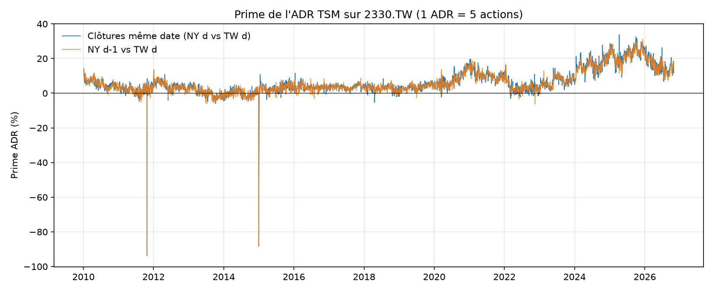
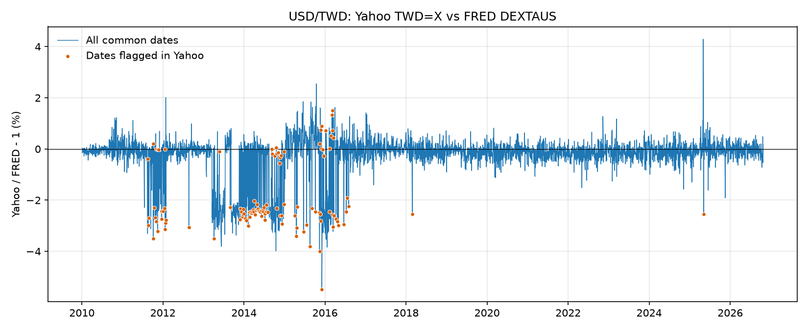
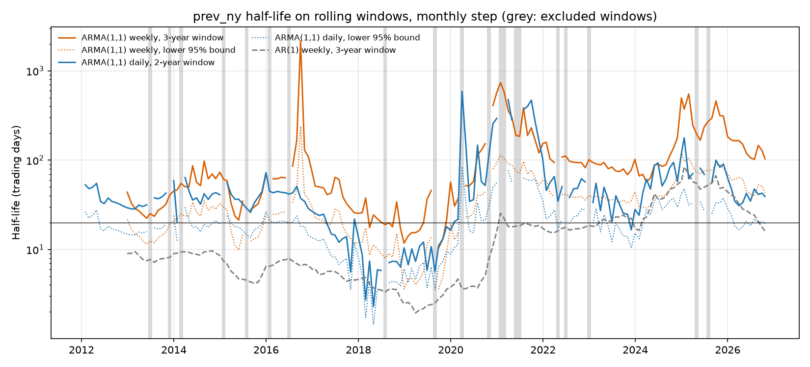

# TSMC ADR Premium

Measuring and modelling the premium of TSMC's NYSE-listed ADR (TSM) over its
Taiwan-listed shares (2330.TW), and asking why arbitrage does not close it.

**Status:** work in progress — data pipeline and premium construction done;
statistical analysis under way. Target completion: February 2027.

## Research questions
1. What drives the premium?
2. Does it mean-revert, and how fast?
3. Does a strategy trading it survive transaction costs?
4. What limits arbitrage (conversion constraints, foreign ownership rules, short-selling)?

## Key methodological issue: non-synchronous prices
Taipei closes at 05:30 UTC, New York at 20:00/21:00 UTC, so no pair of closing
prices is observed at the same time. The premium is built under two alignments
(same calendar date vs. previous NY close) and the measurement noise induced by
asynchrony is quantified before any modelling.

Diagnostics with the FRED exchange rate, 2010-01-04 to 2026-10-23:

| Definition | Observations | Mean premium | Premium std | Daily change std | Daily change autocorrelation (lag 1) |
|---|---:|---:|---:|---:|---:|
| `same_day` | 3,975 | 6.65% | 6.44% | 2.24% | -0.436 |
| `prev_ny` | 4,107 | 6.54% | 6.30% | 1.97% | -0.452 |

Daily changes have an autocorrelation of -0.44 to -0.45 under both definitions, a
sign of measurement noise: a gap caused by asynchrony reverses the next day. It is
unchanged by the FX source (-0.441 and -0.453 with cleaned Yahoo data), so this
noise comes from the non-synchronous closes and not from the exchange rate.

`prev_ny` is the reference definition:

1. It is the only one observable in real time at the Taipei close, when the previous
   NY close is already known, so the only one usable without look-ahead in a
   backtest executed at the Taipei close.
2. It is less noisy: the daily change std is 1.97%, against 2.24% for `same_day`.
3. Its time gap is shorter: about 8.5 hours, against about 15 hours.

`same_day` is kept as a robustness check.

## Data
- Prices: daily unadjusted closes from Yahoo Finance via `yfinance` (unofficial
  API) for TSM (USD) and 2330.TW (TWD).
- Exchange rate: FRED series DEXTAUS (Federal Reserve H.10, TWD per USD), recorded
  at noon New York time.
- Yahoo TWD=X is kept for comparison only (`scripts/compare_fx.py`).

Raw data is not redistributed.

## Data cleaning
Yahoo's TWD=X series contains two gross errors, 1.8015 on 2011-10-25 and 3.67 on
2014-12-31, against 30.11 and 31.60 in FRED. They create premiums of about -94%
and -88%.

Comparing the two sources reveals a less visible problem. Between 2011 and 2016,
Yahoo often departs from FRED: the gap exceeds 1% on 12% of dates in 2011, 52% in
2013, 41% in 2014, 24% in 2015 and 20% in 2016, against about 1% in most years
since 2017. From 2013 to 2016 this includes nine persistent shifts of 10 to 48
consecutive dates at about -2.5%, such as 2013-09-09 to 2013-11-18. A rolling median
cannot detect them, since the neighbouring values are shifted too: only 87 of the
406 dates with a gap above 1% are flagged by the 2% rule on Yahoo's own series.
Of the 124 flagged dates, 115 can be compared directly (9 have no FRED value on that
day), and FRED shows the same move on just 1 of them. The rule flags none of FRED's
own values.

FRED is therefore used for the premium. The alignment rule takes the rate on the
NY date of the ADR used, so it is never later than the ADR price:

- `same_day`: FRED rate of day d.
- `prev_ny`: FRED rate of `adr_date`, the previous NY session.

The rate is recorded 4 hours before the ADR close. Missing values are forward-filled
for at most 3 business days, and never past the last published value.
`scripts/build_premium.py --fx-source yahoo` reproduces the earlier Yahoo version,
and `--no-clean` rebuilds the raw figure above.

## Mean reversion
Reference definition `prev_ny` with the FRED exchange rate, 2010-01-04 to
2026-10-23. Half-lives are in trading days; weekly data are sampled on Fridays and
converted at 5 trading days per week. Code: `scripts/mean_reversion.py`.

**The full sample is not stationary.** ADF does not reject a unit root (p = 0.23
daily, 0.18 weekly) and KPSS rejects level stationarity (p at or below 0.01, the
bound of its table). The premium moves between level regimes: a weekly mean of
3.1% in 2010-2019, 7.3% in 2020-2023, 19.2% from 2024 to April 2026 and 14.1%
since May 2026. Full-sample half-lives mix mean reversion with these level shifts
and are not used.

**A naive AR(1) is biased by asynchrony.** Within sub-periods, AR(1) half-lives
range from 2 to 17 trading days, and daily estimates are about 4 times shorter
than weekly ones. Their residuals remain autocorrelated (lag 1: -0.19 to -0.39).
A simulated AR(1) with a true half-life of 34.3 days, plus white noise calibrated
on the observed -0.44 autocorrelation of daily changes, reproduces the bias: the
AR(1) estimates 4.2 days daily and 14 days weekly.

**Signal plus noise: ARMA(1,1).** An AR(1) signal observed with white noise is an
ARMA(1,1). In simulation it recovers the true half-life at both frequencies. On the
premium, daily and weekly estimates agree at about 55 to 70 trading days within each
sub-period, theta is negative (-0.63 to -0.76 daily, -0.44 to -0.59 weekly), and
weekly residuals are white except in 2020-2023.

| Period | Weeks | Mean premium | AR(1) daily | AR(1) weekly | ARMA daily [95% CI] | ARMA weekly [95% CI] | Theta weekly | Ljung-Box p, weekly ARMA |
|---|---:|---:|---:|---:|---:|---:|---:|---:|
| 2010-2019 | 514 | 3.1% | 2.2 | 7.8 | 61.9 [44.9, 99.4] | 63.1 [40.4, 137.9] | -0.59 | 0.28 |
| 2020-2023 | 206 | 7.3% | 4.1 | 17.0 | 54.6 [30.1, 279.5] | 63.9 [33.1, 551.5] | -0.49 | 0.003 |
| 2024 to April 2026 | 119 | 19.2% | 4.0 | 12.2 | 53.4 [26.9, 2103] | 69.1 [29.6, inf] | -0.44 | 0.72 |

**Rolling windows, without a manual split.** On 3-year windows with a monthly step,
the weekly ARMA half-life has a median of 70 trading days (interquartile range 35 to
122). It exceeds 20 days in 92% of the 160 windows kept, and its lower 95% bound
exceeds 20 days in 68% of them; the weekly AR(1) has a median of 9 days. The level
is not stable, however: windows ending in 2017-2019 have a median of 25 days, with
values below 20 days for windows ending between March 2018 and October 2019, while
windows ending in 2024-2026 have a median of 158 days. The daily ARMA on 2-year
windows has a median of 38 days and is usually shorter than the weekly estimate
(median ratio 1.9).

**Conclusion.** Corrected for asynchrony noise, the half-life is measured in weeks
to months: the rolling weekly ARMA median is about 70 trading days, above 20 days in
92% of windows, against about 9 days for the naive AR(1). It varies over time, from
about 25 days in windows ending in 2017-2019 to about 158 days in windows ending in
2024-2026. Untested observation: the half-life seems to lengthen when the premium
level is high.

**Limitations.**
- The sub-periods were chosen after looking at the data, hence the rolling window
  above, which confirms the order of magnitude but not a stable level.
- Upper bounds of the confidence intervals are unreliable: they come from a Wald
  interval on phi close to 1 and are often very large or infinite.
- Daily ARMA residuals are not white (Ljung-Box p below 0.001 in 2010-2019 and
  2020-2023) although their lag-1 autocorrelation is close to zero: the
  measurement noise is not purely white, so weekly estimates are preferred.
- Since May 2026 there are only 26 weeks of data, too few to estimate a half-life.

### What did not work
- **Chow test.** At the candidate dates of April and May 2026 the test rejects
  stability (p around 1e-6), but it also rejects at every placebo date from 2013 to
  2025 (p from 1e-14 to 3e-4): the pooled "before" regime spans premiums from 1% to
  20%, and the AR(1) residuals are autocorrelated. The results are not conclusive.
- **Dating the level drop.** On data since 2024, the test is already significant at
  2026-01-02 (p = 0.001), so the level drop starts in January 2026. On 23 April 2026,
  Taiwan's Financial Supervisory Commission announced that the cap on a single
  stock in an equity fund would be raised from 10% to 25% (Bloomberg, 23 April 2026;
  Focus Taiwan, 24 April 2026). The exact effective date was not verified. The drop
  therefore began before this announcement; the decision may have accentuated it,
  but these tests cannot isolate its effect.

### References
- Bloomberg, 23 April 2026:
  https://www.bloomberg.com/news/articles/2026-04-23/taiwan-to-ease-limits-on-active-funds-investments-in-tsmc
- Focus Taiwan, 24 April 2026: https://focustaiwan.tw/business/202604240013

## Reproduce
Requires Python 3.12.

    python3.12 -m venv .venv
    source .venv/bin/activate
    pip install -r requirements.txt
    pytest -q
    python scripts/build_premium.py
    python scripts/mean_reversion.py

## Roadmap
- [x] Data pipeline and premium construction (two alignments, unit tests)
- [x] Asynchrony diagnostics and choice of reference definition
- [x] Stationarity, mean reversion (ADF, AR(1), ARMA(1,1) half-life); structural breaks tested, not conclusive
- [ ] Explanatory factors (flows, FX, relative US/Taiwan returns)
- [ ] Walk-forward strategy with transaction costs, bootstrapped Sharpe
- [ ] Extension to other Taiwanese ADRs (UMC, ASE, Chunghwa Telecom)

## Tools
Python, pandas, statsmodels, matplotlib, pytest. Development assisted by Claude Code.