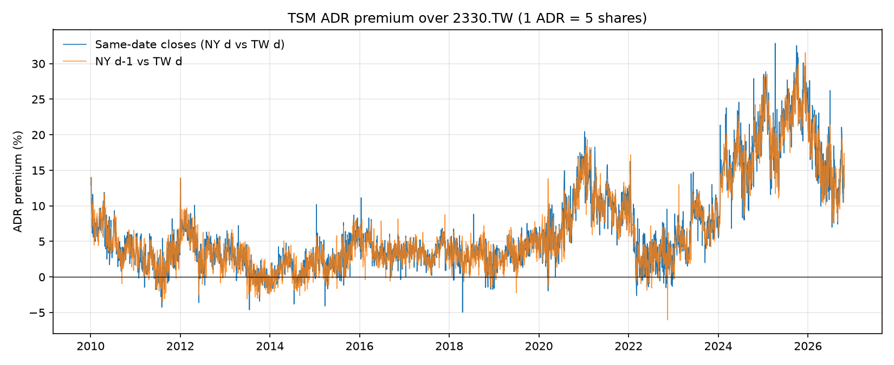
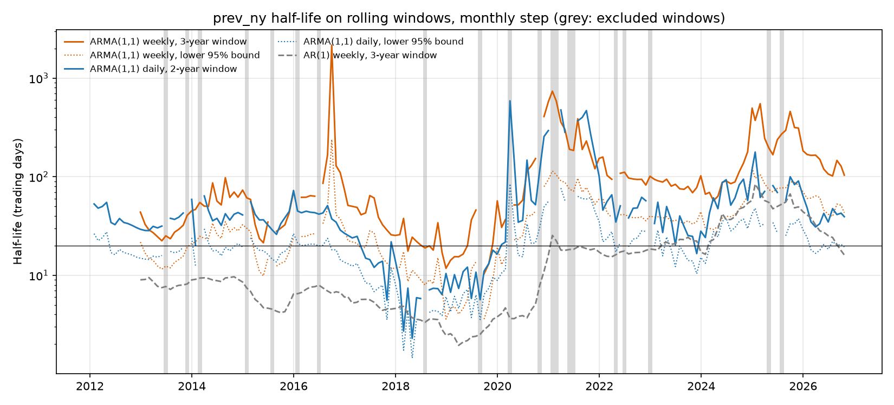
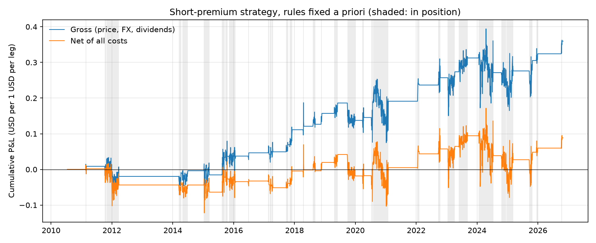
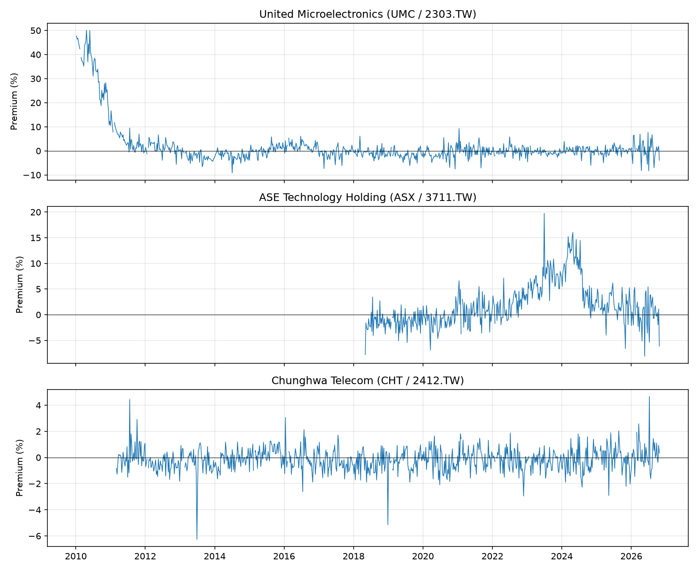
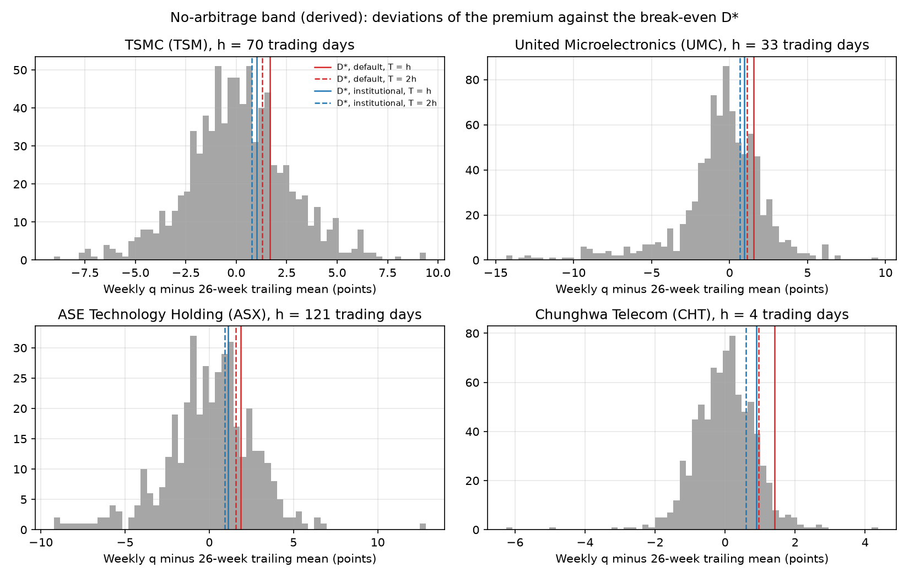

# The TSMC ADR Premium and the Limits to Arbitrage

Short report. Every section refers to the corresponding section of the
[technical report](technical_report.md), which gives the details, all tables and the
reproduction steps. Tables are generated from the result files; no number in a table is
typed by hand.

## Abstract

TSMC's ADR on the NYSE (TSM) trades at a persistent premium over its shares in Taipei
(2330.TW), in apparent breach of the law of one price. This report measures the premium
from 2010 to 2026, estimates how fast it mean-reverts and what moves it, backtests a
simple strategy that trades its reversion, tests the findings out of sample on three
other Taiwanese ADRs with a pre-registered plan, and sums up the limits to arbitrage.
The two markets never trade at the same time, which adds noise that reverses the next
day and biases naive half-lives downwards; corrected, the half-life is roughly 30 to 70
trading days. The ADR carries more US market risk than the local share. A strategy with
rules fixed before any backtest earns 0.360 before costs and 0.088 after, per 1 USD per
leg over 2010-2026, with a net Sharpe ratio of 0.05 whose interval contains 0, and it
loses on all three out-of-sample ADRs. Conversion into new ADRs is capped by regulation,
and costs and slow reversion imply a no-arbitrage band of about 1 to 2 points of premium.

## 1. Question and context

An ADR represents shares of a foreign company held by a depositary bank; one TSM ADR
represents five 2330.TW shares, a ratio confirmed in TSMC's 20-F filings. The premium is
the ADR price over the value of the five shares in dollars, minus one. Its weekly mean was
3.1% over 2010-2019, 7.3% over 2020-2023 and 19.2% from 2024 to April 2026. Lamont (2024)
asks two questions about any such violation: "Why aren't arbitrageurs enforcing LOOP?"
and "Who is buying the expensive stock instead of the cheap stock?". This project answers
them with four steps: measurement, mean reversion, explanatory factors and a trading
strategy, then an out-of-sample test and a synthesis
([technical report, Section 3](technical_report.md#3-introduction)).

Most of the work went into measurement and inference problems. Each would have changed a
conclusion had it not been detected:

<!-- table:issues_short -->
| Issue | Impact (before -> after) |
|---|---|
| a) Errors in the Yahoo exchange rate | `prev_ny` daily change std over 2011-2016: 2.09% -> 1.74%; minimum premium -93.7% -> -6.0% |
| b) Measurement noise from non-synchronous closes | Autocorrelation `prev_ny`: -0.453 (Yahoo) -> -0.452 (FRED): the noise is not from the exchange rate |
| c) AR(1) half-life biased downwards | Weekly half-life by sub-period: 7.8-17.0 (AR(1)) -> 63.1-69.1 days (ARMA) |
| d) Sub-periods chosen after looking at the data | Weekly ARMA median 69.6 days, above 20 days in 92% of windows; its variation across windows (25.4 to 157.5 days) is rank-correlated with level shifts inside the windows (0.86, against 0.35 and 0.48 in a no-regime simulation); windows with a shift below 2 points: median 32.3 days, likely a lower bound |
| e) Chow test at chosen break dates | Break at the candidate dates: claimed -> not conclusive (7 of 7 placebo dates reject); monthly mean 25.7% in December 2025, 20.2% in January 2026 |
| f) US factors read on the wrong date (step 4) | Main-model S&P 500 coefficient on correctly aligned data: 0.24 |
| g) Two collinear US indices (step 4) | Univariate S&P 500 0.203 and Nasdaq-100 0.196 -> jointly -0.063 and 0.278 |
| h) P&L computed on premium changes (step 5) | About 2.4 points per trade of apparent convergence are not capturable |
| i) Exchange rate of the local leg (step 5) | Gross P&L +0.0452 in total, +13.7 bp per trade (t = 1.8) |
| j) Daily marks of two asynchronous legs (step 5) | Gross annual volatility 19.3% (daily) -> 10.5% (weekly); gross Sharpe 0.11 -> 0.21 |
| k) Dependence on the execution day (step 5) | Gross P&L 0.360 -> 0.080; net 0.088 -> -0.191; correlation of the exit loss with the asynchrony gap 0.56 -> 0.08 without July 2020 |
| l) A hedge that seems to work (step 5) | Net Sharpe 0.05 -> 0.10, but weekly volatility 10.5% -> 10.3%: the gain comes from the index rising |
| m) Rules designed on TSMC (step 6) | Net P&L: TSMC +0.088 (in sample) against UMC -0.340, ASE -0.240, Chunghwa -0.049 |
| n) Aggregation rule of H5 (step 6) | Intervals: UMC [-0.193, +0.997]; ASE [-0.190, +0.932]; Chunghwa [-0.293, +0.113] |
| o) Plan text against plan code (step 6) | Same H2 verdict for all three securities |
| p) Band computed on noisy deviations (step 7) | Weeks above D* (default, T = h): 4% to 23%; asynchrony per TSMC trade larger than D* |
<!-- /table:issues_short -->

## 2. Measurement

**Exchange rate.** Yahoo's USD/TWD series contains two impossible values, which gave
premiums down to -93.7%, and less visible errors: the gap with the official FRED rate exceeds
1% on 406 dates, often as persistent shifts of about 2.5% that a rolling-median filter
cannot detect. FRED replaces Yahoo, taken on the NY date of the ADR price used
([Section 4.3](technical_report.md#43-data-cleaning-the-exchange-rate)).

**Asynchrony.** Taipei closes at 05:30 UTC, New York at 20:00 or 21:00 UTC, so no pair of
closes is simultaneous. Two definitions are computed: `same_day` (both closes of date d)
and `prev_ny` (Taipei close of d against the previous NY close). `prev_ny` is the
reference: it is the only one known at the Taipei close, and it is less noisy. Under both
definitions, the lag-1 autocorrelation of daily changes is about -0.45: half of each daily
change reverses the next day. Replacing Yahoo by FRED leaves it unchanged, so this is
measurement noise from the non-synchronous closes, not from the exchange rate
([Section 5](technical_report.md#5-measuring-the-premium)).

<!-- table:asynchrony -->
| Definition | Observations | Mean premium | Premium std | Daily change std | Daily change autocorrelation (lag 1) |
|---|---:|---:|---:|---:|---:|
| `same_day` | 3,975 | 6.65% | 6.44% | 2.24% | -0.436 |
| `prev_ny` | 4,107 | 6.54% | 6.30% | 1.97% | -0.452 |
<!-- /table:asynchrony -->

## 3. Mean reversion

The premium is not stationary over the full sample (ADF p = 0.23, KPSS rejects): it moves
between level regimes, so half-lives are estimated within sub-periods and on rolling
windows. A naive AR(1) gives half-lives of 2 to 17 trading days, with weekly estimates
about four times longer than daily ones. A simulation with a true half-life of 34.3 days
and noise calibrated on the observed autocorrelation reproduces this bias: the AR(1)
finds 4.2 days on daily data and 14.0 on weekly data. An AR(1) signal observed with white
noise is an ARMA(1,1), which recovers the true half-life in the simulation. On the
premium, daily and weekly ARMA estimates agree at about 55 to 70 trading days within each
sub-period, with a negative moving-average coefficient, the trace of the noise
([Section 6](technical_report.md#6-mean-reversion)).

<!-- table:arma -->
| Period (`prev_ny`) | Weeks with data (calendar weeks) | Mean premium | ARMA daily [95% CI] | ARMA weekly [95% CI] | Theta daily | Theta weekly | Ljung-Box p, daily | Ljung-Box p, weekly |
|---|---:|---:|---:|---:|---:|---:|---:|---:|
| 2010-2019 | 514 (521) | 3.1% | 61.9 [44.9, 99.4] | 63.1 [40.4, 137.9] | -0.76 | -0.59 | 8.0e-09 | 0.280 |
| 2020-2023 | 206 (209) | 7.3% | 54.6 [30.1, 279.5] | 63.9 [33.1, 551.5] | -0.67 | -0.49 | 3.8e-05 | 0.003 |
| 2024-Apr 2026 | 119 (121) | 19.2% | 53.4 [26.9, 2,103.1] | 69.1 [29.6, inf] | -0.63 | -0.44 | 0.280 | 0.720 |
<!-- /table:arma -->

The sub-periods were chosen after looking at the data, so the model is re-estimated on
rolling 3-year windows. The weekly ARMA half-life has a median of 69.6 trading days,
against 9.0 for the AR(1), but it varies across windows with the level shifts they
contain (rank correlation 0.86). A simulation without regime change shows that part of
this correlation is mechanical, and that windows without a level shift (median 32.3 days)
favour fast reversions. The half-life is therefore given as a range, roughly 30 to 70
trading days, not as a point
([Section 6.4](technical_report.md#64-robustness-rolling-windows)).

## 4. Explanatory factors

The weekly change of q = ln(1 + premium) equals the ADR's return minus the local share's
return in dollars, so the premium moves when the two react differently. US factors are
read on the ADR's NY date; reading them on the Taipei date would reintroduce asynchrony.
The ADR's S&P 500 beta is 1.06 against 0.85 for the local share in dollars, and the
premium's S&P 500 coefficient is positive in all 167 rolling 3-year windows. A long
local / short ADR pair therefore has an S&P 500 beta of -0.20 [-0.27, -0.14]: it is not
market neutral. Exchange-rate changes are
not passed to the premium one for one, but the size of the pass-through is not
established; traded volumes, lagged factors and foreign flows explain nothing
([Section 7](technical_report.md#7-explanatory-factors-step-4)).

<!-- table:factor_betas -->
| Sample | Weeks | ADR beta [95% CI] | Local share beta, USD [95% CI] | Difference = beta of d q [95% CI] |
|---|---:|---:|---:|---:|
| full | 852 | 1.06 [0.93, 1.18] | 0.85 [0.71, 0.99] | 0.20 [0.14, 0.27] |
| 2010-2019 | 506 | 0.98 [0.87, 1.09] | 0.82 [0.70, 0.94] | 0.16 [0.08, 0.24] |
| 2020-2023 | 203 | 0.95 [0.75, 1.16] | 0.74 [0.51, 0.98] | 0.21 [0.10, 0.32] |
| 2024-Apr 2026 | 117 | 1.73 [1.45, 2.01] | 1.40 [1.16, 1.65] | 0.33 [0.09, 0.57] |
| May 2026-end | 26 | 1.21 [0.47, 1.94] | 0.71 [-0.22, 1.64] | 0.49 [-0.33, 1.32] |

Pair trade (long local in USD, short ADR, equal dollar legs, simple returns), full sample: S&P 500 beta -0.20 [-0.27, -0.14].
<!-- /table:factor_betas -->

## 5. Trading strategy

**Rules, fixed before any backtest.** Weekly z-score of q against the 26 previous weeks;
enter "short premium" (long local, short ADR, 1 USD per leg) when z > 1.5; exit when
z < 0 or after 26 weeks. Each leg trades at the first close after the decision, taken at
the Taipei close: the ADR at the NY close of the same date, the local share at the next
Taipei close. Costs are 5 bp per ADR trade, 10 bp per local trade, the 0.3% Taiwan
transaction tax on sales, 5 bp per currency conversion, a 0.5% annual borrow fee and 21%
withholding on local dividends; all except the tax rate are assumptions, not verified
([Section 8](technical_report.md#8-trading-strategy-step-5)).

**P&L on executable prices.** A P&L computed on the changes of the `prev_ny` premium would
count convergence that no order could capture. At entry decisions the ADR's own close has
already erased 1.47 points of the signalled premium on average (t = -4.7); at exits the
premium has already rebounded by 0.91 points. About 2.4 points per trade of the apparent
convergence are asynchrony
([Section 8.2](technical_report.md#82-execution-and-pl-on-executable-prices)).

<!-- table:backtest_headline -->
| P&L | Total | Annual return | Annual vol, daily marks | Annual vol, weekly | Sharpe, daily | Sharpe, weekly [95% bootstrap CI] | Max drawdown | Winning trades |
|---|---:|---:|---:|---:|---:|---:|---:|---:|
| Gross | 0.360 | 2.21% | 19.3% | 10.5% | 0.11 | 0.21 [-0.04, 0.47] | -0.23 | 79% |
| Net | 0.088 | 0.54% | 19.3% | 10.5% | 0.03 | 0.05 [-0.19, 0.29] | -0.25 | 61% |

33 trades, 6.4 weeks on average, in position 26% of the time, over 16.3 years.
<!-- /table:backtest_headline -->

The timing is better than chance: random entries with the same holding periods do worse
(one-sided p-value 0.012). But the gross edge of 109 bp per round trip is mostly consumed
by 82 bp of costs, 39% of them the transaction tax. Delaying both legs by one trading day
cuts the gross P&L to 0.080 and makes the net P&L -0.191. Hedging the pair's S&P 500 beta
doubles the net Sharpe ratio (0.05 to 0.10) without reducing volatility (10.5% to 10.3%):
the gain comes from the rise of the index, not from lower risk
([Section 8.5](technical_report.md#85-robustness)).

<!-- table:robustness_costs -->
| Cost scenario | All-in cost per round trip | Net P&L | Net Sharpe, weekly | Tax share of costs |
|---|---:|---:|---:|---:|
| Default | 82 bp | 0.088 | 0.05 | 39% |
| Institutional | 52 bp | 0.187 | 0.11 | 61% |
| Tax only | 32 bp | 0.255 | 0.15 | 100% |

Break-even all-in cost per round trip (gross P&L / trades): 109 bp per 1 USD per leg.
<!-- /table:robustness_costs -->

## 6. Out-of-sample test

The rules were fixed before any backtest, but chosen knowing TSMC's premium. The findings
were therefore tested on UMC, ASE Technology Holding and Chunghwa Telecom with a plan
committed and tagged (`prereg-step6`) before any of their data was downloaded
([preregistration](preregistration_step6.md)). The methods are those of the TSMC code with
no new parameter, and a hypothesis is "generalised" if it is confirmed for at least 2 of
the 3 securities
([Section 9](technical_report.md#9-out-of-sample-test-step-6)).

<!-- table:step6_hypotheses -->
|  | Criterion | TSMC (in sample) | UMC | ASE | Chunghwa | Aggregation |
|---|---|---|---|---|---|---|
| H1 | < -0.2 | -0.452 | -0.454 yes | -0.460 yes | -0.469 yes | 3/3, generalised |
| H2 | ARMA > 2 x AR(1) | ARMA 69.6 d vs AR(1) 9.0 d (160 windows) | ARMA 32.9 d vs AR(1) 3.4 d (159 windows) yes | ARMA 120.6 d vs AR(1) 9.1 d (59 windows) yes | ARMA 4.4 d vs AR(1) 2.2 d (146 windows) no | 2/3, generalised |
| H3 | difference > 0, 95% CI above 0 | 0.203 [0.139, 0.268] (ADR 1.06, local 0.85) | 0.107 [0.015, 0.199] (ADR 0.97, local 0.86) yes | 0.202 [0.099, 0.305] (ADR 1.34, local 1.13) yes | 0.038 [0.006, 0.070] (ADR 0.23, local 0.19) yes | 3/3, generalised |
| H4 | 95% CI contains 0 or is below 0 | net Sharpe 0.05 [-0.19, 0.29], width 0.48 | net Sharpe -0.25 [-0.59, 0.10], width 0.69 yes | net Sharpe -0.30 [-0.87, 0.18], width 1.05 yes, weak (low power) | net Sharpe -0.10 [-0.42, 0.20], width 0.62 yes | 3/3, generalised |
| H5 | difference > 0 | not evaluated | +0.401 [-0.193, +0.997] yes | +0.366 [-0.190, +0.932] yes | -0.087 [-0.293, +0.113] no | 2/3, generalised |
<!-- /table:step6_hypotheses -->

Asynchrony noise (H1), the higher US beta of the ADR (H3) and the failure of the strategy
after costs (H4) are generalised on 3 of 3. The half-life correction (H2) is generalised
on 2 of 3: Chunghwa misses the criterion by 0.035 trading days, and the rule is applied as
written. H4 holds for different reasons: UMC and ASE lose before costs, while Chunghwa's
timing is significant but its gross gain of 69 bp per trade is below its costs of 79 bp.
H5, a signal taken at the NY close, came out of the TSMC results; it satisfies the
aggregation rule, but every interval contains 0, so nothing is concluded. The rule counted
weak confirmations like strong ones, a limit of the plan. The strategy earns money,
marginally, only on TSMC, and loses on the other three: the TSMC result should be read as
in sample.

## 7. Limits to arbitrage and conclusion

**Conversion.** TSMC's 20-F states that no additional ADRs may be issued against deposited
shares "without specific R.O.C. FSC approval, except in limited circumstances", within the
number previously approved and only to the extent that earlier ADRs have been cancelled.
Creation is capped, not forbidden; cancellation remains possible. The trade that would
close a premium is limited, the one that would close a discount is not. UMC, ASE and
Chunghwa describe the same rule
([Section 10.1](technical_report.md#101-conversion)).

**No-arbitrage band (derived).** If a deviation D decays with half-life h, a position held
T days captures D (1 - 0.5^(T/h)) and pays the round-trip cost C and the borrow fee. The
break-even deviation is D* = (C + b T / 252) / (1 - 0.5^(T/h)). With each security's
half-life it is about 1 to 2 points of premium. Observed deviations exceed it often, but
they include asynchrony noise of about 2.4 points per TSMC trade, more than D*, and the
formula ignores the risk that the premium widens before it converges (Shleifer and
Vishny, 1997). D* is a lower bound
([Section 10.5](technical_report.md#105-no-arbitrage-band-derived)).

<!-- table:arbitrage_band -->
| Security | h (trading days) | D*, default, T = h | D*, default, T = 2h | D*, institutional, T = h | D*, institutional, T = 2h | Weeks with deviation > D* (default, T = h) | Weeks with abs deviation > D* | Deviation std (points) |
|---|---:|---:|---:|---:|---:|---:|---:|---:|
| TSMC | 69.6 | 1.68 | 1.30 | 1.02 | 0.77 | 23% | 45% | 2.55 |
| UMC | 32.9 | 1.53 | 1.11 | 0.95 | 0.67 | 19% | 44% | 2.88 |
| ASE | 120.6 | 1.88 | 1.57 | 1.12 | 0.91 | 22% | 42% | 2.67 |
| Chunghwa | 4.4 | 1.42 | 0.96 | 0.89 | 0.60 | 4% | 8% | 0.87 |

D* in points of q. Round-trip cost C: 70 bp (default), 44 bp (institutional); borrow fee 0.50% and 0.25% a year.
<!-- /table:arbitrage_band -->

**Conclusion.**

- *Demonstrated.* Arbitrageurs do not enforce the law of one price because the conversion
  that would close a premium is capped by Taiwanese regulation, and trading the premium's
  mean reversion without conversion does not survive realistic costs, on TSMC (net Sharpe
  0.05, interval containing 0) and on three other Taiwanese ADRs. On all four ADRs the ADR
  carries more US market risk than the local share, consistent with demand from US
  investors, though this does not identify who buys.
- *Derived.* Costs and slow reversion set a no-arbitrage band of about 1 to 2 points of
  premium, a lower bound of the same order as the asynchrony noise in the observed premium.
- *Exploratory.* The persistence of the premium appears to increase with the ADR's extra
  US market exposure: Chunghwa, with a beta difference of 0.04, has a premium close to 0
  and a half-life of a few days, while the semiconductor ADRs, with differences of 0.11 to
  0.20, have half-lives of 33 to 121 trading days. This was observed on four securities
  only and not tested.

## 8. Limitations

Prices come from an unofficial interface and were checked on individual dates only. All
costs except the tax rate are assumptions. The FRED rate is published with a lag and is
synchronous with neither close. Half-lives are a range, not a point, and their variation
over time cannot be read as a change in the speed of reversion. The backtests have few
trades (21 to 46 per security), so their intervals are wide. The out-of-sample test covers
three securities, and the cross-sectional observation four. The full list of unverified
items is in [Section 12](technical_report.md#12-not-verified) of the technical report.

## References

- Lamont, O. A. (2024). TSMC: Totally Stupid Market Chaos. Acadian Asset Management,
  Owenomics:
  https://acadian-asset.com/investment-insights/owenomics/tsmc-totally-stupid-market-chaos
- Shleifer, A. and Vishny, R. W. (1997). The Limits of Arbitrage. *The Journal of
  Finance*, 52(1), 35-55.
- TSMC, UMC, ASE Technology Holding and Chunghwa Telecom, annual reports on Form 20-F, SEC
  EDGAR (links in the technical report).
- Federal Reserve Bank of St. Louis, FRED series DEXTAUS; Yahoo Finance, through
  `yfinance`.
