# The TSMC ADR Premium: Measurement, Mean Reversion and the Limits to Arbitrage

Technical report, covering steps 1 to 7 of the project roadmap. A shorter version is in
[report.md](report.md).

All tables are generated by `scripts/make_report_tables.py` from the result files of the
analysis scripts; no number in a table is typed by hand. A copy of every table is in
[docs/tables](tables/). Figures are produced by the scripts listed in
[Appendix C](#appendix-c-how-to-reproduce). Raw data is not redistributed.

## 1. Abstract

TSMC's NYSE-listed ADR (TSM) trades at a persistent premium over its Taiwan-listed
shares (2330.TW), in apparent breach of the law of one price. This report measures that
premium from daily unadjusted closes and the official USD/TWD rate (FRED DEXTAUS) from
2010 to 2026, studies whether and how fast it mean-reverts, what moves it, and whether a
simple strategy that trades its reversion survives costs; it then tests these findings
out of sample on three other Taiwanese ADRs and sums up the limits to arbitrage.

Most of the work went into measurement and inference problems, summarised in Section 2.
The two markets never trade at the same time, which adds noise that reverses the next
day (lag-1 autocorrelation of daily changes -0.45) and biases naive half-life estimates
downwards. Corrected with a signal-plus-noise model, the half-life is roughly 30 to 70
trading days, not the few days of a naive AR(1). The ADR carries more US market risk than
the local share (S&P 500 beta 1.06 against 0.85), so a long local / short ADR pair has a
beta of about -0.20. A strategy with rules fixed before any backtest earns 0.360 before
costs and 0.088 after (USD per 1 USD per leg over 2010-2026), with a net weekly Sharpe
ratio of 0.05 whose bootstrap interval contains 0; it depends on the execution day, and
part of the apparent convergence in the premium is asynchrony that no order can capture.
A pre-registered test on UMC, ASE and Chunghwa confirms the asynchrony noise, the higher
US beta of the ADR and the failure of the strategy after costs on all three; the strategy
loses on all three. Taiwanese regulation caps the creation of new ADRs; costs and slow
reversion imply a no-arbitrage band of about 1 to 2 points of premium, a derived lower
bound.

## 2. Summary of methodological issues

Each issue below would have changed a conclusion had it not been detected. The sections
in parentheses describe them in detail: a) Section 4.3; b) Section 5.2; c) Section 6.2;
d) Section 6.4; e) Section 11; f) and g) Section 7; h) to l) Section 8; m) to o)
Section 9; p) Section 10.

<!-- table:issues -->
| Issue | How it was detected | Fix | Impact (before -> after) |
|---|---|---|---|
| a) Errors in the Yahoo exchange rate | 2 impossible values (outside [25, 40]) gave premiums down to -93.7%; a local rule then flagged 124 dates; comparison with FRED found 406 dates with a gap above 1%, of which 87 flagged, and 9 persistent shifts | FRED DEXTAUS, taken on the NY date of the ADR used | `prev_ny` daily change std over 2011-2016: 2.09% -> 1.74%; minimum premium -93.7% -> -6.0% |
| b) Measurement noise from non-synchronous closes | Daily changes have a lag-1 autocorrelation of -0.45; it is unchanged when Yahoo is replaced by FRED | `prev_ny` as reference; weekly sampling and a signal-plus-noise model downstream | Autocorrelation `prev_ny`: -0.453 (Yahoo) -> -0.452 (FRED): the noise is not from the exchange rate |
| c) AR(1) half-life biased downwards | Weekly AR(1) half-lives 7.8-17.0 days against 2.2-4.1 daily; a calibrated simulation (true 34.3 days) gives 4.2 daily and 14.0 weekly | ARMA(1,1): AR(1) signal plus white measurement noise | Weekly half-life by sub-period: 7.8-17.0 (AR(1)) -> 63.1-69.1 days (ARMA) |
| d) Sub-periods chosen after looking at the data | Sub-period boundaries were read from the premium chart, so agreement within them may be selected | Rolling 3-year windows with a monthly step, no manual split | Weekly ARMA median 69.6 days, above 20 days in 92% of windows; its variation across windows (25.4 to 157.5 days) is rank-correlated with level shifts inside the windows (0.86, against 0.35 and 0.48 in a no-regime simulation); windows with a shift below 2 points: median 32.3 days, likely a lower bound |
| e) Chow test at chosen break dates | Rejection at the April-May 2026 dates (p 2.8e-07 to 1.9e-06); placebo dates reject too (all 7, p at most 2.7e-04) | Results reported as not conclusive; the timing of the 2026 decline is read from monthly means instead | Break at the candidate dates: claimed -> not conclusive (7 of 7 placebo dates reject); monthly mean 25.7% in December 2025, 20.2% in January 2026 |
| f) US factors read on the wrong date (step 4) | With `prev_ny`, the Taipei date d pairs with the NY close of d-1; reading the S&P 500 on d would reintroduce asynchrony. A check compares the date of every factor value with the ADR's NY date | Factors read on the ADR's NY date; the check runs on every panel and was confirmed by reintroducing the bug | Main-model S&P 500 coefficient on correctly aligned data: 0.24 |
| g) Two collinear US indices (step 4) | With both indices in one model, their coefficients change sign | One index (S&P 500), chosen a priori; Nasdaq-100 as a robustness check | Univariate S&P 500 0.203 and Nasdaq-100 0.196 -> jointly -0.063 and 0.278 |
| h) P&L computed on premium changes (step 5) | The `prev_ny` premium pairs a Taipei close with an ADR close already past at decision time; at the entry decision the ADR's own close has already moved the premium by -1.47 points (t = -4.7), at the exit by 0.91 (t = 2.1) | Each leg executed at its first close after the decision; P&L on execution prices and each leg's own closes | About 2.4 points per trade of apparent convergence are not capturable |
| i) Exchange rate of the local leg (step 5) | The local sale was first converted at the FRED rate of the ADR's exit date, before the local sale itself | FRED rate of the local leg's own execution dates, at entry and exit; a test fails with the old rule | Gross P&L +0.0452 in total, +13.7 bp per trade (t = 1.8) |
| j) Daily marks of two asynchronous legs (step 5) | Daily P&L mixes a Taipei close and a NY close and reverses the next day | Volatility and Sharpe ratio computed on weekly P&L | Gross annual volatility 19.3% (daily) -> 10.5% (weekly); gross Sharpe 0.11 -> 0.21 |
| k) Dependence on the execution day (step 5) | Delaying both legs by one trading day | Reported as a robustness result; the exit hypothesis based on asynchrony was tested and rejected | Gross P&L 0.360 -> 0.080; net 0.088 -> -0.191; correlation of the exit loss with the asynchrony gap 0.56 -> 0.08 without July 2020 |
| l) A hedge that seems to work (step 5) | Hedging the pair's S&P 500 beta doubles the net Sharpe ratio | Volatility and the hedge's own P&L reported next to the Sharpe ratio | Net Sharpe 0.05 -> 0.10, but weekly volatility 10.5% -> 10.3%: the gain comes from the index rising |
| m) Rules designed on TSMC (step 6) | The rules were fixed before any backtest but chosen knowing TSMC's premium | Pre-registered out-of-sample test on three other ADRs, same rules | Net P&L: TSMC +0.088 (in sample) against UMC -0.340, ASE -0.240, Chunghwa -0.049 |
| n) Aggregation rule of H5 (step 6) | H5 is 'generalised' (2 of 3) while every interval contains 0 | No conclusion drawn on H5; the limit of the rule is reported | Intervals: UMC [-0.193, +0.997]; ASE [-0.190, +0.932]; Chunghwa [-0.293, +0.113] |
| o) Plan text against plan code (step 6) | The pre-registration text says mean reversion on q, the TSMC code it requires uses the premium | TSMC code followed; q version reported as exploratory | Same H2 verdict for all three securities |
| p) Band computed on noisy deviations (step 7) | Observed deviations exceed D* in a large share of weeks, while the strategy fails after costs | D* presented as a derived lower bound; asynchrony and risk discussed | Weeks above D* (default, T = h): 4% to 23%; asynchrony per TSMC trade larger than D* |
<!-- /table:issues -->

## 3. Introduction

An American Depositary Receipt (ADR) is a certificate traded in the United States that
represents shares of a foreign company held by a depositary bank. One TSM ADR represents
five ordinary 2330.TW shares, a ratio confirmed in TSMC's annual reports on Form 20-F
(Section 4.1). With the exchange rate, the price of an ADR can be compared with the
price of the shares it represents; the difference, in percent, is the ADR premium. Under
the law of one price (LOOP), two claims on the same cash flows should trade at the same
price once currencies and conversion costs are accounted for, and arbitrage should keep
the premium close to zero.

The TSM premium is far from zero. Its weekly mean was 3.1% over 2010-2019, 7.3% over
2020-2023 and 19.2% from 2024 to April 2026 (Section 6.1). Lamont (2024) asks two
questions about any violation of the law of one price: "Why aren't arbitrageurs enforcing
LOOP?" and "Who is buying the expensive stock instead of the cheap stock?". The project's
four research questions follow from them: what drives the premium (Section 7), whether
and how fast it mean-reverts (Section 6), whether a strategy trading it survives
transaction costs (Sections 8 and 9), and what limits arbitrage (Section 10).

The 2025-2026 period adds a policy element. On 23 April 2026, Taiwan's Financial
Supervisory Commission (FSC) announced that the cap on a single stock in an equity fund
would be raised from 10% to 25% (Bloomberg, 23 April 2026; Focus Taiwan, 24 April 2026).
The exact effective date was not verified. Section 11 discusses what the data can and
cannot say about this announcement.

Throughout, a statement is marked as demonstrated when it rests on a test reported
here, as derived when it follows from a calculation on estimated quantities, and as
exploratory when it is an observation that was not tested.

## 4. Data

### 4.1 Sources and ADS ratio

<!-- table:data_sources -->
| Series | Ticker | Source | Unit | First | Last | Observations |
|---|---|---|---|---|---|---:|
| TSMC ADR | `TSM` | Yahoo Finance (yfinance) | USD per ADR | 2010-01-04 | 2026-10-30 | 4,233 |
| TSMC ordinary share | `2330.TW` | Yahoo Finance (yfinance) | TWD per share | 2010-01-04 | 2026-10-30 | 4,112 |
| USD/TWD, comparison only | `TWD=X` | Yahoo Finance (yfinance) | TWD per USD | 2010-01-04 | 2026-10-30 | 4,380 |
| USD/TWD, used for the premium | `DEXTAUS` | FRED (Federal Reserve H.10) | TWD per USD | 2010-01-04 | 2026-10-23 | 4,205 |
<!-- /table:data_sources -->

Prices are daily closes from Yahoo Finance, downloaded with the unofficial `yfinance`
library. They are **unadjusted** (`auto_adjust=False`): ex-dividend dates differ
between Taipei and the ADR, and Yahoo's retroactive adjustment would distort the level
of the premium. Dividends are taken separately, at their ex-dates, from the same source
and used only in the backtest (Section 8.3). The exchange rate used for the premium is
the FRED series DEXTAUS (Federal Reserve H.10, TWD per USD), recorded at noon New York
time. Yahoo's TWD=X is kept only to compare the two sources. The premium sample ends on
2026-10-23, the last FRED value; Yahoo prices continue to 2026-10-30.

FRED has no value on some days. These gaps are forward-filled for at most 3 business
days and never past the last published value: 180 values are filled since 2010, of
which 43 are used by the `prev_ny` premium and 36 by `same_day`.

**ADS ratio.** The premium uses five common shares per ADR over the whole sample. This
was first an assumption; it is now confirmed by TSMC's 20-F filings: "Each ADS
represents the right to receive five common shares" (filed 2010-04-15) and "each ADS
represents five (5) common shares" (filed 2026-04-16). The 20-F filed in 2018 gives the
same NYSE listing date, 1997-10-08. The filings were checked at these three dates, not
every year (Section 12).

### 4.2 Manual verification

One date was recomputed by hand from the raw files and compared with the premium
reported by two news articles (ts2.tech and StockTi, secondary sources). On 2026-06-23
the two definitions of Section 5 differ by almost 8 points, which makes it a useful test
case.

<!-- table:manual_check -->
| Item | Value |
|---|---:|
| Prices: TSM close on 2026-06-22 and on 2026-06-23 (USD); 2330.TW close on 2026-06-23 (TWD) | 467.67; 436.39; 2,490.0 |
| FRED USD/TWD on 2026-06-22 and on 2026-06-23 | 31.63; 31.63 |
| `prev_ny`: 467.67 / (5 x 2,490.0 / 31.63) - 1 | 18.81% (pipeline: 18.81%) |
| `same_day`: 436.39 / (5 x 2,490.0 / 31.63) - 1 | 10.87% |
| News reports: premium, same day (previous NY close) | 11.7% (17.9%) |
| Recomputed from the reported values 439.78, 2,490.0, 31.625 (`same_day` on 2026-06-22) | 11.71% (17.87%) |
<!-- /table:manual_check -->

The hand calculation reproduces the pipeline value of 18.81% for `prev_ny`. The
`same_day` premium is 10.87% because it uses the TSM close of 2026-06-23, which fell
6.7% from the previous NY close during a session that took place after the Taipei close;
the gap between the two definitions on this date is a timing effect, not a data error.
The news reports compare Taipei and New York prices of the same day, the `same_day`
definition. Their ADR price (439.78 USD) differs from the official close in our data
(436.39 USD) and is not timestamped. Taking their values, the calculation reproduces
their premiums: 11.71% against 11.7% reported, and 17.87% against 17.9% for the previous
day. This validates the formula and the date alignment
([Appendix E](#appendix-e-reconciliation-with-news-reports)).

### 4.3 Data cleaning: the exchange rate

**Naive approach.** The first version used Yahoo's TWD=X and removed only impossible
values, outside a range of 25 to 40 TWD per USD. Two values were removed, and they were
gross errors: 1.8015 on 2011-10-25 and 3.67 on 2014-12-31, which gave premiums of about
-94% and -88%.

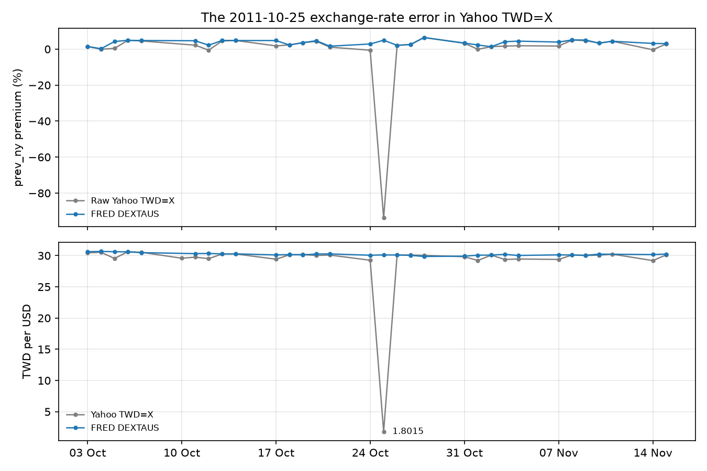

**Problem.** The zoom above shows smaller discrepancies around the error: on several
dates the Yahoo rate sits below FRED. A local rule, which flags values more than 2% away
from a centred 5-day rolling median, flagged 124 dates, 122 of them between 2011 and
2016.

**Detection.** Each flagged date was compared with FRED. If FRED showed the same move
against its own rolling median, the move was real; otherwise it was an error in Yahoo.
Of the 124 flagged dates, 115 can be compared directly, and FRED shows the same move on
just 1 of them. On the flagged dates the mean absolute deviation from the rolling median
is 2.70% for Yahoo and 0.10% for FRED, and the same rule flags none of FRED's own values.
In 28 cases the flagged Yahoo value is close to FRED while its neighbours are off, which
points to a second, less visible problem: persistent shifts. The gap between Yahoo and
FRED exceeds 1% on 12% of dates in 2011, 52% in 2013, 41% in 2014, 24% in 2015 and 20%
in 2016, against at most 1% in every year since 2017 except 2025 (3%). Over the whole
sample 406 dates have a gap above 1%, and only 87 of them are flagged by the local rule:
Yahoo stays about 2.5% below FRED for 10 to 48 consecutive dates, and a rolling median
cannot detect such shifts because the neighbouring values are shifted too. The details
are in [Appendix A](#appendix-a-data-and-cleaning-details).

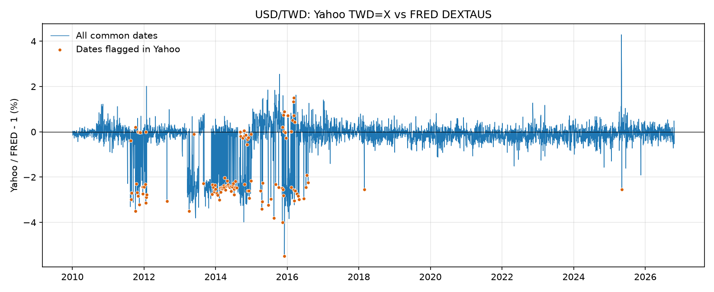

**Correction.** FRED replaces Yahoo in the premium. The rate is taken on the NY date of
the ADR price used, so it is never later than that price: FRED of day d for `same_day`,
FRED of `adr_date` (the previous NY session) for `prev_ny`. The FRED rate is recorded 4
hours before the ADR close.

**Impact.** The minimum `prev_ny` premium moves from -93.7% to -6.0%. Over 2011-2016,
the standard deviation of daily changes falls by 17% for both definitions. The
autocorrelation of daily changes barely moves (-0.453 with Yahoo, -0.452 with FRED for
`prev_ny`), which matters for Section 5.

<!-- table:fx_impact -->
| Definition | Observations (Yahoo / FRED) | Mean premium (Yahoo / FRED) | Daily change std (Yahoo / FRED) | Daily change std, 2011-2016 (Yahoo / FRED) | Daily change autocorrelation (Yahoo / FRED) |
|---|---:|---:|---:|---:|---:|
| `prev_ny` | 4,102 / 4,107 | 6.29% / 6.54% | 2.10% / 1.97% | 2.09% / 1.74% (-17%) | -0.453 / -0.452 |
| `same_day` | 3,971 / 3,975 | 6.41% / 6.65% | 2.38% / 2.24% | 2.10% / 1.74% (-17%) | -0.441 / -0.436 |
<!-- /table:fx_impact -->

## 5. Measuring the premium

### 5.1 Two definitions

The premium on Taipei date d is

    premium = P_ADR (USD) / (5 x P_local (TWD) / FX (TWD per USD)) - 1.

No pair of closing prices is observed at the same time, so two definitions are
computed: `same_day`, the NY close of day d against the Taipei close of day d; and
`prev_ny`, the NY close of the last NY trading day strictly before d (`adr_date`)
against the Taipei close of day d.

<!-- table:closing_times -->
| Season | Taipei close (13:30 local), UTC | NY close (16:00 local), UTC | FRED rate (noon NY), UTC | `same_day` gap: NY close d - Taipei close d | `prev_ny` gap: Taipei close d - NY close d-1 | `prev_ny` gap on a Taipei Monday (Friday NY close) |
|---|---:|---:|---:|---:|---:|---:|
| Winter (example 2026-01-15) | 05:30 | 21:00 | 17:00 | 15.5 h | 8.5 h | 56.5 h |
| Summer (example 2026-07-15) | 05:30 | 20:00 | 16:00 | 14.5 h | 9.5 h | 57.5 h |
<!-- /table:closing_times -->

`prev_ny` is the reference definition, for three reasons. It is the only one observable
in real time at the Taipei close, when the previous NY close is already known, so the
only one usable without look-ahead in a backtest decided at the Taipei close. It is less
noisy: the daily change standard deviation is 1.97%, against 2.24% for `same_day`. Its
time gap is shorter: 8.5 to 9.5 hours, against 14.5 to 15.5 hours for `same_day`,
depending on daylight saving time in New York; on a Taipei Monday it uses the Friday NY
close, a gap of 56.5 to 57.5 hours. `same_day` is kept as a robustness check.

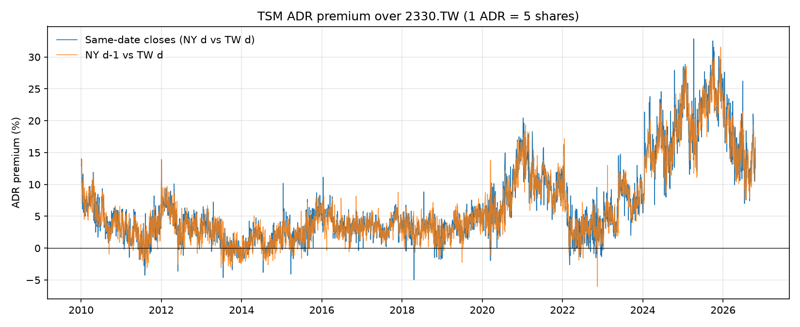

### 5.2 Asynchrony

**Naive approach.** The daily premium was first read as a direct measure of the
deviation from the law of one price, day by day.

**Problem.** The daily series contains large jumps that reverse the next day. With the
FRED rate, 14 daily changes exceed 10 points in either definition (listed in
[Appendix A](#appendix-a-data-and-cleaning-details)).

**Detection.** The lag-1 autocorrelation of daily changes is about -0.44 to -0.45 under
both definitions: close to half of each daily change is reversed the next day. This is
the signature of measurement noise. The exchange rate was a candidate cause, but
replacing Yahoo by FRED leaves the autocorrelation unchanged (Section 4.3). The noise
comes from the non-synchronous closes.

<!-- table:asynchrony -->
| Definition | Observations | Mean premium | Premium std | Daily change std | Daily change autocorrelation (lag 1) |
|---|---:|---:|---:|---:|---:|
| `same_day` | 3,975 | 6.65% | 6.44% | 2.24% | -0.436 |
| `prev_ny` | 4,107 | 6.54% | 6.30% | 1.97% | -0.452 |
<!-- /table:asynchrony -->

The hypothesis that the weekend gap of Mondays adds noise is rejected. The daily change
standard deviation of `prev_ny` is 2.00% on Mondays, against 1.88% to 2.09% on other
days, and the lag-1 autocorrelation of daily ARMA(1,1) residuals (Section 6.3) is 0.061
on Mondays, against -0.043 to 0.079 on other days.

<!-- table:weekdays -->
| Taipei weekday | Daily changes | `prev_ny` daily change std | `same_day` daily change std | ARMA residual pairs | Lag-1 residual autocorrelation (daily ARMA, `prev_ny`) |
|---|---:|---:|---:|---:|---:|
| Monday | 807 | 2.00% | 2.05% | 783 | 0.061 |
| Tuesday | 836 | 2.09% | 2.08% | 810 | -0.043 |
| Wednesday | 836 | 1.92% | 2.26% | 809 | 0.079 |
| Thursday | 825 | 1.88% | 2.54% | 799 | 0.014 |
| Friday | 802 | 1.95% | 2.20% | 780 | 0.045 |
<!-- /table:weekdays -->

**Example.** The sequence below is one of the jumps above 10 points. It is described from
the data only; no market event is attributed to it.

<!-- table:example -->
| Taipei date d | TSM close on d (USD) | 2330.TW close on d (TWD) | FRED on d | `same_day` | TSM close on `adr_date` (USD) | `prev_ny` |
|---|---:|---:|---:|---:|---:|---:|
| 2025-04-07 | 146.17 | 848.0 | 33.02 | 13.83% | 146.80 | 14.12% |
| 2025-04-08 | 141.37 | 816.0 | 33.01 | 14.38% | 146.17 | 18.30% |
| 2025-04-09 | 158.75 | 785.0 | 32.85 | 32.86% | 141.37 | 18.89% |
| 2025-04-10 | 151.13 | 863.0 | 32.86 | 15.09% | 158.75 | 20.86% |
| 2025-04-11 | 157.08 | 889.0 | 32.50 | 14.85% | 151.13 | 11.72% |
| 2025-04-14 | 155.84 | 865.0 | 32.36 | 16.60% | 157.08 | 18.04% |
| 2025-04-15 | 157.33 | 877.0 | 32.48 | 16.54% | 155.84 | 15.01% |
| 2025-04-16 | 151.67 | 855.0 | 32.48 | 15.23% | 157.33 | 19.53% |
<!-- /table:example -->

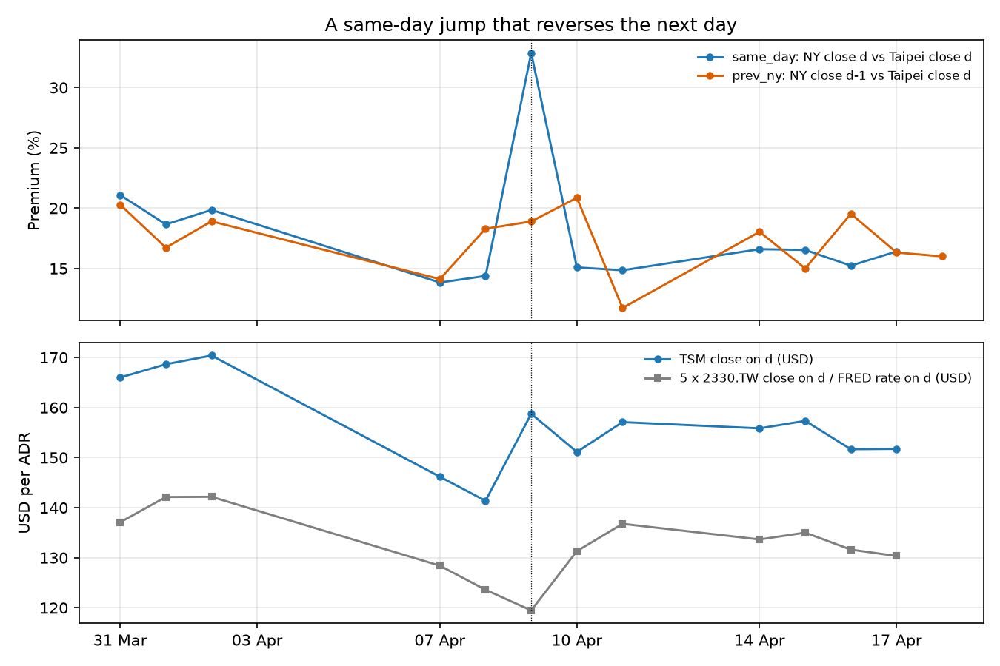

On 2025-04-09 the TSM close rose 12.3% during a NY session that started after the Taipei
close of the same date. The `same_day` premium jumped from 14.38% to 32.86%. On
2025-04-10, 2330.TW rose 9.9% and the `same_day` premium returned to 15.09%. The
`prev_ny` premium shows the same move one day later (20.86% on 2025-04-10) and reverses
on 2025-04-11. The pattern is consistent with each market closing before the other has
priced the same information, rather than with a lasting change in the relative
valuation of the two securities.

**Correction and impact.** Mean reversion cannot be measured on daily changes without
accounting for this noise (Section 6.2), factor regressions must read US variables on the
ADR's NY date (Section 7), and a backtest must compute its P&L on prices that could have
been traded (Section 8.2).

## 6. Mean reversion

Reference definition `prev_ny` with the FRED exchange rate. Half-lives are expressed in
trading days. Weekly data are sampled on Fridays (last observation of the week) and
converted at 5 trading days per week. Weeks without any observation are left empty
rather than filled: there are 12, all in January or February, which is consistent with
the Lunar New Year closure of the Taipei market (not verified against an exchange
calendar).

### 6.1 Stationarity and level regimes

<!-- table:stationarity -->
| Definition | Frequency | Observations | ADF statistic | ADF p-value | ADF lags (AIC) | KPSS statistic | KPSS p-value |
|---|---:|---:|---:|---:|---:|---:|---:|
| `prev_ny` | daily | 4,107 | -2.14 | 0.228 | 13 | 5.50 | 0.01 (bound) |
| `prev_ny` | weekly | 865 | -2.26 | 0.184 | 3 | 2.59 | 0.01 (bound) |
| `same_day` | daily | 3,975 | -2.13 | 0.234 | 17 | 5.32 | 0.01 (bound) |
| `same_day` | weekly | 864 | -1.77 | 0.395 | 9 | 2.51 | 0.01 (bound) |
<!-- /table:stationarity -->

ADF does not reject a unit root (p = 0.23 daily and 0.18 weekly for `prev_ny`), and KPSS
rejects level stationarity at the bound of its table (p at or below 0.01). The premium is
not stationary around a single mean over the full sample: it moves between level
regimes, with a weekly mean of 3.1% in 2010-2019, 7.3% in 2020-2023, 19.2% from 2024 to
April 2026 and 14.1% since May 2026. Full-sample half-lives mix mean reversion with these
level shifts (the ARMA(1,1) of Section 6.3 gives 127.4 trading days daily and 381.0
weekly on the full sample) and are not used. The analysis below works within
sub-periods and on rolling windows.

### 6.2 Naive AR(1) and its bias

**Naive approach.** The half-life is estimated from an AR(1) regression of the daily
change on the lagged level, dp_t = a + b p_{t-1}, with phi = 1 + b and half-life
ln(0.5) / ln(phi).

<!-- table:ar1_naive -->
| Period (`prev_ny`) | AR(1) daily [95% CI] | AR(1) weekly [95% CI] | Weekly / daily | Residual autocorrelation, daily | Residual autocorrelation, weekly |
|---|---:|---:|---:|---:|---:|
| 2010-2019 | 2.2 [2.0, 2.5] | 7.8 [6.3, 10.0] | 3.5 | -0.24 | -0.22 |
| 2020-2023 | 4.1 [3.3, 5.3] | 17.0 [11.3, 31.2] | 4.1 | -0.39 | -0.19 |
| 2024-Apr 2026 | 4.0 [3.0, 5.6] | 12.2 [7.6, 25.4] | 3.1 | -0.37 | -0.27 |
| Full sample | 13.8 [11.5, 17.2] | 54.2 [38.7, 88.7] | 3.9 | -0.42 | -0.36 |
<!-- /table:ar1_naive -->

**Problem.** Within sub-periods, the AR(1) gives half-lives of 2 to 17 trading days, but
the weekly estimate is 3.1 to 4.1 times longer than the daily one. Both cannot be right.
The residuals remain autocorrelated (lag 1: -0.19 to -0.39 within sub-periods).

**Detection.** A simulation reproduces the gap. The latent premium is an AR(1) with
phi = 0.98, a true half-life of 34.3 days. White measurement noise is added, with a
standard deviation twice that of the AR(1) innovation; this gives daily changes an
autocorrelation of -0.44, the value observed on the premium.

<!-- table:simulation -->
| Estimator (half-life in days) | Mean | Std | Range over 30 replications | True value |
|---|---:|---:|---:|---:|
| AR(1), daily | 4.2 | 0.5 | 3.4 to 5.6 | 34.3 |
| AR(1), weekly | 14.0 | 1.8 | 11.6 to 19.3 | 34.3 |
| ARMA(1,1), daily | 35.0 | 4.8 | 27.1 to 46.4 | 34.3 |
| ARMA(1,1), weekly | 35.0 | 5.8 | 25.8 to 48.4 | 34.3 |
<!-- /table:simulation -->

Over 30 replications, the AR(1) estimates 4.2 days on daily data and 14.0 days on weekly
data, for a true value of 34.3. Measurement noise biases phi towards zero; the bias is
smaller on weekly data, where five days of true moves weigh more against the noise, but
it does not disappear. The naive AR(1) half-lives of the premium are therefore biased
downwards, and the daily-to-weekly ratio of about 4 is the trace of this bias.

### 6.3 Correction: signal plus noise, ARMA(1,1)

The observed premium is modelled as the true premium plus measurement noise:

    observed_t = s_t + e_t,   s_t = c + phi s_{t-1} + u_t,

where s_t, the true premium, is an AR(1) and e_t is white noise from asynchrony. The sum
of an AR(1) and white noise is an ARMA(1,1). Its autoregressive coefficient is the
persistence phi of the true premium; its moving-average coefficient theta absorbs the
noise and is negative when the noise is large. The model is estimated by maximum
likelihood (`statsmodels` ARIMA(1,0,1) with a constant); the confidence interval of the
half-life comes from that of phi. In the simulation above it recovers the true half-life
at both frequencies (35.0 days on average, daily and weekly), with theta at -0.61 daily
and -0.34 weekly.

<!-- table:arma -->
| Period (`prev_ny`) | Weeks with data (calendar weeks) | Mean premium | ARMA daily [95% CI] | ARMA weekly [95% CI] | Theta daily | Theta weekly | Ljung-Box p, daily | Ljung-Box p, weekly |
|---|---:|---:|---:|---:|---:|---:|---:|---:|
| 2010-2019 | 514 (521) | 3.1% | 61.9 [44.9, 99.4] | 63.1 [40.4, 137.9] | -0.76 | -0.59 | 8.0e-09 | 0.280 |
| 2020-2023 | 206 (209) | 7.3% | 54.6 [30.1, 279.5] | 63.9 [33.1, 551.5] | -0.67 | -0.49 | 3.8e-05 | 0.003 |
| 2024-Apr 2026 | 119 (121) | 19.2% | 53.4 [26.9, 2,103.1] | 69.1 [29.6, inf] | -0.63 | -0.44 | 0.280 | 0.720 |
<!-- /table:arma -->

**Impact.** Within each sub-period, daily and weekly estimates agree at about 55 to 70
trading days, against 2 to 17 days for the AR(1). Theta is negative throughout (-0.76 to
-0.63 daily, -0.59 to -0.44 weekly), as expected under measurement noise. Weekly
residuals are white in 2010-2019 and from 2024 to April 2026 (Ljung-Box p = 0.28 and 0.72
at 4 lags), but not in 2020-2023 (p = 0.003). Daily residuals have a lag-1
autocorrelation close to zero but are not white in 2010-2019 and 2020-2023: the
measurement noise is not purely white, so weekly estimates are preferred. The `same_day`
definition gives similar values in the first two sub-periods (58.1 daily and 63.8
weekly; 53.1 and 71.2) and shorter ones from 2024 to April 2026 (33.7 and 46.1).

### 6.4 Robustness: rolling windows

**Problem.** The sub-periods were chosen after looking at the premium chart. Agreement
within them may partly reflect that choice, the same problem as a break test at a chosen
date (Section 11).

**Correction.** The ARMA(1,1) is re-estimated on rolling windows with a monthly step and
no manual split: weekly data on 3-year windows (156 weeks) and daily data on 2-year
windows (504 days), with the weekly AR(1) for comparison. Windows where the fit did not
converge or where phi exceeds 0.999 are excluded from the statistics and shaded on the
figure.

<!-- table:rolling -->
| Estimate (`prev_ny`, half-life in trading days) | Windows | Excluded | Median | Interquartile range | Share > 20 days | Share with lower 95% bound > 20 days | Median abs level shift in window (points) | Rank correlation: abs level shift vs half-life |
|---|---:|---:|---:|---:|---:|---:|---:|---:|
| ARMA(1,1) weekly, 3-year windows | 167 | 7 | 69.6 | 34.6 to 122.3 | 92% | 68% | 2.7 | 0.86 |
| ARMA(1,1) daily, 2-year windows | 178 | 13 | 37.8 | 25.4 to 55.1 | 81% | 41% | 1.9 | 0.74 |
| AR(1) weekly, 3-year windows | 167 | 0 | 9.0 | 4.8 to 20.0 | 25% | 13% | 2.7 | 0.81 |
| ARMA(1,1) weekly, windows ending 2013-2016 | 48 | 3 | 50.4 | 30.0 to 64.3 | 100% | 58% | 2.0 | 0.84 |
| ARMA(1,1) weekly, windows ending 2017-2019 | 36 | 1 | 25.4 | 17.8 to 39.9 | 63% | 14% | 0.9 | 0.43 |
| ARMA(1,1) weekly, windows ending 2020-2023 | 48 | 3 | 101.1 | 82.4 to 168.9 | 100% | 96% | 5.5 | 0.51 |
| ARMA(1,1) weekly, windows ending 2024-2026 | 34 | 0 | 157.5 | 102.2 to 243.1 | 100% | 100% | 11.3 | 0.89 |
| ARMA(1,1) weekly, windows with abs level shift < 2 points | 73 | 3 | 32.3 | 22.7 to 46.4 | 81% | 27% | 1.0 | 0.44 |
<!-- /table:rolling -->

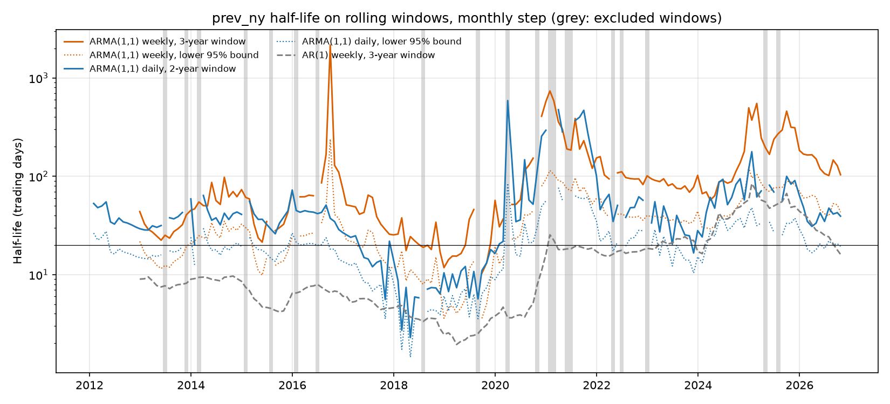

**Impact.** The order of magnitude holds; the level does not. The weekly ARMA half-life
has a median of 69.6 trading days (interquartile range 34.6 to 122.3). It exceeds 20 days
in 92% of the 160 windows kept, and its lower 95% bound exceeds 20 days in 68% of them,
against a median of 9.0 days for the weekly AR(1). The daily ARMA on 2-year windows has a
median of 37.8 days and is usually shorter than the weekly estimate (median ratio 1.9).

**A second problem: level shifts inside the windows.** The weekly half-life varies
strongly across windows: windows ending in 2017-2019 have a median of 25.4 days, while
windows ending in 2024-2026 have a median of 157.5 days. But a window that contains a
change of level inflates phi in the same way as the full sample (Section 6.1). The level
shift is measured as the difference between the mean premium of the last year and of the
first year of each window. Across the weekly windows kept, the rank correlation between
the absolute level shift and the half-life is 0.86 (overlapping windows, so no
significance level is claimed). In the 70 kept windows where the level moves by less
than 2 points, the median half-life is 32.3 days (interquartile range 22.7 to 46.4); it
exceeds 20 days in 81% of them, but its lower 95% bound does so in only 27%.

**Is the correlation mechanical?** It has two possible explanations: level shifts inside
a window inflate phi; or a mechanical effect, since a slowly reverting process wanders
away from its mean for longer, so its first-year and last-year means differ more even
without any change of regime, and selecting windows with a small shift then selects fast
reversions. A simulation separates the two. It generates an AR(1) signal plus white
noise without any regime change, on the real Taipei trading dates, with a weekly
half-life of 32 or 70 trading days, calibrated on the real autocorrelation and standard
deviation of daily changes, and applies exactly the same rolling analysis, with 50
replications per half-life (`scripts/simulate_level_shift.py`).

<!-- table:level_shift_sim -->
| Series (weekly ARMA, 3-year windows) | Rank correlation: abs level shift vs half-life, median [5%, 95%] | Median half-life, all windows [5%, 95%] | Median half-life, windows with shift < 2 points [5%, 95%] | Windows with shift < 2 points | Share of replications reaching the real correlation | Share of replications reaching the real stable median |
|---|---:|---:|---:|---:|---:|---:|
| Simulated, true half-life 32 days, no regime (50 replications) | 0.35 [0.10, 0.67] | 26.6 [19.4, 36.9] | 24.4 [16.9, 31.6] | 104 | 0% | 2% |
| Simulated, true half-life 70 days, no regime (50 replications) | 0.48 [0.16, 0.72] | 48.9 [30.5, 73.6] | 38.6 [24.3, 56.7] | 64 | 0% | 74% |
| Real `prev_ny` | 0.86 | 69.6 | 32.3 | 70 |  |  |
<!-- /table:level_shift_sim -->

Without any regime change, the median rank correlation is 0.35 for a true half-life of
32 days and 0.48 for 70 days: part of the observed correlation is mechanical. But no
replication reaches the observed 0.86, so level shifts inside the windows also
contribute. Selecting windows with a small shift biases the half-life downwards: a true
half-life of 32 days gives a stable-window median at least as high as the observed 32.3
in only 2% of replications, so 32.3 days is probably a lower bound. The median over all
windows is biased downwards by the short windows themselves (26.6 days for a true 32,
48.9 for a true 70) and, in the real data, upwards by level shifts; the observed 69.6
days is an indication rather than a strict upper bound.

### 6.5 Conclusion of the section

Corrected for asynchrony noise, the half-life is clearly longer than the about 9 days of
the naive AR(1). The rolling estimates give a range rather than a point: roughly 30 to 70
trading days, about 1.5 to 3.3 months at 21 trading days per month. Even in stable
windows, the lower 95% bound exceeds 20 days in only 27% of cases, so a half-life above
20 trading days cannot be asserted with confidence. The variation across windows, from
about 25 days in windows ending in 2017-2019 to about 158 days in windows ending in
2024-2026, may reflect level shifts and the mechanical effect rather than a genuine
change in the speed of reversion. Untested observation: the half-life appears longer when
the premium is high (rank correlation of 0.59 between the half-life and the mean level of
the window), but this is confounded with level shifts.

### 6.6 Economic implication

A half-life of roughly 30 to 70 trading days means that a position betting on a narrower
premium, short the ADR and long the ordinary shares, would typically be held for one to
several months before half of a deviation closes. Over that horizon the arbitrageur pays
the borrowing fee on the ADR, ties up capital on both legs and bears the risk that the
premium widens before it narrows. Sections 8 and 10 quantify these costs.

## 7. Explanatory factors (step 4)

Weekly data (Fridays), reference definition `prev_ny`, 2010-01-04 to 2026-10-23. With
q = ln(1 + premium) and the exchange rate in TWD per USD, the weekly change decomposes
exactly as dq = r_ADR - r_local + d ln FX = r_ADR - r_local,USD: the premium moves when
the ADR and the local share react differently. All standard errors are Newey-West, with
floor(4 (n / 100)^(2/9)) lags and at least one. Code: `scripts/factors.py`, results in
`data/factor_results.csv`.

**Naive approach.** Regress the level of the premium on the level of US indices, both
indices together, with the US variables read on the Taipei date of each row.

**Problems.** First, the premium is not stationary (Section 6.1): a regression of one
trending series on another finds a relation even without any link, so changes are
regressed, not levels. Second, with `prev_ny` the Taipei date d is paired with the NY
close of d-1; reading the S&P 500 on d would reintroduce the asynchrony of Section 5.2.
Third, the S&P 500 and the Nasdaq-100 move together, and with both in one model their
coefficients change sign.

**Detection and correction.** Every US factor is read on the ADR's NY date; a check
compares the date of each factor value with that date on every panel, and it fails when
the bug is reintroduced. The main model, specified before estimation, regresses dq on
the S&P 500 log return and d ln FX; the S&P 500 was chosen a priori as the broad market
index, and the Nasdaq-100 is a robustness check. The contemporaneous regressions describe
co-movement within the week; they are not forecasts.

**Impact.** Univariately, the S&P 500 and the Nasdaq-100 have coefficients of 0.203 and
0.196; together, -0.063 and 0.278. The index chosen does not change the conclusions.

<!-- table:factor_models -->
| Model (weekly d q, `prev_ny`, full sample) | S&P 500 | Nasdaq-100 | d ln FX | d ln traded-value ratio | R2 | Weeks |
|---|---:|---:|---:|---:|---:|---:|
| univariate r_sp500 | 0.203 (p 6.0e-10) |  |  |  | 4.3% | 852 |
| univariate r_ndx |  | 0.196 (p 4.4e-13) |  |  | 5.7% | 852 |
| univariate dln_fx |  |  | 0.096 (p 0.455) |  | 0.1% | 852 |
| univariate dln_value_ratio |  |  |  | 0.004 (p 0.190) | 0.4% | 839 |
| multivariate | 0.240 (p 4.8e-12) |  | 0.362 (p 0.003) |  | 5.4% | 852 |
| robustness: Nasdaq-100 instead of S&P 500 |  | 0.230 (p 1.5e-15) | 0.401 (p 7.9e-04) |  | 7.1% | 852 |
| robustness: with traded-value ratio | 0.238 (p 6.6e-12) |  | 0.355 (p 0.005) | 0.003 (p 0.284) | 5.6% | 839 |
| appendix: both indices (collinear) | -0.063 (p 0.545) | 0.278 (p 8.2e-04) | 0.395 (p 9.6e-04) |  | 7.2% | 852 |
<!-- /table:factor_models -->

### 7.1 Robust: the ADR carries more US market risk

The S&P 500 beta is 1.06 for the ADR against 0.85 for the local share in USD; their
difference is the beta of dq. In the main model the premium's S&P 500 coefficient is
0.24 [0.17, 0.31]. It is 0.21 to 0.37 in the three sub-periods up to April 2026, with 95%
intervals excluding 0, and positive in all 167 rolling 3-year windows (interval excluding
0 in 66% of them); the 26 weeks since May 2026 are too few to conclude. A long local /
short ADR pair with equal dollar legs therefore has an S&P 500 beta of -0.20
[-0.27, -0.14], negative in all rolling windows.

<!-- table:factor_main -->
| Sample | Weeks | S&P 500 coefficient [95% CI] | d ln FX coefficient [95% CI] | R2 |
|---|---:|---:|---:|---:|
| full | 852 | 0.24 [0.17, 0.31] | 0.36 [0.12, 0.60] | 5.4% |
| 2010-2019 | 506 | 0.21 [0.12, 0.30] | 0.43 [0.14, 0.73] | 4.7% |
| 2020-2023 | 203 | 0.23 [0.11, 0.34] | 0.16 [-0.21, 0.52] | 7.3% |
| 2024-Apr 2026 | 117 | 0.37 [0.13, 0.62] | 0.42 [-0.16, 0.99] | 7.0% |
| May 2026-end | 26 | 0.48 [-0.37, 1.34] | -0.07 [-1.94, 1.79] | 5.6% |
<!-- /table:factor_main -->

<!-- table:factor_betas -->
| Sample | Weeks | ADR beta [95% CI] | Local share beta, USD [95% CI] | Difference = beta of d q [95% CI] |
|---|---:|---:|---:|---:|
| full | 852 | 1.06 [0.93, 1.18] | 0.85 [0.71, 0.99] | 0.20 [0.14, 0.27] |
| 2010-2019 | 506 | 0.98 [0.87, 1.09] | 0.82 [0.70, 0.94] | 0.16 [0.08, 0.24] |
| 2020-2023 | 203 | 0.95 [0.75, 1.16] | 0.74 [0.51, 0.98] | 0.21 [0.10, 0.32] |
| 2024-Apr 2026 | 117 | 1.73 [1.45, 2.01] | 1.40 [1.16, 1.65] | 0.33 [0.09, 0.57] |
| May 2026-end | 26 | 1.21 [0.47, 1.94] | 0.71 [-0.22, 1.64] | 0.49 [-0.33, 1.32] |

Pair trade (long local in USD, short ADR, equal dollar legs, simple returns), full sample: S&P 500 beta -0.20 [-0.27, -0.14].
<!-- /table:factor_betas -->

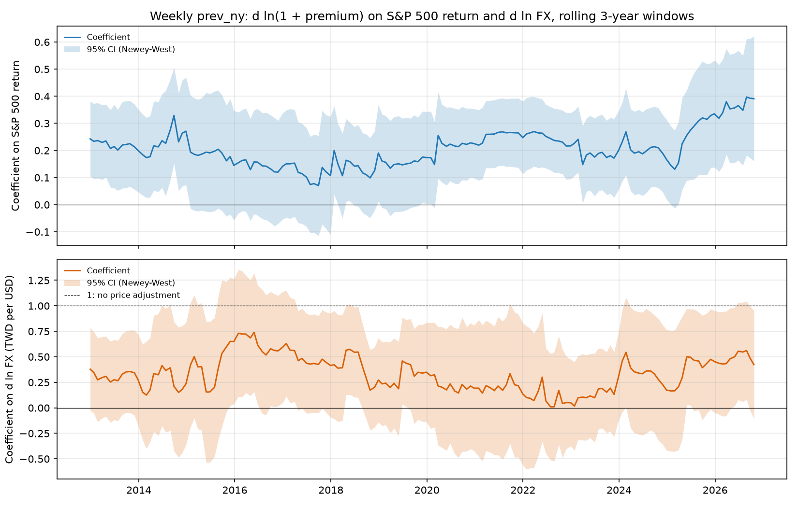

### 7.2 Partial: the exchange rate is not passed through one for one

In the decomposition, d ln FX enters with a coefficient of 1 if prices do not react. A
full pass-through is rejected (p = 2.4e-12 univariate, 2.4e-07 in the main model), but
the size of the pass-through is not established: the coefficient is 0.10 univariate (not
different from 0), 0.36 in the main model, -0.29 univariate and -0.12 in the main model on
monthly data, and the rolling interval excludes 0 in only 17% of windows (it excludes 1 in
80%).

<!-- table:factor_fx_tests -->
| Model (full sample) | d ln FX coefficient | p-value, coefficient = 1 | p-value, coefficient = 0 |
|---|---:|---:|---:|
| univariate dln_fx | 0.10 | 2.4e-12 | 0.455 |
| multivariate | 0.36 | 2.4e-07 | 0.003 |
| robustness: Nasdaq-100 instead of S&P 500 | 0.40 | 5.6e-07 | 7.9e-04 |
| robustness: with traded-value ratio | 0.35 | 2.9e-07 | 0.005 |
| univariate dln_fx, monthly data | -0.29 |  | 0.021 |
| multivariate, monthly data | -0.12 |  | 0.337 |
<!-- /table:factor_fx_tests -->

<!-- table:factor_rolling -->
| Coefficient, 3-year windows, monthly step | Windows | Median | Range | Share positive | Share with 95% CI excluding 0 | Share with 95% CI excluding 1 |
|---|---:|---:|---:|---:|---:|---:|
| r_sp500 (joint model) | 167 | 0.20 | 0.07 to 0.40 | 100% | 66% |  |
| dln_fx (joint model) | 167 | 0.33 | 0.01 to 0.74 | 100% | 17% | 80% |
| pair trade beta | 167 | -0.18 | -0.33 to -0.00 | 0% | 63% |  |
<!-- /table:factor_rolling -->

### 7.3 Not conclusive

- **Traded volumes.** The change in the ratio of ADR to local traded value is endogenous:
  volumes react to the premium and to the same news. It is not significant (coefficient
  0.004, p = 0.19 univariate; p = 0.28 added to the main model) and is kept out of the main
  model.
- **Predictive version.** With factors lagged one week, R2 is at most 1.4%; no relation is
  usable for trading.
- **Foreign investor flows.** No documented official historical source was found.

<!-- table:factor_predictive -->
| Predictive model (factors lagged one week, full sample) | Coefficients | R2 |
|---|---|---:|
| univariate r_sp500 | -0.017 (p 0.611) | 0.0% |
| univariate r_ndx | -0.009 (p 0.763) | 0.0% |
| univariate dln_fx | -0.245 (p 0.043) | 0.6% |
| univariate dln_value_ratio | -0.005 (p 0.031) | 0.7% |
| multivariate | r_sp500 -0.046 (p 0.218); dln_fx -0.296 (p 0.026) | 0.8% |
| robustness: Nasdaq-100 instead of S&P 500 | r_ndx -0.033 (p 0.341); dln_fx -0.289 (p 0.037) | 0.7% |
| robustness: with traded-value ratio | r_sp500 -0.049 (p 0.194); dln_fx -0.265 (p 0.044); dln_value_ratio -0.005 (p 0.044) | 1.4% |
| appendix: both indices (collinear) | r_sp500 -0.061 (p 0.559); r_ndx 0.013 (p 0.889); dln_fx -0.295 (p 0.030) | 0.8% |
<!-- /table:factor_predictive -->

Robustness with `same_day`, whose ADR price is later than the Taipei close: the S&P 500
coefficient rises to 0.32, as expected when the ADR has already priced part of the next
Taipei session.

<!-- table:factor_same_day -->
| Definition | Weeks | S&P 500 [95% CI] | d ln FX [95% CI] | R2 |
|---|---:|---:|---:|---:|
| `same_day`, full sample | 850 | 0.32 [0.25, 0.39] | 0.69 [0.46, 0.91] | 10.7% |
<!-- /table:factor_same_day -->

**Consequence for the strategy.** A long local / short ADR position is not market
neutral: it loses when Wall Street rises. Section 8.5 tests a hedge.

## 8. Trading strategy (step 5)

Backtest of a simple mean-reversion trade on the premium, 2010-07-16 (first valid
signal) to 2026-10-30. Code: `src/adr_premium/backtest.py`, `scripts/backtest.py`,
`src/adr_premium/robustness.py` and `scripts/backtest_robustness.py`.

### 8.1 Rules fixed a priori

The rules were chosen before any backtest was run and are never tuned; the sensitivity
grids are reported without selection, and the headline result always uses these rules.

- Signal: z-score of q = ln(1 + premium), `prev_ny` premium, sampled on the last Taipei
  date of each week; the mean and standard deviation come from the 26 previous weeks only.
- Entry when z > 1.5: "short premium", long the local share and short the ADR, with 1 USD
  in each leg.
- Exit when z < 0, or after 26 weeks.
- One direction only: short selling in Taiwan is more constrained (not verified), while
  shorting the ADR is "cheap and easy" according to Lamont (2024).

P&L is in USD per 1 USD per leg, without compounding; dividing by 2 gives a return on
gross exposure.

### 8.2 Execution and P&L on executable prices

**Naive approach.** Compute the strategy's P&L from the changes of the `prev_ny` premium
between entry and exit.

**Problem.** The `prev_ny` premium pairs a Taipei close with an ADR close that is already
in the past at decision time. A P&L built on it books a convergence that no order could
have captured.

**Detection.** On the decision dates, the gap between `same_day` and `prev_ny`, which is
the move of the ADR's own close on the decision date, is far from its average: at entry
decisions the ADR close has already erased 1.47 points of the signalled premium on
average (t = -4.7, 32 trades); at exit decisions the premium has already rebounded by 0.91
points (t = 2.1, 30 trades), against a mean of about 0.1 points on all days.

**Correction.** The signal is known at the Taipei close of the decision date. Each leg
trades at the first close strictly after that moment: the ADR at the NY close of the same
calendar date, the local share at the next Taipei close; the local leg is converted at
the FRED rate of its own execution dates. The P&L is computed on these execution prices
and on each leg's daily closes. Tests check that no decision uses later data and that
every leg trades after its decision; both were confirmed by reintroducing the bugs.

**Impact.** About 2.4 points per trade of the apparent convergence in the premium are
asynchrony that no order can capture.

<!-- table:robustness_asynchrony -->
| Decision | Trades | Mean gap (points) | Median gap (points) | t |
|---|---:|---:|---:|---:|
| entry | 32 | -1.47 | -1.34 | -4.7 |
| exit | 30 | 0.91 | 0.79 | 2.1 |

| Delay at | Trades | n | Pearson | p | Spearman | p |
|---|---|---:|---:|---:|---:|---:|
| entry | all trades | 32 | 0.03 | 0.888 | 0.09 | 0.641 |
| entry | without July 2020 | 31 | 0.03 | 0.892 | 0.08 | 0.666 |
| exit | all trades | 30 | 0.56 | 0.001 | 0.25 | 0.177 |
| exit | without July 2020 | 29 | 0.08 | 0.685 | 0.17 | 0.368 |
<!-- /table:robustness_asynchrony -->

Two further corrections were made. The local sale was first converted at the FRED rate
of the ADR's exit date, before the local sale itself; converting it at the rate of the
local leg's own execution dates changes the gross P&L by +13.7 bp per trade (t = 1.8).
And the daily P&L marks a Taipei close against a NY close, which adds day-to-day noise
that reverses: the annual volatility is 19.3% on daily marks and 10.5% on weekly P&L, so
volatility and Sharpe ratios are computed on weekly P&L.

<!-- table:fx_date_correction -->
| Trades | Change in total gross P&L | Change per trade | t |
|---|---:|---:|---:|
| 33 | +0.0452 | +13.7 bp | 1.8 |
<!-- /table:fx_date_correction -->

### 8.3 Costs and financing

All costs are assumptions, not verified against an official source, except the rate of
the transaction tax, which TSMC's 20-F states: "A securities transaction tax, at the rate
of 0.3% of the sales proceeds, will be withheld upon a sale of common shares in the
R.O.C. Transfers of ADSs are not subject to R.O.C. securities transaction tax."

<!-- table:costs -->
| Cost | Default | Institutional scenario | Source |
|---|---:|---:|---|
| ADR commission, per transaction | 5 bp | 2 bp | assumption, not verified |
| Local commission, per transaction | 10 bp | 3 bp | assumption; regulatory ceiling 0.1425% (Taipei Times, 2000), discounts common |
| Taiwan securities transaction tax, on sales of the local share | 30 bp | 30 bp | 0.3% of the sale proceeds, stated in TSMC's 20-F (2026) and secondary sources |
| FX conversion, per conversion | 5 bp | 2 bp | assumption, not verified |
| ADR borrow fee, per year, pro rata | 0.50% | 0.25% | assumption, not verified |
| Withholding on local dividends | 21.00% | 21.00% | 21% since 2018, 20% before (EY; Investment Taiwan) |
<!-- /table:costs -->

Dividends come from Yahoo at their ex-dates; each of the 39 ADR dividends since 2010
matches 5 times the local one in USD within 4.4%. The short pays the gross ADR dividend;
paying it net of withholding raises the net P&L from 0.088 to 0.105. Financing: the
short-sale proceeds fund the local purchase; no interest income or financing cost is
modelled apart from the borrow fee.

### 8.4 Results

<!-- table:backtest_headline -->
| P&L | Total | Annual return | Annual vol, daily marks | Annual vol, weekly | Sharpe, daily | Sharpe, weekly [95% bootstrap CI] | Max drawdown | Winning trades |
|---|---:|---:|---:|---:|---:|---:|---:|---:|
| Gross | 0.360 | 2.21% | 19.3% | 10.5% | 0.11 | 0.21 [-0.04, 0.47] | -0.23 | 79% |
| Net | 0.088 | 0.54% | 19.3% | 10.5% | 0.03 | 0.05 [-0.19, 0.29] | -0.25 | 61% |

33 trades, 6.4 weeks on average, in position 26% of the time, over 16.3 years.
<!-- /table:backtest_headline -->

32 of the 33 exits are on z < 0, one at 26 weeks.

<!-- table:backtest_costs -->
| Component (total, USD per 1 USD per leg) | Value |
|---|---:|
| Gross P&L (price, FX, dividends) | +0.360 |
| Taiwan transaction tax | -0.105 |
| Local commission | -0.068 |
| ADR commission | -0.034 |
| FX conversion | -0.034 |
| ADR borrow fee | -0.021 |
| Withholding on dividends | -0.010 |
| Net P&L | +0.088 |
<!-- /table:backtest_costs -->

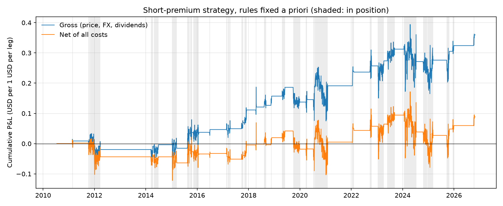

<!-- table:backtest_subperiods -->
| Sub-period | Trades (by entry) | Gross P&L | Net P&L | Net Sharpe, weekly | Exposure |
|---|---:|---:|---:|---:|---:|
| 2010-2019 | 20 | 0.137 | -0.018 | -0.03 | 22% |
| 2020-2023 | 7 | 0.175 | 0.113 | 0.23 | 31% |
| 2024-Apr 2026 | 5 | 0.012 | -0.035 | -0.08 | 43% |
| May 2026-end | 1 | 0.035 | 0.029 | 1.39 | 5% |
<!-- /table:backtest_subperiods -->

The sub-period since May 2026 contains one trade and carries no statistical weight.

**Sensitivity, without selection.** Over entry thresholds {1.0, 1.5, 2.0} and windows
{13, 26, 52} weeks the net Sharpe ratio ranges from -0.08 to 0.15; with a 3% borrow fee
it is -0.01. The best grid point (entry 2.0, window 13 weeks) is not retained.

<!-- table:backtest_grid -->
| Quantity | Window 13 weeks | Window 26 weeks | Window 52 weeks |
|---|---:|---:|---:|
| Net Sharpe, weekly, entry z > 1 | 0.07 | 0.04 | 0.00 |
| Net Sharpe, weekly, entry z > 1.5 | 0.06 | 0.05 | -0.08 |
| Net Sharpe, weekly, entry z > 2 | 0.15 | 0.13 | 0.06 |
| Net annual return, entry z > 1 | 0.86% | 0.52% | 0.04% |
| Net annual return, entry z > 1.5 | 0.71% | 0.54% | -0.91% |
| Net annual return, entry z > 2 | 1.57% | 1.26% | 0.61% |
| Trades, entry z > 1 | 77 | 58 | 42 |
| Trades, entry z > 1.5 | 54 | 33 | 25 |
| Trades, entry z > 2 | 34 | 23 | 19 |
<!-- /table:backtest_grid -->

<!-- table:backtest_borrow -->
| ADR borrow fee | Net P&L | Net annual return | Net Sharpe, weekly | Total borrow cost |
|---|---:|---:|---:|---:|
| 0.25% | 0.099 | 0.61% | 0.06 | -0.010 |
| 0.50% | 0.088 | 0.54% | 0.05 | -0.021 |
| 1.00% | 0.068 | 0.42% | 0.04 | -0.042 |
| 3.00% | -0.015 | -0.09% | -0.01 | -0.125 |
<!-- /table:backtest_borrow -->

### 8.5 Robustness

**Bootstrap.** Circular block bootstrap of the weekly P&L, 13-week blocks (about twice
the average holding period of 6.4 weeks; the autocorrelation of weekly P&L is -0.34 at
lag 1 and small beyond a few lags), 5,000 draws, fixed seed. Gross Sharpe 0.21
[-0.04, 0.47]; net 0.05 [-0.19, 0.29], with 33% of the net draws at or below 0.

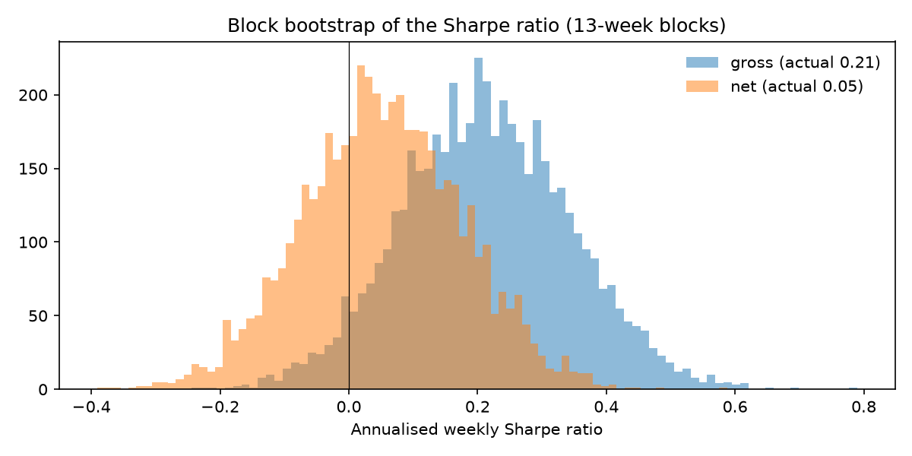

**Random entries.** 33 trades with the same holding periods placed at random dates
without overlap (2,000 replications, same execution and costs). The timing beats random
entries (one-sided p-value 0.012 gross, 0.011 net). Random entries lose because the
premium rose over the sample. The holding periods come from the signal itself, so the
test is somewhat favourable.

<!-- table:robustness_mc -->
| P&L | Actual | Random entries, median | Random entries, 5% to 95% | One-sided p-value |
|---|---:|---:|---:|---:|
| Gross | 0.360 | -0.037 | -0.329 to 0.240 | 0.012 |
| Net | 0.088 | -0.318 | -0.612 to -0.041 | 0.011 |
<!-- /table:robustness_mc -->

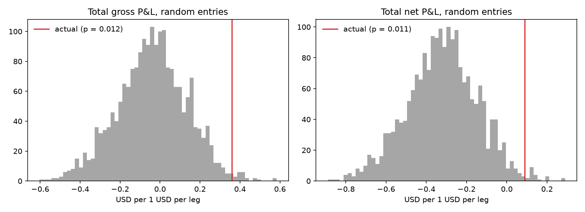

**Execution fragility.** Delaying both legs by one trading day cuts the gross P&L from
0.360 to 0.080 and makes the net P&L -0.191. Most of the loss comes from the exit, and one
trade (July 2020) accounts for half of it: without it, a delayed exit costs 0.36% per
trade (t = 1.2) instead of 0.70% (t = 1.6).

<!-- table:robustness_execution -->
| Trades | Execution | Total gross P&L | Mean per trade | Mean loss vs normal | t of the loss |
|---|---|---:|---:|---:|---:|
| all trades | normal | 0.360 | 1.09% | 0.00% |  |
| all trades | entry delayed | 0.311 | 0.94% | 0.15% | 0.4 |
| all trades | exit delayed | 0.128 | 0.39% | 0.70% | 1.6 |
| all trades | both delayed | 0.080 | 0.24% | 0.85% | 1.5 |
| without July 2020 | normal | 0.315 | 0.98% | 0.00% |  |
| without July 2020 | entry delayed | 0.273 | 0.85% | 0.13% | 0.4 |
| without July 2020 | exit delayed | 0.200 | 0.62% | 0.36% | 1.2 |
| without July 2020 | both delayed | 0.157 | 0.49% | 0.49% | 1.1 |
<!-- /table:robustness_execution -->

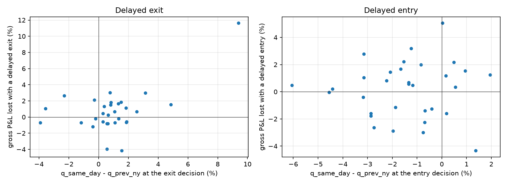

**Cost scenarios.** The break-even all-in cost is 109 bp per round trip (per 1 USD per
leg), against 82 bp with the default costs. The tax is 39% of the default costs and 61%
of the institutional ones.

<!-- table:robustness_costs -->
| Cost scenario | All-in cost per round trip | Net P&L | Net Sharpe, weekly | Tax share of costs |
|---|---:|---:|---:|---:|
| Default | 82 bp | 0.088 | 0.05 | 39% |
| Institutional | 52 bp | 0.187 | 0.11 | 61% |
| Tax only | 32 bp | 0.255 | 0.15 | 100% |

Break-even all-in cost per round trip (gross P&L / trades): 109 bp per 1 USD per leg.
<!-- /table:robustness_costs -->

**Beta hedge.** The pair's S&P 500 beta is estimated on the 156 weeks before each entry
only (at least 52; a test with the bug reintroduced confirms no later data is used) and
hedged with index returns as a proxy for a futures contract, at 1 bp per hedge trade.

**Naive reading.** The hedge doubles the net Sharpe ratio, from 0.05 to 0.10. **Problem
and detection.** The weekly volatility barely moves (10.5% to 10.3%) and the realised beta
goes from -0.058 to -0.015: the gain comes from the long index position while the S&P 500
rose (+0.086), not from lower risk. **Impact.** The hedge is not a source of risk-adjusted
return.

<!-- table:robustness_hedge -->
| Version | P&L | Total | Annual vol, weekly | Sharpe, weekly | Max drawdown | Realised beta to the S&P 500 |
|---|---|---:|---:|---:|---:|---:|
| unhedged | gross | 0.360 | 10.5% | 0.21 | -0.23 | -0.055 |
| hedged | gross | 0.446 | 10.3% | 0.26 | -0.20 | -0.012 |
| unhedged | net | 0.088 | 10.5% | 0.05 | -0.25 | -0.058 |
| hedged | net | 0.173 | 10.3% | 0.10 | -0.22 | -0.015 |

Price P&L of the index hedge over all trades: +0.086.
<!-- /table:robustness_hedge -->

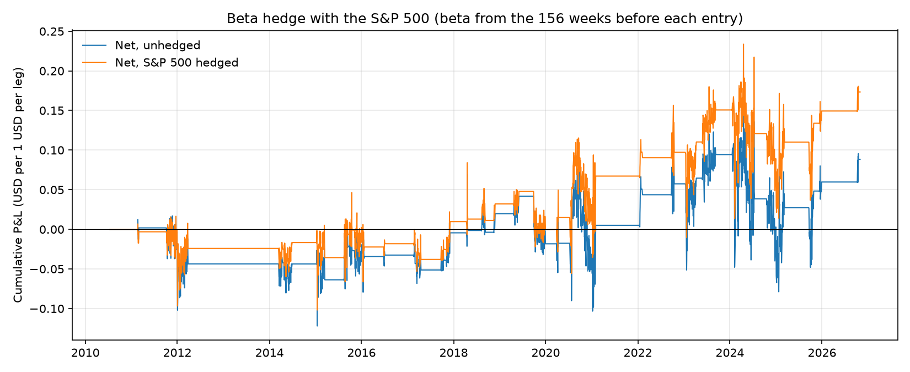

**Stress periods.** The strategy was in position for 14% of March 2020 (from 27 March) and
flat in August 2024, April 2025 and January to May 2026, so these episodes say nothing
about its resilience.

<!-- table:robustness_stress -->
| Period | Version | Days in position | Net P&L | Worst week, net |
|---|---|---:|---:|---:|
| March 2020 | unhedged | 14% | 0.0031 | -0.0005 |
| March 2020 | hedged | 14% | 0.0059 | -0.0005 |
| August 2024 | unhedged | 0% | 0.0000 | 0.0000 |
| August 2024 | hedged | 0% | 0.0000 | 0.0000 |
| April 2025 | unhedged | 0% | 0.0000 | 0.0000 |
| April 2025 | hedged | 0% | 0.0000 | 0.0000 |
| January-May 2026 | unhedged | 0% | 0.0000 | 0.0000 |
| January-May 2026 | hedged | 0% | 0.0000 | 0.0000 |
<!-- /table:robustness_stress -->

**Conclusion of the section.** A simple strategy does not survive realistic costs on
TSMC: its timing is better than chance, but its gross edge of 109 bp per round trip is
mostly consumed by 82 bp of costs, 39% of them the Taiwan transaction tax, and its result
depends on the execution day.

## 9. Out-of-sample test (step 6)

**Naive approach.** Judge the strategy and the TSMC findings on TSMC alone.

**Problem.** The rules of Section 8 were fixed before any backtest, but chosen knowing
TSMC's premium, and every finding of Sections 5 to 8 was obtained on one security.

**Correction.** The findings were tested on three other Taiwanese ADRs, UMC, ASE
Technology Holding and Chunghwa Telecom, with a plan written before any of their data was
downloaded: [preregistration_step6.md](preregistration_step6.md), committed and tagged
`prereg-step6` (commit `912658ae89d237d2a549db5a82a8e209968696f2`) before the first
download. The methods and parameters are those of the TSMC code, with no new parameter.
The plan adds a higher-cost scenario for these less liquid lines (commissions and FX
doubled, borrow fee 1% a year), a fifth hypothesis and an aggregation rule: a hypothesis
is "generalised" if it is confirmed for at least 2 of the 3 securities. Before the run,
the code was made configurable by security; a non-regression test checks that every TSMC
result is unchanged, and all TSMC output files were identical byte for byte. Code:
`scripts/step6_out_of_sample.py`.

### 9.1 Securities and data

Ratios and listing dates were checked in 20-F filings. ASE Technology Holding was
established on 2018-04-30 by a share exchange with Advanced Semiconductor Engineering
(ASE Inc.) and the acquisition of SPIL; before that date the ticker ASX belonged to ASE
Inc., whose ADS represented five of its own shares, so the sample starts on 2018-04-30.
Chunghwa carried out capital reductions from 2007 to 2010, the last one paid on
2011-01-25; the dates on which each line's unadjusted price reflects it were not
verified, so the sample starts on 2011-03-01.

<!-- table:step6_securities -->
| Security | ADR / local | Shares per ADS | Sample start | Sample end | Ratio checked in |
|---|---|---:|---|---|---|
| TSMC | TSM / 2330.TW | 5 | 2010-01-01 | 2026-10-30 | 20-F filed 2010-04-15, 2018-04-19, 2026-04-16 |
| UMC | UMC / 2303.TW | 5 | 2010-01-01 | 2026-10-30 | 20-F filed 2010-04-30, 2018-04-26, 2026-04-30 |
| ASE | ASX / 3711.TW | 2 | 2018-04-30 | 2026-10-30 | 20-F filed 2019-04-26, 2026-04-01 (ASE Inc., 5 shares, before 2018-04-30) |
| Chunghwa | CHT / 2412.TW | 10 | 2011-03-01 | 2026-10-30 | 20-F filed 2010, 2011, 2012, 2013 and 2026-04-15 |
<!-- /table:step6_securities -->

No price or exchange-rate value was corrected, and no daily return exceeded 25% in
absolute value on either line. Yahoo has no local Chunghwa dividend for the ADR dividend
of 2013-07-15 (1.777 USD); it was reported and kept, and no trade held the position over
that date. UMC's premium was about 46% in January 2010 and fell gradually to 2% by mid-2011,
without a jump; it was kept. The full list of checks is in
[Appendix A](#appendix-a-data-and-cleaning-details).

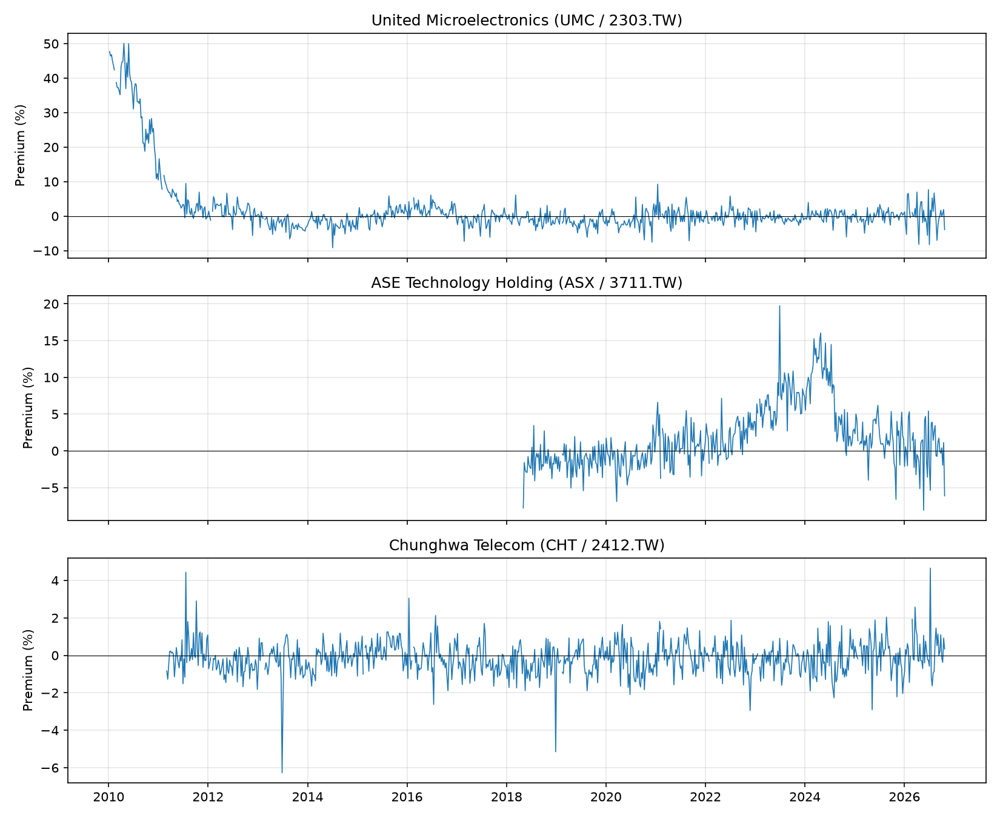

### 9.2 Results by hypothesis

<!-- table:step6_hypotheses -->
|  | Criterion | TSMC (in sample) | UMC | ASE | Chunghwa | Aggregation |
|---|---|---|---|---|---|---|
| H1 | < -0.2 | -0.452 | -0.454 yes | -0.460 yes | -0.469 yes | 3/3, generalised |
| H2 | ARMA > 2 x AR(1) | ARMA 69.6 d vs AR(1) 9.0 d (160 windows) | ARMA 32.9 d vs AR(1) 3.4 d (159 windows) yes | ARMA 120.6 d vs AR(1) 9.1 d (59 windows) yes | ARMA 4.4 d vs AR(1) 2.2 d (146 windows) no | 2/3, generalised |
| H3 | difference > 0, 95% CI above 0 | 0.203 [0.139, 0.268] (ADR 1.06, local 0.85) | 0.107 [0.015, 0.199] (ADR 0.97, local 0.86) yes | 0.202 [0.099, 0.305] (ADR 1.34, local 1.13) yes | 0.038 [0.006, 0.070] (ADR 0.23, local 0.19) yes | 3/3, generalised |
| H4 | 95% CI contains 0 or is below 0 | net Sharpe 0.05 [-0.19, 0.29], width 0.48 | net Sharpe -0.25 [-0.59, 0.10], width 0.69 yes | net Sharpe -0.30 [-0.87, 0.18], width 1.05 yes, weak (low power) | net Sharpe -0.10 [-0.42, 0.20], width 0.62 yes | 3/3, generalised |
| H5 | difference > 0 | not evaluated | +0.401 [-0.193, +0.997] yes | +0.366 [-0.190, +0.932] yes | -0.087 [-0.293, +0.113] no | 2/3, generalised |
<!-- /table:step6_hypotheses -->

<!-- table:step6_mean_reversion -->
| Quantity (half-lives in trading days) | TSMC | UMC | ASE | Chunghwa |
|---|---:|---:|---:|---:|
| Rolling weekly ARMA(1,1), median half-life | 69.6 | 32.9 | 120.6 | 4.4 |
| Rolling weekly AR(1), median half-life | 9.0 | 3.4 | 9.1 | 2.2 |
| Rolling daily ARMA(1,1), median half-life | 37.8 | 13.7 | 47.7 | 4.2 |
| Weekly windows | 167 | 167 | 67 | 153 |
| Weekly ARMA windows excluded | 7 | 8 | 8 | 7 |
| Mean `prev_ny` premium | 6.5% | 1.9% | 1.8% | -0.2% |
| Premium std | 6.3% | 8.9% | 4.2% | 0.8% |
| Lag-1 autocorrelation of daily changes | -0.452 | -0.454 | -0.460 | -0.469 |
| Exploratory: H2 on q, ARMA median |  | 34.5 | 125.4 | 4.4 |
| Exploratory: H2 on q, AR(1) median |  | 3.4 | 9.2 | 2.2 |
<!-- /table:step6_mean_reversion -->

<!-- table:step6_factors -->
| Security | ADR beta | Local beta (USD) | Difference [95% CI] | Main model: S&P 500 [95% CI] | Main model: d ln FX [95% CI] | Weeks |
|---|---:|---:|---:|---:|---:|---:|
| TSMC | 1.06 | 0.85 | 0.203 [0.139, 0.268] | 0.24 [0.17, 0.31] | 0.36 [0.12, 0.60] | 852 |
| UMC | 0.97 | 0.86 | 0.107 [0.015, 0.199] | 0.16 [0.06, 0.25] | 0.51 [0.24, 0.79] | 852 |
| ASE | 1.34 | 1.13 | 0.202 [0.099, 0.305] | 0.23 [0.12, 0.33] | 0.28 [-0.09, 0.64] | 430 |
| Chunghwa | 0.23 | 0.19 | 0.038 [0.006, 0.070] | 0.06 [0.02, 0.09] | 0.19 [0.06, 0.32] | 796 |
<!-- /table:step6_factors -->

<!-- table:step6_strategy -->
| Strategy, a priori rules | TSMC | UMC | ASE | Chunghwa |
|---|---:|---:|---:|---:|
| Trades | 33 | 41 | 21 | 46 |
| Gross P&L | 0.360 | -0.008 | -0.059 | 0.316 |
| Net P&L | 0.088 | -0.340 | -0.240 | -0.049 |
| Net Sharpe, weekly | 0.05 | -0.25 | -0.30 | -0.10 |
| 95% CI, low | -0.19 | -0.59 | -0.87 | -0.42 |
| 95% CI, high | 0.29 | 0.10 | 0.18 | 0.20 |
| Random-entry p-value, gross | 0.012 | 0.580 | 0.634 | 5.0e-04 |
| Break-even cost per trade (bp) | 109 | -2 | -28 | 69 |
| All-in cost per trade, default (bp) | 82 | 81 | 86 | 79 |
| All-in cost per trade, higher (bp) | 130 | 124 | 130 | 122 |
| Tax share of default costs | 39% | 37% | 35% | 38% |
| Net P&L, higher costs | -0.068 | -0.518 | -0.332 | -0.247 |
| Net P&L, execution one day later | -0.191 | -0.146 | 0.136 | -0.204 |
| Exposure | 26% | 17% | 21% | 20% |
| Years | 16.3 | 16.3 | 8.0 | 15.2 |
<!-- /table:step6_strategy -->

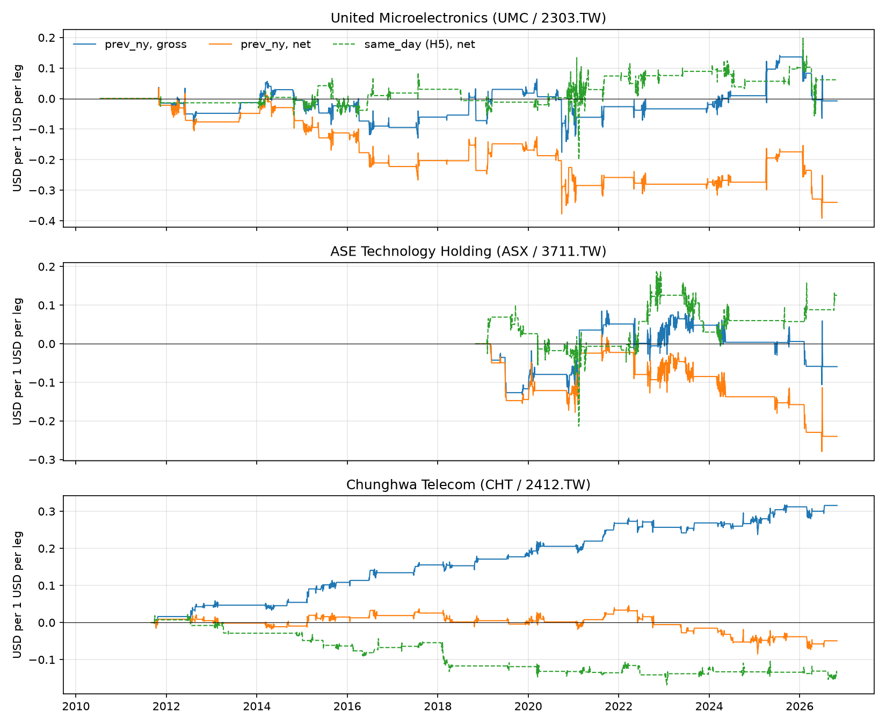

### 9.3 Reading

- H1, H3 and H4 are generalised on 3 of 3 securities: asynchrony noise, the higher US
  market beta of the ADR and the failure of the strategy after costs are not specific to
  TSMC.
- H2 is generalised on 2 of 3. Chunghwa misses the criterion by 0.035 trading days
  (4.378 against a threshold of 4.413); the rule is applied as written.
- H4 is confirmed for different reasons. UMC and ASE already lose before costs.
  Chunghwa's timing is significant (random-entry p-value 0.0005), but its gross gain of
  69 bp per trade is below its costs of 79 bp. ASE's interval is wide (1.05), so its
  confirmation is weak (low power).
- H5, a signal taken at the NY close, came out of the TSMC results (Section 8.2) and was
  tested only here. It satisfies the aggregation rule, but no difference is significant:
  every interval contains 0. It is not concluded that a signal at the NY close is better.

<!-- table:step6_h5 -->
| Security | Trades, `prev_ny` | Net P&L, `prev_ny` | Trades, `same_day` | Net P&L, `same_day` | Difference [95% block-bootstrap CI] |
|---|---:|---:|---:|---:|---:|
| UMC | 41 | -0.340 | 38 | 0.062 | 0.401 [-0.193, 0.997] |
| ASE | 21 | -0.240 | 25 | 0.126 | 0.366 [-0.190, 0.932] |
| Chunghwa | 46 | -0.049 | 37 | -0.137 | -0.087 [-0.293, 0.113] |
<!-- /table:step6_h5 -->

The beta hedge behaves as for TSMC: volatility is almost unchanged.

<!-- table:step6_hedge -->
| Security | Mean pair beta at entry | Trades without hedge | Net vol, weekly (unhedged / hedged) | Net Sharpe (unhedged / hedged) | Net max drawdown (unhedged / hedged) |
|---|---:|---:|---:|---:|---:|
| TSMC | -0.16 | 0 | 10.5% / 10.3% | 0.05 / 0.10 | -0.25 / -0.22 |
| UMC | -0.12 | 0 | 8.4% / 8.2% | -0.25 / -0.20 | -0.43 / -0.35 |
| ASE | -0.18 | 2 | 9.8% / 9.7% | -0.30 / -0.26 | -0.30 / -0.28 |
| Chunghwa | -0.04 | 1 | 3.1% / 3.2% | -0.10 / -0.08 | -0.13 / -0.13 |
<!-- /table:step6_hedge -->

### 9.4 In sample and out of sample

The strategy earns money, marginally, only on TSMC, the security its rules were designed
on, and loses on the other three (net P&L -0.340 for UMC, -0.240 for ASE, -0.049 for
Chunghwa, against +0.088 for TSMC). Although the rules were fixed before any backtest,
they were chosen with knowledge of TSMC's premium, and the TSMC result should be read as
in sample. The one-day execution delay does not even have a consistent sign: it turns
ASE's net result positive (0.136).

### 9.5 Deviations from the plan

- The plan's text says mean reversion is estimated on q = ln(1 + premium), while the TSMC
  code it requires uses the premium itself. The TSMC code was followed; on q, marked
  exploratory, the H2 verdicts are the same for all three securities.
- The Chunghwa dividend gap of 2013 (Section 9.1).
- Two ASE trades and one Chunghwa trade are not hedged in the beta-hedge variant, for lack
  of 52 weeks of history, as the plan's rule requires.

**A lesson on the aggregation rule.** The rule counted weak confirmations (a positive
difference whose interval contains 0) like strong ones. A rule of this kind should state
the level of evidence that counts, not only the number of securities.

### 9.6 Exploratory observation

Four securities only, not tested. The persistence of the premium seems to increase with
the difference in US market beta between the ADR and the local share. Chunghwa has a
difference of 0.04, a premium close to 0 (mean -0.2%, standard deviation 0.8%) and a
half-life of a few days; the three semiconductor ADRs have differences of 0.11 to 0.20 and
half-lives of 33 to 121 trading days. The mean premium level does not follow the same
order (1.9% for UMC, 1.8% for ASE, 6.5% for TSMC), and UMC's mean is driven by 2010.

## 10. Limits to arbitrage (step 7)

A synthesis of Sections 5 to 9: no new hypothesis is tested. Each statement refers to an
earlier section or to a source; the no-arbitrage band is a derived calculation.

**Naive approach.** Read the premium itself as the profit available to an arbitrageur:
20% in Lamont's example, 6.5% on average over our sample.

**Problem.** The arbitrage that would close the premium requires converting shares into
ADRs, which is restricted; without conversion, a trader can only bet on the premium's
reversion, which is slow, costly and risky.

### 10.1 Conversion

Lamont (2024) writes that the ADR and the underlying "are not fully fungible in the
short-term" because of "regulations that prevent the creation of new U.S. shares and
limit the ability of U.S. investors to buy in Taiwan". TSMC's 20-F for 2025 (filed
2026-04-16) is more precise: "We, or the foreign depositary bank, may not increase the
number of depositary receipts by depositing shares in a depositary receipt facility or
issuing additional depositary receipts against these deposits without specific R.O.C.
FSC approval, except in limited circumstances", namely stock dividends, pre-emptive
rights and deposits of shares bought on the market; for the latter, "the total number of
deposited shares outstanding after an issuance [...] may not exceed the number of
deposited shares previously approved by the R.O.C. FSC", and new issuances are "permitted
to the extent that previously issued depositary receipts have been cancelled and the
underlying shares have been withdrawn". Withdrawal is possible, but a non-R.O.C. holder
must register with the Taiwan Stock Exchange and appoint a local agent and custodian.

The creation of ADRs is therefore capped, not forbidden: the trade that would close a
premium (buy in Taipei, create the ADR, sell it in New York) is limited by past
withdrawals, while the reverse trade, which would close a discount, is not. The 2026 20-F
filings of UMC, ASE and Chunghwa describe the same rule (Chunghwa refers to the
Securities and Futures Bureau). UMC adds: "As a result of the limited ability to deposit
common shares into our ADS program, the prevailing market price of our ADSs [...] may
differ from the prevailing market price of the equivalent number of our common shares".
ASE's and Chunghwa's depositary charges up to US$5.00 per 100 ADSs issued or cancelled.

### 10.2 Costs

Trading the premium without converting, the TSMC strategy's gross edge is 109 bp per
round trip against all-in costs of 82 bp with the default costs, 52 bp with
institutional costs and 32 bp with the tax alone (Section 8.5). The transaction tax is 39%
of the default costs and 61% of the institutional ones; on UMC, ASE and Chunghwa it is 35%
to 38% of the default costs (Section 9).

### 10.3 Slowness

Corrected for asynchrony noise, TSMC's premium has a half-life of roughly 30 to 70
trading days (Section 6). Out of sample the median weekly ARMA half-life ranges from 4.4
trading days for Chunghwa to 32.9 for UMC and 120.6 for ASE (69.6 for TSMC on the same
windows; Section 9).

### 10.4 Risk

The pair has an S&P 500 beta of about -0.20 (Section 7.1), and hedging it leaves the
strategy's volatility almost unchanged (Section 8.5). The premium can widen before it
converges: the net TSMC strategy has a maximum drawdown of -0.25 per 1 USD per leg. This
is the risk Shleifer and Vishny (1997) describe: arbitrage becomes ineffective when
prices diverge far from fundamental values.

### 10.5 No-arbitrage band (derived)

**Correction.** If a deviation D of the premium from its mean decays with half-life h, a
position held T trading days captures on average D (1 - 0.5^(T/h)) and pays the
round-trip cost C plus the borrow fee b T / 252. The break-even deviation is

    D* = (C + b T / 252) / (1 - 0.5^(T/h)).

It is computed with each security's median weekly ARMA half-life, the default costs
(C = 70 bp, b = 0.5%) and the institutional costs (C = 44 bp, b = 0.25%), for T = h and
T = 2h, and compared with the weekly deviations of q from its mean over the 26 previous
weeks. Code: `scripts/arbitrage_band.py`, tested on hand-computed cases.

<!-- table:arbitrage_band -->
| Security | h (trading days) | D*, default, T = h | D*, default, T = 2h | D*, institutional, T = h | D*, institutional, T = 2h | Weeks with deviation > D* (default, T = h) | Weeks with abs deviation > D* | Deviation std (points) |
|---|---:|---:|---:|---:|---:|---:|---:|---:|
| TSMC | 69.6 | 1.68 | 1.30 | 1.02 | 0.77 | 23% | 45% | 2.55 |
| UMC | 32.9 | 1.53 | 1.11 | 0.95 | 0.67 | 19% | 44% | 2.88 |
| ASE | 120.6 | 1.88 | 1.57 | 1.12 | 0.91 | 22% | 42% | 2.67 |
| Chunghwa | 4.4 | 1.42 | 0.96 | 0.89 | 0.60 | 4% | 8% | 0.87 |

D* in points of q. Round-trip cost C: 70 bp (default), 44 bp (institutional); borrow fee 0.50% and 0.25% a year.
<!-- /table:arbitrage_band -->

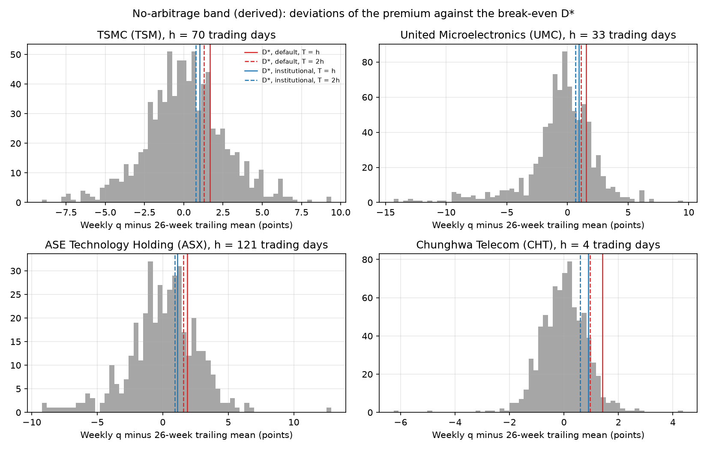

**Impact.** The band is about 1 to 2 points of premium. Observed deviations exceed it in
4% to 23% of weeks, but they are measured on the `prev_ny` premium, whose asynchrony noise
accounts for about 2.4 points per TSMC trade (Section 8.2), more than D* itself. D* is a
lower bound, for two reasons. First, an observed deviation overstates the deviation an
order can capture, so the observed deviation needed to cover costs is larger than D*.
Second, the formula ignores risk: the premium can widen before it converges (Shleifer and
Vishny, 1997), so an arbitrageur would require a larger deviation than the one that only
covers expected costs. The band is an order of magnitude, not a trading rule.

### 10.6 Premiums and discounts

The asymmetry of conversion is consistent with what the data show (an interpretation,
not a test): large and persistent premiums, and discounts that stay small. TSMC is at a
discount in 5% of weeks, never below -3.1%, against a premium of up to 29.5%. Discounts
are not rare everywhere: UMC is at a discount in 52% of weeks (minimum -9.2%, maximum
premium 50.1%), ASE in 38%, Chunghwa in 59% but around 0. On all four securities, the
largest discounts are much smaller than the largest premiums.

<!-- table:premium_sign -->
| Security | Weeks | Weeks at a discount | Weeks below -2% | Min | 5% | Median | 95% | Max |
|---|---:|---:|---:|---:|---:|---:|---:|---:|
| TSMC | 865 | 5% | 0% | -3.1% | 0.0% | 4.3% | 21.0% | 29.5% |
| UMC | 865 | 52% | 19% | -9.2% | -3.8% | -0.1% | 21.1% | 50.1% |
| ASE | 437 | 38% | 15% | -8.1% | -3.5% | 1.0% | 10.1% | 19.7% |
| Chunghwa | 807 | 59% | 1% | -6.3% | -1.4% | -0.2% | 1.2% | 4.7% |
<!-- /table:premium_sign -->

### 10.7 Conclusion: Lamont's two questions

**Why aren't arbitrageurs enforcing the law of one price?** Demonstrated: the conversion
that would close a premium is capped by Taiwanese regulation (20-F filings), and trading
the premium's mean reversion without conversion does not survive realistic costs, on
TSMC (net Sharpe 0.05, interval containing 0) and on three other Taiwanese ADRs. Derived:
costs and slow reversion set a no-arbitrage band of about 1 to 2 points of premium, a
lower bound of the same order as the asynchrony noise in the observed premium.

**Who is buying the expensive stock?** Demonstrated on four ADRs: the ADR carries more
US market risk than the local share, which is consistent with demand from US investors,
though it does not identify who buys. Exploratory: the persistence of the premium appears
to increase with this US market exposure (Section 9.6), a link observed on four
securities only.

## 11. What did not work

**Chow test at chosen dates.** A Chow test on the weekly AR(1) of `prev_ny` was run at
four candidate break dates in April and May 2026, around the FSC announcement. It rejects
stability at all four (p from 2.8e-07 to 1.9e-06), with only 26 to 30 weeks after each
date. The same test was run at seven placebo dates from 2013 to 2025, and it rejects at
every one of them (p from 1.5e-14 to 2.7e-04): the "before" regime of a full-history test
pools level regimes whose weekly means range from 3.1% to 19.2%, and the AR(1) residuals
are autocorrelated, which breaks the assumptions behind the F distribution. The results
are reported as not conclusive, and no structural break is claimed. On data since 2024
the test is significant at 2026-01-02 (p = 0.001), but a decline that started in April
would also produce a rejection at that date. The timing is therefore read from monthly
means: the mean `prev_ny` premium stays between 23.9% and 25.7% from September to
December 2025, falls to 20.21% in January 2026 and to 13.16% in May. The decline begins in
January 2026, before the FSC announcement of 23 April 2026; the decision may have
accentuated it, but these data cannot isolate its effect.

<!-- table:chow -->
| Test | Break date | F | p-value | Weeks before | Weeks after |
|---|---|---:|---:|---:|---:|
| Candidate date, full history | 2026-04-01 | 15.37 | 2.8e-07 | 822 | 30 |
| Candidate date, full history | 2026-04-15 | 13.99 | 1.1e-06 | 824 | 28 |
| Candidate date, full history | 2026-04-24 | 13.38 | 1.9e-06 | 825 | 27 |
| Candidate date, full history | 2026-05-01 | 14.14 | 9.1e-07 | 826 | 26 |
| Placebo date, full history | 2013-01-04 | 8.29 | 2.7e-04 | 149 | 703 |
| Placebo date, full history | 2016-01-01 | 15.68 | 2.0e-07 | 301 | 551 |
| Placebo date, full history | 2018-01-05 | 22.83 | 2.2e-10 | 404 | 448 |
| Placebo date, full history | 2020-01-03 | 32.71 | 2.1e-14 | 506 | 346 |
| Placebo date, full history | 2022-01-07 | 16.41 | 1.0e-07 | 609 | 243 |
| Placebo date, full history | 2024-01-05 | 33.07 | 1.5e-14 | 709 | 143 |
| Placebo date, full history | 2025-01-03 | 12.76 | 3.5e-06 | 761 | 91 |
| Sample from 2024 only | 2025-01-03 | 1.48 | 0.232 | 51 | 91 |
| Sample from 2024 only | 2025-07-04 | 1.42 | 0.246 | 75 | 67 |
| Sample from 2024 only | 2026-01-02 | 7.03 | 0.001 | 101 | 41 |
| Sample from 2024 only | 2026-04-01 | 7.55 | 7.8e-04 | 112 | 30 |
| Sample from 2024 only | 2026-04-15 | 7.78 | 6.3e-04 | 114 | 28 |
| Sample from 2024 only | 2026-04-24 | 6.76 | 0.002 | 115 | 27 |
| Sample from 2024 only | 2026-05-01 | 6.44 | 0.002 | 116 | 26 |
<!-- /table:chow -->

<!-- table:monthly -->
| Month | Mean `prev_ny` premium | Min | Max | Trading days |
|---|---:|---:|---:|---:|
| 2025-09 | 24.81% | 21.1% | 29.5% | 21 |
| 2025-10 | 25.15% | 21.3% | 30.0% | 20 |
| 2025-11 | 23.93% | 20.3% | 26.4% | 20 |
| 2025-12 | 25.67% | 20.8% | 31.6% | 22 |
| 2026-01 | 20.21% | 16.6% | 24.0% | 21 |
| 2026-02 | 19.49% | 16.5% | 22.6% | 12 |
| 2026-03 | 17.78% | 13.6% | 20.8% | 22 |
| 2026-04 | 15.19% | 10.6% | 20.6% | 20 |
| 2026-05 | 13.16% | 10.1% | 16.2% | 20 |
| 2026-06 | 15.93% | 11.5% | 20.3% | 21 |
| 2026-07 | 13.17% | 7.7% | 21.4% | 22 |
| 2026-08 | 12.24% | 9.0% | 15.6% | 21 |
| 2026-09 | 12.12% | 7.8% | 17.6% | 20 |
| 2026-10 | 15.32% | 10.5% | 19.4% | 16 |
<!-- /table:monthly -->

**The asynchrony explanation of the exit fragility.** The hypothesis was that the gross
gain lost when the exit is delayed comes from asynchrony noise. The correlation between
the loss and the asynchrony gap at the exit decision is 0.56, but it falls to 0.08
(p = 0.68) without the July 2020 trade, and the rank correlation is not significant in
either case. The hypothesis is rejected; the cause of the exit fragility is not
identified (Section 8.5).

**H5, a signal at the NY close.** It satisfies the aggregation rule of the plan, but no
difference is significant (Section 9.3); nothing is concluded.

**The level of the premium.** The exploratory link between the difference in US beta and
the premium holds for its persistence, not for its mean level (Section 9.6).

**Factors.** Traded volumes, lagged factors and foreign flows explain nothing (Section
7.3).

## 12. Not verified

- **Price data.** `yfinance` is an unofficial interface with no quality guarantee; prices
  were checked on individual dates only (Section 4.2). UMC's high premium of 2010 was not
  checked against an independent source.
- **ADS ratios** were checked in 20-F filings at three or more dates per company, not
  every year; a change later reversed would not have been seen.
- **Effective date of the FSC decision** of April 2026.
- **Empty weeks** attributed to the Lunar New Year closure, not checked against an
  exchange calendar.
- **History of the Taipei daily price limit** over the sample.
- **Costs**: ADR and local commissions, FX conversion cost, ADR borrow fee, and whether the
  short pays the gross or the net ADR dividend. The local commission ceiling of 0.1425%
  comes from a 2000 press article; the withholding rate (21% since 2018, 20% before) from
  secondary sources, and the earlier rate is not modelled.
- **Short selling in Taiwan** is described as more constrained, without verification.
- **Chunghwa's capital reduction**: the dates on which each line's unadjusted price
  reflects it.
- **Chunghwa's local dividend of 2013**, missing in Yahoo.
- **Traded volumes** from Yahoo.
- **Index returns as a proxy for futures** in the hedge, which ignores the financing and
  dividend components of a futures contract.
- **Working (1960)**: volume and pages of the reference.

## 13. Limitations

- **Publication lag and timing of FRED.** The last FRED value is dated 2026-10-23, and in
  a live strategy the FRED rate would not be available at the Taipei close; it is recorded
  at 16:00 or 17:00 UTC, synchronous with neither close.
- **Daily residuals.** The daily ARMA(1,1) residuals are not white in 2010-2019 and
  2020-2023; Mondays do not explain it, and the cause remains unknown.
- **Level shifts and selection in rolling windows** (Section 6.4): the half-life is given
  as a range, and its variation across windows cannot be read as a change in the speed of
  reversion.
- **Confidence intervals of half-lives.** Upper bounds come from a Wald interval on phi
  close to 1 and are often very large or infinite; lower bounds are more informative.
- **Weekly conversion** at 5 trading days per week overstates trading days in holiday
  weeks.
- **Backtest.** Few trades (33 for TSMC, 21 to 46 out of sample), so intervals are wide;
  financing is not modelled apart from the borrow fee; the exit FX and dividends are
  converted at FRED rates.
- **Four securities** only for the out-of-sample test and the exploratory observation.

## References

- Lamont, O. A. (2024). TSMC: Totally Stupid Market Chaos. Acadian Asset Management,
  Owenomics, October 2024:
  https://acadian-asset.com/investment-insights/owenomics/tsmc-totally-stupid-market-chaos
- Shleifer, A. and Vishny, R. W. (1997). The Limits of Arbitrage. *The Journal of
  Finance*, 52(1), 35-55.
- Working, H. (1960). Note on the Correlation of First Differences of Averages in a
  Random Chain. *Econometrica*, 28(4), 916-918 (volume and pages not verified).

Company filings (SEC EDGAR, Form 20-F):

- TSMC: https://www.sec.gov/Archives/edgar/data/1046179/000095012310034985/h04138e20vf.htm (2010),
  https://www.sec.gov/Archives/edgar/data/1046179/000119312518121866/d459142d20f.htm (2018),
  https://www.sec.gov/Archives/edgar/data/1046179/000162828026025362/tsm-20251231.htm (2026)
- UMC: https://www.sec.gov/Archives/edgar/data/1033767/000119312510100488/d20f.htm (2010),
  https://www.sec.gov/Archives/edgar/data/1033767/000119312518132616/d484523d20f.htm (2018),
  https://www.sec.gov/Archives/edgar/data/1033767/000119312526193757/d91630d20f.htm (2026)
- ASE: https://www.sec.gov/Archives/edgar/data/1122411/000095010318003940/dp87030_20f.htm (2018, ASE Inc.),
  https://www.sec.gov/Archives/edgar/data/1122411/000095010319005149/dp102525_20f.htm (2019),
  https://www.sec.gov/Archives/edgar/data/1122411/000119312526135585/d50802d20f.htm (2026)
- Chunghwa Telecom: https://www.sec.gov/Archives/edgar/data/1132924/000119312510087384/d20f.htm (2010),
  https://www.sec.gov/Archives/edgar/data/1132924/000110465912026593/a12-9954_120f.htm (2012),
  https://www.sec.gov/Archives/edgar/data/1132924/000119312526155848/cht-20251231.htm (2026)

Costs:

- PwC, Taiwan, corporate, other taxes: https://taxsummaries.pwc.com/taiwan/corporate/other-taxes
- Kaizen CPA, Guide to Taiwan Securities Transaction Tax: https://kaizencpa.com/knowledge/info/id/364.html
- Interactive Brokers, Taiwan Stock Exchange fees: https://www.interactivebrokers.com/ru/accounts/fees/TAIWAN_StkFees.php?nhf=T
- Taipei Times, 3 March 2000: https://www.taipeitimes.com/News/biz/archives/2000/03/03/0000026462
- EY, 2018, Taiwan withholding rate for non-residents: https://globaltaxnews.ey.com/news/2018-5118-taiwan-increases-withholding-tax-rate-for-nonresident-recipients-without-fixed-place-of-business-in-taiwan
- Investment Taiwan, Bravo! Taiwan 2024: https://investtaiwan.nat.gov.tw/eBook/BravoTaiwan/2024ebook_en/files/basic-html/page33.html

Data:

- Federal Reserve Bank of St. Louis, FRED series DEXTAUS:
  https://fred.stlouisfed.org/graph/fredgraph.csv?id=DEXTAUS
- Yahoo Finance, through the `yfinance` library.

Policy announcement and news reports:

- Bloomberg, 23 April 2026: https://www.bloomberg.com/news/articles/2026-04-23/taiwan-to-ease-limits-on-active-funds-investments-in-tsmc
- Focus Taiwan, 24 April 2026: https://focustaiwan.tw/business/202604240013
- ts2.tech, 23 June 2026: https://ts2.tech/en/tsmc-drops-6-key-investor-trend-cant-be-missed/
- StockTi, 23 June 2026: https://stockti.com/tsmc-adr-premium-shrinks-sparking-6-slide-in-us-shares

## Appendix A. Data and cleaning details

Exchange rate: the two gross errors, the verdicts on the dates flagged in Yahoo, the gap
between Yahoo and FRED by year, and the persistent shifts.

<!-- table:fx_gross_errors -->
| Date | Yahoo TWD=X | FRED DEXTAUS | `same_day` premium (raw Yahoo) | `prev_ny` premium (raw Yahoo) |
|---|---:|---:|---:|---:|
| 2011-10-25 | 1.8015 | 30.11 | -93.9% | -93.7% |
| 2014-12-31 | 3.6700 | 31.60 | -88.3% | -88.3% |
<!-- /table:fx_gross_errors -->

<!-- table:fx_verdicts -->
| Verdict for the dates flagged in Yahoo | Dates |
|---|---:|
| Yahoo point off (gap > 1%, FRED flat) | 86 |
| Yahoo point close to FRED, its neighbours off | 28 |
| No FRED value on that date | 9 |
| FRED shows the same move | 1 |
<!-- /table:fx_verdicts -->

<!-- table:fx_gap_by_year -->
| Year | Common dates | Mean abs gap | Share abs gap > 1% | Dates flagged in Yahoo |
|---|---:|---:|---:|---:|
| 2010 | 250 | 0.17% | 1% | 0 |
| 2011 | 249 | 0.50% | 12% | 15 |
| 2012 | 251 | 0.23% | 3% | 8 |
| 2013 | 250 | 1.40% | 52% | 10 |
| 2014 | 249 | 1.13% | 41% | 46 |
| 2015 | 251 | 0.85% | 24% | 23 |
| 2016 | 251 | 0.74% | 20% | 20 |
| 2017 | 247 | 0.22% | 1% | 0 |
| 2018 | 249 | 0.25% | 0% | 1 |
| 2019 | 248 | 0.18% | 0% | 0 |
| 2020 | 250 | 0.23% | 1% | 0 |
| 2021 | 249 | 0.22% | 0% | 0 |
| 2022 | 250 | 0.25% | 1% | 0 |
| 2023 | 249 | 0.24% | 1% | 0 |
| 2024 | 251 | 0.25% | 0% | 0 |
| 2025 | 248 | 0.28% | 3% | 1 |
| 2026 | 204 | 0.20% | 0% | 0 |
<!-- /table:fx_gap_by_year -->

<!-- table:fx_shifts -->
| Start | End | Consecutive dates | Mean gap Yahoo/FRED |
|---|---|---:|---:|
| 2013-03-19 | 2013-04-01 | 10 | -2.51% |
| 2013-04-15 | 2013-05-03 | 15 | -2.40% |
| 2013-05-09 | 2013-05-22 | 10 | -2.55% |
| 2013-05-24 | 2013-07-15 | 35 | -2.58% |
| 2013-09-09 | 2013-11-18 | 48 | -2.52% |
| 2014-08-18 | 2014-09-08 | 15 | -2.42% |
| 2014-09-15 | 2014-10-02 | 14 | -2.63% |
| 2015-12-22 | 2016-01-06 | 10 | -2.72% |
| 2016-01-19 | 2016-02-04 | 13 | -2.64% |
<!-- /table:fx_shifts -->

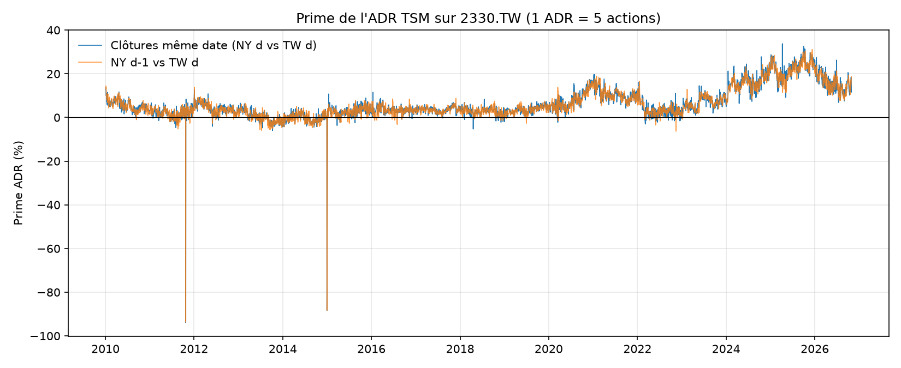

Daily changes of more than 10 points (FRED rate):

<!-- table:jumps -->
| Date | `same_day` | `prev_ny` | `same_day` next day | `prev_ny` next day |
|---|---:|---:|---:|---:|
| 2020-03-16 | -1.95% | 13.83% | 9.43% | 1.16% |
| 2020-03-17 | 9.43% | 1.16% | 3.66% | 12.80% |
| 2020-03-18 | 3.66% | 12.80% | 7.60% | 8.67% |
| 2020-07-28 | 3.62% | 12.19% | 14.64% | 6.81% |
| 2020-07-29 | 14.64% | 6.81% | 8.00% | 11.47% |
| 2022-11-10 | 9.55% | 1.38% | 5.39% | 1.12% |
| 2022-11-15 | 4.10% | -6.03% | 1.25% | 2.60% |
| 2024-08-05 | 18.61% | 20.04% | 15.77% | 9.85% |
| 2024-08-06 | 15.77% | 9.85% | 10.04% | 10.73% |
| 2024-10-17 | 27.92% | 16.55% | 18.58% | 22.02% |
| 2025-04-09 | 32.86% | 18.89% | 15.09% | 20.86% |
| 2025-04-10 | 15.09% | 20.86% | 14.85% | 11.72% |
| 2026-07-01 | 13.07% | 21.44% | 12.23% | 14.91% |
| 2026-07-31 | 7.59% | 7.70% | 11.17% | 10.09% |
<!-- /table:jumps -->

Data checks of the out-of-sample securities:

<!-- table:step6_data_checks -->
| Security | Check | Date | Value | Action |
|---|---|---|---|---|
| UMC | adr closes | 2010-01-04 | 4233 | first date and count |
| UMC | local closes | 2010-01-04 | 4112 | first date and count |
| UMC | FX report |  | FX points removed: 0; FX points flagged for manual review: 0 | as for TSMC |
| UMC | dividends checked |  | 17 | max |gap| 0.024 |
| ASE | adr closes | 2018-04-30 | 2139 | first date and count |
| ASE | local closes | 2018-04-30 | 2068 | first date and count |
| ASE | FX report |  | FX points removed: 0; FX points flagged for manual review: 0 | as for TSMC |
| ASE | dividends checked |  | 9 | max |gap| 0.026 |
| Chunghwa | adr closes | 2011-03-01 | 3942 | first date and count |
| Chunghwa | local closes | 2011-03-01 | 3828 | first date and count |
| Chunghwa | FX report |  | FX points removed: 0; FX points flagged for manual review: 0 | as for TSMC |
| Chunghwa | dividends checked |  | 16 | max |gap| 0.036 |
| Chunghwa | dividend flagged (gap > 5% or no local match) | 2013-07-15 | 1.777 | reported, kept |
<!-- /table:step6_data_checks -->

## Appendix B. Additional tables

The 33 trades of the TSMC strategy (rules fixed a priori, default costs):

<!-- table:backtest_trades -->
| Entry decision | Exit decision | Exit reason | Weeks | z at entry | z at exit | Gross P&L | Net P&L |
|---|---|---|---:|---:|---:|---:|---:|
| 2011-02-18 | 2011-02-25 | z_below_exit | 1 | 1.61 | -0.62 | +0.0087 | +0.0018 |
| 2011-10-07 | 2011-10-21 | z_below_exit | 2 | 1.63 | -0.15 | +0.0009 | -0.0064 |
| 2011-10-28 | 2012-03-23 | z_below_exit | 20 | 2.22 | -0.57 | -0.0292 | -0.0390 |
| 2014-03-14 | 2014-04-11 | z_below_exit | 4 | 1.62 | -0.73 | +0.0092 | +0.0015 |
| 2014-04-25 | 2014-06-27 | z_below_exit | 9 | 3.71 | -0.55 | +0.0067 | -0.0016 |
| 2015-01-09 | 2015-03-13 | z_below_exit | 8 | 2.34 | -1.24 | -0.0116 | -0.0201 |
| 2015-08-14 | 2015-09-11 | z_below_exit | 4 | 2.19 | -1.01 | +0.0492 | +0.0418 |
| 2015-09-25 | 2015-10-16 | z_below_exit | 3 | 1.62 | -0.19 | +0.0029 | -0.0050 |
| 2015-11-06 | 2016-01-22 | z_below_exit | 11 | 2.61 | -0.51 | +0.0006 | -0.0073 |
| 2016-06-24 | 2016-07-01 | z_below_exit | 1 | 2.28 | -1.46 | +0.0092 | +0.0017 |
| 2017-02-17 | 2017-02-24 | z_below_exit | 1 | 1.54 | -0.51 | -0.0036 | -0.0106 |
| 2017-03-10 | 2017-03-24 | z_below_exit | 2 | 1.61 | -0.35 | +0.0077 | +0.0002 |
| 2017-03-31 | 2017-04-14 | z_below_exit | 2 | 2.76 | -1.30 | -0.0013 | -0.0084 |
| 2017-09-22 | 2017-10-13 | z_below_exit | 3 | 2.28 | -0.17 | +0.0200 | +0.0122 |
| 2017-11-03 | 2017-12-01 | z_below_exit | 4 | 2.96 | -0.38 | +0.0419 | +0.0346 |
| 2018-04-13 | 2018-04-20 | z_below_exit | 1 | 1.62 | -1.62 | +0.0097 | +0.0030 |
| 2018-08-10 | 2018-09-07 | z_below_exit | 4 | 1.59 | -0.01 | +0.0056 | -0.0023 |
| 2018-11-16 | 2018-11-23 | z_below_exit | 1 | 1.60 | -0.57 | +0.0305 | +0.0234 |
| 2019-04-19 | 2019-05-31 | z_below_exit | 6 | 2.55 | -0.39 | +0.0291 | +0.0222 |
| 2019-09-27 | 2019-12-27 | z_below_exit | 13 | 1.54 | -0.46 | -0.0488 | -0.0601 |
| 2020-03-27 | 2020-04-10 | z_below_exit | 2 | 2.89 | -0.71 | +0.0081 | +0.0007 |
| 2020-07-10 | 2020-07-24 | z_below_exit | 2 | 2.04 | -1.09 | +0.0446 | +0.0364 |
| 2020-07-31 | 2021-01-29 | max_hold | 26 | 2.10 | 2.17 | +0.0010 | -0.0137 |
| 2022-01-14 | 2022-01-26 | z_below_exit | 2 | 2.33 | -1.56 | +0.0454 | +0.0386 |
| 2022-09-23 | 2022-10-14 | z_below_exit | 3 | 1.56 | -0.07 | +0.0205 | +0.0138 |
| 2023-01-13 | 2023-04-07 | z_below_exit | 11 | 1.95 | -0.23 | +0.0167 | +0.0071 |
| 2023-05-26 | 2023-09-08 | z_below_exit | 15 | 2.69 | -0.11 | +0.0388 | +0.0298 |
| 2024-01-19 | 2024-07-12 | z_below_exit | 25 | 3.63 | -0.11 | -0.0411 | -0.0558 |
| 2024-10-18 | 2024-12-13 | z_below_exit | 8 | 2.68 | -0.08 | -0.0165 | -0.0250 |
| 2024-12-20 | 2025-03-07 | z_below_exit | 10 | 2.15 | -1.41 | +0.0213 | +0.0136 |
| 2025-09-19 | 2025-10-23 | z_below_exit | 5 | 1.87 | -0.08 | +0.0292 | +0.0211 |
| 2025-12-12 | 2025-12-26 | z_below_exit | 2 | 1.88 | -0.15 | +0.0189 | +0.0114 |
| 2026-10-08 | 2026-10-16 | z_below_exit | 1 | 1.53 | -0.33 | +0.0354 | +0.0287 |
<!-- /table:backtest_trades -->

Variants of the TSMC strategy:

<!-- table:backtest_variants -->
| Variant | Gross P&L | Net P&L | Net Sharpe, weekly | Net max drawdown |
|---|---:|---:|---:|---:|
| Rules fixed a priori, default costs | 0.360 | 0.088 | 0.05 | -0.25 |
| Short pays the ADR dividend net of withholding | 0.360 | 0.105 | 0.06 | -0.25 |
| Execution one trading day later on each leg | 0.080 | -0.191 | -0.12 | -0.44 |
<!-- /table:backtest_variants -->

Every number quoted in the text of Sections 4 to 6, with its source:

<!-- table:key_figures -->
| Quantity quoted in the text | Value | Source |
|---|---|---|
| Last FRED value | 2026-10-23 | fx_fred.csv |
| FRED values forward-filled since 2010 | 180 | fx_fred.csv |
| Forward-filled values used by prev_ny / same_day | 43 / 36 | premium CSVs |
| Empty weeks in the weekly prev_ny series | 12 | premium_prev_ny.csv |
| Largest daily rise of 2330.TW | 9.98% on 2026-07-31 | raw_closes.csv |
| Last Yahoo price date | 2026-10-30 | raw_closes.csv |
| Article premium recomputed from reported inputs | 11.71% | computed |
| Reported ADR price with FRED rate | 11.73% | computed |
| TSM close with reported rate | 10.85% | computed |
| TSM close vs reported ADR price | -0.77% | raw_closes.csv |
| same_day premium on previous NY date | 17.87% | premium_table.csv |
| Manual check prev_ny premium | 18.81% | computed from raw_closes.csv, fx_fred.csv |
| Manual check same_day premium | 10.87% | computed |
| Manual check TSM change on d | -6.7% | raw_closes.csv |
| Manual check Yahoo vs FRED gap | 0.23% | raw_closes.csv, fx_fred.csv |
| Monthly mean prev_ny 2025-12 | 25.67% | premium_prev_ny.csv |
| Monthly mean prev_ny 2026-01 | 20.21% | premium_prev_ny.csv |
| Monthly mean prev_ny 2026-04 | 15.19% | premium_prev_ny.csv |
| Monthly mean prev_ny 2026-05 | 13.16% | premium_prev_ny.csv |
| Monthly mean prev_ny Sep-Dec 2025 range | 23.9% to 25.7% | premium_prev_ny.csv |
| Gross error 2011-10-25 prev_ny premium | -93.7% | recomputed |
| Gross error 2014-12-31 prev_ny premium | -88.3% | recomputed |
| Dates with |gap| > 1% | 406 | recomputed |
| of which flagged | 87 | recomputed |
| Flagged dates | 124 | recomputed |
| Share |gap|>1% in 2011 | 12% | recomputed |
| Share |gap|>1% in 2013 | 52% | recomputed |
| Share |gap|>1% in 2014 | 41% | recomputed |
| Share |gap|>1% in 2015 | 24% | recomputed |
| Share |gap|>1% in 2016 | 20% | recomputed |
| Share of flagged dates in 2011-2016 | 122 | recomputed |
| Verdict yahoo_point_off | 86 | recomputed |
| Verdict yahoo_neighbours_off | 28 | recomputed |
| Verdict no_fred_value | 9 | recomputed |
| Verdict fred_confirms | 1 | recomputed |
| Flagged dates comparable | 115 | recomputed |
| Mean |FRED deviation| on flagged dates | 0.10% | recomputed |
| Mean |Yahoo deviation| on flagged dates | 2.70% | recomputed |
| FRED values flagged by the same rule | 0 | recomputed |
| Persistent shifts | 9 | recomputed |
| Longest persistent shift (dates) | 48 | recomputed |
| Shortest persistent shift (dates) | 10 | recomputed |
| prev_ny 2011-2016 noise change | -17% | recomputed |
| prev_ny autocorr Yahoo / FRED | -0.453 / -0.452 | recomputed / premium CSVs |
| same_day 2011-2016 noise change | -17% | recomputed |
| same_day autocorr Yahoo / FRED | -0.441 / -0.436 | recomputed / premium CSVs |
| prev_ny min premium FRED | -6.0% | premium CSVs |
| same_day min premium FRED | -5.0% | premium CSVs |
| Monday prev_ny gap, winter | 56.5 h | computed (zoneinfo) |
| Monday prev_ny gap, summer | 57.5 h | computed (zoneinfo) |
| same_day daily change std (FRED) | 2.24% | premium CSVs |
| same_day autocorr (FRED) | -0.436 | premium CSVs |
| prev_ny daily change std (FRED) | 1.97% | premium CSVs |
| prev_ny autocorr (FRED) | -0.452 | premium CSVs |
| Premium sample | 2010-01-04 to 2026-10-23 | premium CSVs |
| prev_ny daily change std by weekday | Mon 2.00%, Tue 2.09%, Wed 1.92%, Thu 1.88%, Fri 1.95% | premium CSVs |
| Daily ARMA residual autocorrelation by weekday | Mon 0.061, Tue -0.043, Wed 0.079, Thu 0.014, Fri 0.045 | recomputed from premium_prev_ny.csv |
| Jumps above 10 points | 14 | premium_table.csv |
| Example 2025-04-08 same_day / prev_ny | 14.38% / 18.30% | premium_table.csv |
| Example 2025-04-09 same_day / prev_ny | 32.86% / 18.89% | premium_table.csv |
| Example 2025-04-10 same_day / prev_ny | 15.09% / 20.86% | premium_table.csv |
| Example TSM change 2025-04-09 | 12.3% | premium_table.csv |
| Example 2330.TW change 2025-04-10 | 9.9% | premium_table.csv |
| ADF p prev_ny daily | 0.23 | mean_reversion_results.csv |
| ADF p prev_ny weekly | 0.18 | mean_reversion_results.csv |
| ADF p same_day daily | 0.23 | mean_reversion_results.csv |
| ADF p same_day weekly | 0.39 | mean_reversion_results.csv |
| Weekly mean premium 2010-2019 | 3.1% | mean_reversion_results.csv |
| Weekly mean premium 2020-2023 | 7.3% | mean_reversion_results.csv |
| Weekly mean premium 2024-Apr 2026 | 19.2% | mean_reversion_results.csv |
| Weekly mean premium May 2026-end | 14.1% | mean_reversion_results.csv |
| AR(1) weekly/daily ratio by sub-period | 3.5, 4.1, 3.1 | mean_reversion_results.csv |
| Simulation AR(1), daily mean | 4.2 | recomputed simulation |
| Simulation AR(1), weekly mean | 14.0 | recomputed simulation |
| Simulation ARMA(1,1), daily mean | 35.0 | recomputed simulation |
| Simulation ARMA(1,1), weekly mean | 35.0 | recomputed simulation |
| Simulation true half-life | 34.3 | ln(0.5)/ln(0.98) |
| Simulation daily change autocorr | -0.44 | recomputed simulation |
| Simulation theta daily / weekly | -0.61 / -0.34 | recomputed simulation |
| Simulation replications | 30 | recomputed simulation |
| Weeks with data / calendar weeks 2010-2019 | 514 / 521 | premium_prev_ny.csv |
| ARMA 2010-2019 daily / weekly | 61.9 / 63.1 | mean_reversion_results.csv |
| Weeks with data / calendar weeks 2020-2023 | 206 / 209 | premium_prev_ny.csv |
| ARMA 2020-2023 daily / weekly | 54.6 / 63.9 | mean_reversion_results.csv |
| Weeks with data / calendar weeks 2024-Apr 2026 | 119 / 121 | premium_prev_ny.csv |
| ARMA 2024-Apr 2026 daily / weekly | 53.4 / 69.1 | mean_reversion_results.csv |
| ARMA theta range daily | -0.76 to -0.63 | mean_reversion_results.csv |
| ARMA theta range weekly_friday | -0.59 to -0.44 | mean_reversion_results.csv |
| same_day ARMA daily / weekly by sub-period | 58.1 / 63.8; 53.1 / 71.2; 33.7 / 46.1 | mean_reversion_results.csv |
| Full-sample ARMA daily / weekly | 127.4 / 381.0 | mean_reversion_results.csv |
| Rolling ARMA(1,1) weekly, 3-year windows | median 69.6, IQR 34.6 to 122.3, >20 days 92%, lower bound >20 68%, windows 167, excluded 7, rank correlation with abs level shift 0.86 | mean_reversion_results.csv |
| Rolling ARMA(1,1) daily, 2-year windows | median 37.8, IQR 25.4 to 55.1, >20 days 81%, lower bound >20 41%, windows 178, excluded 13, rank correlation with abs level shift 0.74 | mean_reversion_results.csv |
| Rolling AR(1) weekly, 3-year windows | median 9.0, IQR 4.8 to 20.0, >20 days 25%, lower bound >20 13%, windows 167, excluded 0, rank correlation with abs level shift 0.81 | mean_reversion_results.csv |
| Rolling weekly ARMA, windows ending 2013-2016 | median 50.4, median abs shift 2.0, rank correlation 0.84 | mean_reversion_results.csv |
| Rolling weekly ARMA, windows ending 2017-2019 | median 25.4, median abs shift 0.9, rank correlation 0.43 | mean_reversion_results.csv |
| Rolling weekly ARMA, windows ending 2020-2023 | median 101.1, median abs shift 5.5, rank correlation 0.51 | mean_reversion_results.csv |
| Rolling weekly ARMA, windows ending 2024-2026 | median 157.5, median abs shift 11.3, rank correlation 0.89 | mean_reversion_results.csv |
| Rolling weekly ARMA, small level shift | windows 73, median 32.3, IQR 22.7 to 46.4, >20 days 81%, lower bound >20 27% | mean_reversion_results.csv |
| Rank correlation abs level shift vs weekly ARMA half-life | 0.86 (nominal p 5.5e-48, overlapping windows) | mean_reversion_results.csv, premium_prev_ny.csv |
| Rank correlation window mean level vs weekly ARMA half-life | 0.59 | mean_reversion_results.csv, premium_prev_ny.csv |
| Weekly ARMA windows below 20 days | 13, ending 2018-03-30 to 2019-10-31 | mean_reversion_results.csv |
| Median weekly/daily ratio, rolling | 1.9 | mean_reversion_results.csv |
| Simulation no regime, true 32: rank correlation | 0.35 [0.10, 0.67] | level_shift_simulation.csv |
| Simulation no regime, true 32: median half-life all / stable windows | 26.6 / 24.4 | level_shift_simulation.csv |
| Simulation no regime, true 32: share stable median >= real / rank correlation max | 2% / 0.69 | level_shift_simulation.csv |
| Simulation no regime, true 32: share overall median >= real | 0% | level_shift_simulation.csv |
| Simulation no regime, true 32: daily change autocorrelation | -0.451 | level_shift_simulation.csv |
| Simulation no regime, true 70: rank correlation | 0.48 [0.16, 0.72] | level_shift_simulation.csv |
| Simulation no regime, true 70: median half-life all / stable windows | 48.9 / 38.6 | level_shift_simulation.csv |
| Simulation no regime, true 70: share stable median >= real / rank correlation max | 74% / 0.75 | level_shift_simulation.csv |
| Simulation no regime, true 70: share overall median >= real | 10% | level_shift_simulation.csv |
| Simulation no regime, true 70: daily change autocorrelation | -0.453 | level_shift_simulation.csv |
| Simulation replications per half-life | 50 | level_shift_simulation.csv |
| Placebo Chow p-value range | 1.5e-14 to 2.7e-04 | mean_reversion_results.csv |
| Candidate Chow p-value range | 2.8e-07 to 1.9e-06 | mean_reversion_results.csv |
| Candidate weeks after | 26 to 30 | mean_reversion_results.csv |
| Since-2024 Chow p at 2026-01-02 | 0.001 | mean_reversion_results.csv |
| Since-2024 Chow p in 2025 | 0.232, 0.246 | mean_reversion_results.csv |
<!-- /table:key_figures -->

## Appendix C. How to reproduce

Requires Python 3.12. From the repository root, in this order:

    python3.12 -m venv .venv
    source .venv/bin/activate
    pip install -r requirements.txt
    pytest -q
    python scripts/build_premium.py              # downloads and caches TSMC data, FRED premium
    python scripts/build_premium.py --fx-source yahoo
    python scripts/build_premium.py --no-clean   # raw Yahoo figure
    python scripts/export_premium_table.py
    python scripts/compare_fx.py
    python scripts/mean_reversion.py
    python scripts/simulate_level_shift.py       # about 1-2 minutes on 8 cores
    python scripts/make_report_figures.py
    python scripts/factors.py
    python scripts/backtest.py
    python scripts/backtest_robustness.py
    python scripts/step6_out_of_sample.py        # downloads UMC, ASE and Chunghwa data
    python scripts/arbitrage_band.py
    python scripts/make_report_tables.py         # writes docs/tables/ and fills the reports
    python scripts/check_report_numbers.py

Yahoo data can be revised after download, so a fresh download may differ slightly from
the cached data used here.

## Appendix D. Software versions

<!-- table:versions -->
| Component | Version |
|---|---|
| Python | 3.12.15 |
| pandas | 3.1.0 |
| numpy | 2.5.4 |
| statsmodels | 0.15.0 |
| scipy | 1.18.1 |
| matplotlib | 3.11.2 |
| yfinance | 1.7.0 |
| pytest | 9.2.0 |
<!-- /table:versions -->

## Appendix E. Reconciliation with news reports

Full calculation behind Section 4.2. The news reports are secondary sources; their ADR
price is not timestamped and differs from the official close in our data.

<!-- table:manual_check_detail -->
| Item | Value | Source |
|---|---:|---|
| Taipei date d | 2026-06-23 | `premium_table.csv` |
| NY date used by `prev_ny` (`adr_date`) | 2026-06-22 | previous NY session |
| TSM close on `adr_date` (USD) | 467.67 | `raw_closes.csv` |
| 2330.TW close on d (TWD) | 2,490.0 | `raw_closes.csv` |
| FRED USD/TWD on `adr_date` | 31.63 | `fx_fred.csv` |
| Local value of one ADR: 5 x 2,490.0 / 31.63 (USD) | 393.61 | computed |
| `prev_ny` premium: 467.67 / 393.61 - 1 | 18.81% | computed |
| `prev_ny` premium in `premium_table.csv` | 18.81% | pipeline |
| TSM close on d (USD) | 436.39 | `raw_closes.csv` |
| FRED USD/TWD on d | 31.63 | `fx_fred.csv` |
| `same_day` premium: 436.39 / 393.61 - 1 | 10.87% | computed |
| Yahoo TWD=X on `adr_date`, for comparison | 31.7020 | `raw_closes.csv` |
| News reports: TSM price (USD), not timestamped | 439.78 | news reports |
| News reports: 2330.TW close (TWD) / USD/TWD | 2,490.0 / 31.625 | news reports |
| News reports: premium | 11.7% | news reports |
| Recomputed from the reported inputs: 439.78 / (5 x 2,490.0 / 31.625) - 1 | 11.71% | computed |
| Reported ADR price with FRED rate on d | 11.73% | computed |
| TSM close with reported rate | 10.85% | computed |
| `same_day` premium (TSM close, FRED rate) | 10.87% | pipeline |
| News reports: premium at the previous NY close | 17.9% | news reports |
| `same_day` premium on 2026-06-22 | 17.87% | `premium_table.csv` |
<!-- /table:manual_check_detail -->

With the reported ADR price and the FRED rate the premium is 11.73%, and with the TSM
close and the reported rate it is 10.85%: the gap between the reported 11.7% and the
pipeline's 10.87% comes from the ADR price used, while the difference between the two
exchange rates (31.625 and 31.63) accounts for about 0.02 points. On the same date,
Yahoo's TWD=X differs from FRED by 0.23%.
