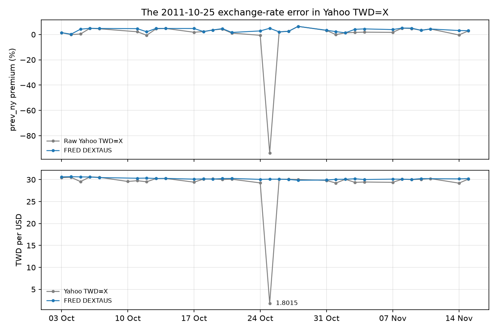
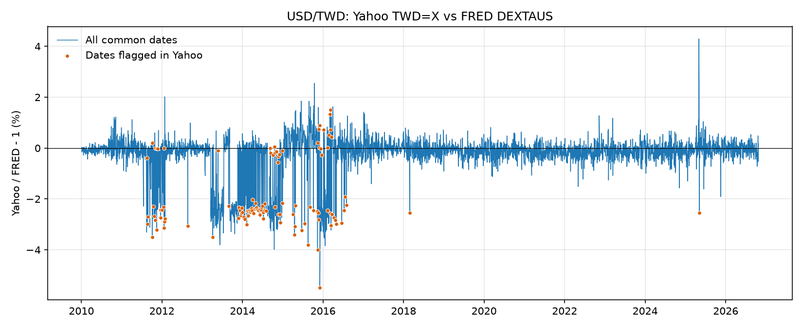
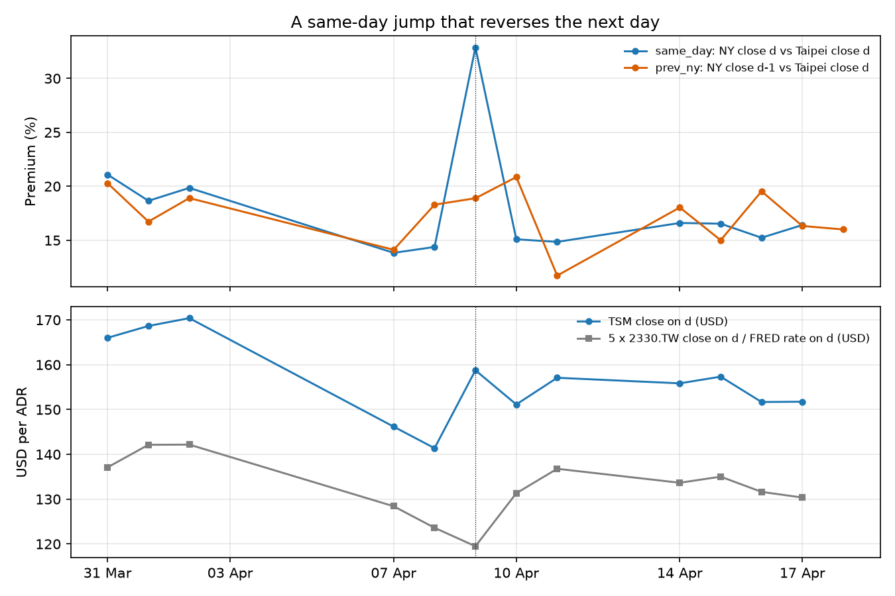
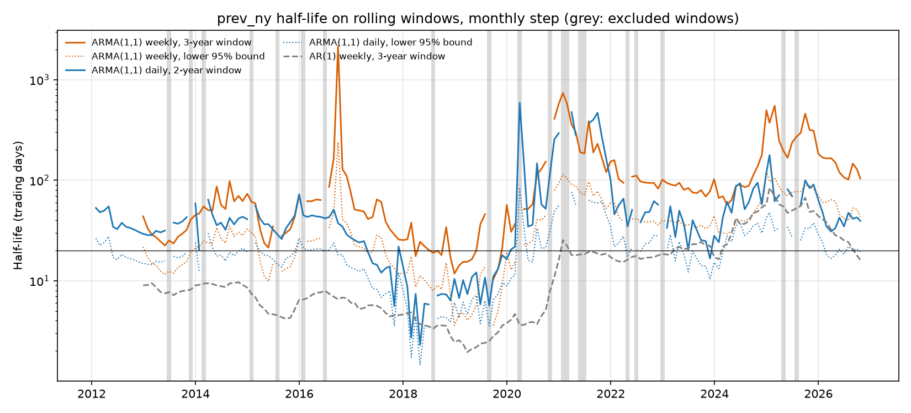

# The TSMC ADR Premium: Data, Measurement and Mean Reversion

Interim report, covering steps 1 to 3 of the project roadmap. Preliminary version of
the final report: same structure, stopping where the work currently stands.

All tables are generated by `scripts/make_report_tables.py` from the files in
`data/`. Figures are produced by the scripts listed in Appendix A.

## 1. Abstract

TSMC's NYSE-listed ADR (TSM) trades at a persistent premium over its Taiwan-listed
shares (2330.TW), in apparent breach of the law of one price. This report measures
that premium from daily unadjusted closes (Yahoo Finance) and the official USD/TWD
rate (FRED DEXTAUS), 2010-01-04 to 2026-10-23, and studies whether and how fast it
mean-reverts. Three measurement problems had to be solved before any modelling:
errors in the Yahoo exchange rate, noise from non-synchronous closing times, and a
resulting downward bias in naive half-life estimates. The premium is not stationary
over the full sample and moves between level regimes. Corrected for asynchrony noise
with an AR(1)-plus-noise (ARMA(1,1)) model, its half-life is weeks to months (rolling
weekly median about 70 trading days) rather than the few days suggested by a naive
AR(1), and it varies over time. No structural break could be established.

## 2. Summary of methodological issues

Each issue below would have changed a conclusion had it not been detected. Sections
4 to 7 describe them in detail.

<!-- table:issues -->
| Issue | How it was detected | Fix | Impact (before -> after) |
|---|---|---|---|
| a) Errors in the Yahoo exchange rate | 2 impossible values (outside [25, 40]) gave premiums down to -93.7%; a local rule then flagged 124 dates; comparison with FRED found 406 dates with a gap above 1%, of which 87 flagged, and 9 persistent shifts | FRED DEXTAUS, taken on the NY date of the ADR used | `prev_ny` daily change std over 2011-2016: 2.09% -> 1.74%; minimum premium -93.7% -> -6.0% |
| b) Measurement noise from non-synchronous closes | Daily changes have a lag-1 autocorrelation of -0.45; it is unchanged when Yahoo is replaced by FRED | `prev_ny` as reference; weekly sampling and a signal-plus-noise model downstream | Autocorrelation `prev_ny`: -0.453 (Yahoo) -> -0.452 (FRED): the noise is not from the exchange rate |
| c) AR(1) half-life biased downwards | Weekly AR(1) half-lives 7.8-17.0 days against 2.2-4.1 daily; a calibrated simulation (true 34.3 days) gives 4.2 daily and 14.0 weekly | ARMA(1,1): AR(1) signal plus white measurement noise | Weekly half-life by sub-period: 7.8-17.0 (AR(1)) -> 63.1-69.1 days (ARMA) |
| d) Sub-periods chosen after looking at the data | Sub-period boundaries were read from the premium chart, so agreement within them may be selected | Rolling 3-year windows with a monthly step, no manual split | Weekly ARMA median 69.6 days, above 20 days in 92% of windows, but from 25.4 (windows ending 2017-2019) to 157.5 (ending 2024-2026) |
| e) Chow test at chosen break dates | Rejection at the April-May 2026 dates (p 2.8e-07 to 1.9e-06); placebo dates reject too (all 7, p at most 2.7e-04) | Results reported as not conclusive; no break claimed | Break at the candidate dates: claimed -> not conclusive (7 of 7 placebo dates reject) |
<!-- /table:issues -->

## 3. Introduction

An American Depositary Receipt (ADR) is a certificate traded in the United States
that represents shares of a foreign company held by a depositary bank. One TSM ADR
represents five ordinary 2330.TW shares; the code assumes this ratio is constant over
the whole sample (not verified, see Section 8). With the exchange rate, the price of an ADR
can be compared with the price of the shares it represents; the difference, in
percent, is the ADR premium. Under the law of one price (LOOP), two claims on the same
cash flows should trade at the same price once currencies and conversion costs are
accounted for, and arbitrage should keep the premium close to zero.

The TSM premium is far from zero. Its weekly mean was 3.1% over 2010-2019, 7.3% over
2020-2023 and 19.2% from 2024 to April 2026 (Section 6.1). Two questions follow. Why
does arbitrage not close the gap? And who buys the ADR at a premium instead of the
cheaper ordinary share? The project's research questions point to conversion
constraints, foreign ownership rules and short-selling limits as candidate
explanations; none of them is tested in this report.

The 2025-2026 period adds a policy element. On 23 April 2026, Taiwan's Financial
Supervisory Commission (FSC) announced that the cap on a single stock in an equity
fund would be raised from 10% to 25% (Bloomberg, 23 April 2026; Focus Taiwan, 24
April 2026). The exact effective date was not verified. Section 7 discusses what the
data can and cannot say about this announcement.

This report covers the first three steps of the roadmap: the data, the construction
of the premium with its asynchrony diagnostics, and its stationarity and mean
reversion. The explanatory factors and a trading strategy are later steps.

## 4. Data

<!-- table:data_sources -->
| Series | Ticker | Source | Unit | First | Last | Observations |
|---|---|---|---|---|---|---:|
| TSMC ADR | `TSM` | Yahoo Finance (yfinance) | USD per ADR | 2010-01-04 | 2026-10-30 | 4,233 |
| TSMC ordinary share | `2330.TW` | Yahoo Finance (yfinance) | TWD per share | 2010-01-04 | 2026-10-30 | 4,112 |
| USD/TWD, comparison only | `TWD=X` | Yahoo Finance (yfinance) | TWD per USD | 2010-01-04 | 2026-10-30 | 4,380 |
| USD/TWD, used for the premium | `DEXTAUS` | FRED (Federal Reserve H.10) | TWD per USD | 2010-01-04 | 2026-10-23 | 4,205 |
<!-- /table:data_sources -->

Prices are daily closes from Yahoo Finance, downloaded with the unofficial `yfinance`
library. They are **unadjusted** (`auto_adjust=False`): ex-dividend dates differ
between Taipei and the ADR, and Yahoo's retroactive adjustment would distort the level
of the premium. The exchange rate used for the premium is the FRED series DEXTAUS
(Federal Reserve H.10, TWD per USD), recorded at noon New York time. Yahoo's TWD=X is
kept only to compare the two sources. The premium sample ends on 2026-10-23, the last
FRED value; Yahoo prices continue to 2026-10-30. Raw data is not redistributed.

FRED has no value on some days. These gaps are forward-filled for at most 3 business
days and never past the last published value: 180 values are filled since 2010, of
which 43 are used by the `prev_ny` premium and 36 by `same_day`.

### 4.1 Manual verification

One date was recomputed by hand from the raw files to check the pipeline. On
2026-06-23 the two definitions of Section 5 differ by almost 8 points, which makes it
a useful test case.

<!-- table:manual_check -->
| Item | Value | Source |
|---|---:|---|
| Taipei date d | 2026-06-23 | `premium_table.csv` |
| NY date used by `prev_ny` (`adr_date`) | 2026-06-22 | previous NY session |
| TSM close on `adr_date` (USD) | 467.67 | `raw_closes.csv` |
| 2330.TW close on d (TWD) | 2,490.0 | `raw_closes.csv` |
| FRED USD/TWD on `adr_date` | 31.63 | `fx_fred.csv` |
| Local value of one ADR: 5 x 2,490.0 / 31.63 (USD) | 393.61 | computed |
| `prev_ny` premium: 467.67 / 393.61 - 1 | 18.81% | computed |
| `prev_ny` premium in `premium_table.csv` | 18.81% | pipeline |
| TSM close on d (USD) | 436.39 | `raw_closes.csv` |
| FRED USD/TWD on d | 31.63 | `fx_fred.csv` |
| `same_day` premium: 436.39 / 393.61 - 1 | 10.87% | computed |
| Yahoo TWD=X on `adr_date`, for comparison | 31.7020 | `raw_closes.csv` |
<!-- /table:manual_check -->

The hand calculation reproduces the pipeline value of 18.81% for `prev_ny`. The
`same_day` premium is 10.87% because it uses the TSM close of 2026-06-23, which fell
6.7% from the previous NY close; that NY session took place after the Taipei close of
the same date, so the local price could not reflect it. The gap between the two
definitions on this date is therefore a timing effect, not a data error. On the same
date, Yahoo's TWD=X differs from FRED by 0.23%.

A comparison with a premium value published by a third party for this date is
**not verified**: no such published value is available in the project's sources.

### 4.2 Data cleaning: the exchange rate

**Naive approach.** The first version used Yahoo's TWD=X and removed only impossible
values, outside a range of 25 to 40 TWD per USD. Two values were removed, and they
were gross errors: 1.8015 on 2011-10-25 and 3.67 on 2014-12-31.

<!-- table:fx_gross_errors -->
| Date | Yahoo TWD=X | FRED DEXTAUS | `same_day` premium (raw Yahoo) | `prev_ny` premium (raw Yahoo) |
|---|---:|---:|---:|---:|
| 2011-10-25 | 1.8015 | 30.11 | -93.9% | -93.7% |
| 2014-12-31 | 3.6700 | 31.60 | -88.3% | -88.3% |
<!-- /table:fx_gross_errors -->

**Problem detected.** The zoom above already shows smaller discrepancies around the
error: on several dates the Yahoo rate sits below FRED. A local rule, which flags
values more than 2% away from a centred 5-day rolling median, flagged 124 dates, 122
of them between 2011 and 2016.

**How it was detected.** Each flagged date was compared with FRED. If FRED showed the
same move against its own rolling median, the move was real; otherwise it was an error
in Yahoo.

<!-- table:fx_verdicts -->
| Verdict for the dates flagged in Yahoo | Dates |
|---|---:|
| Yahoo point off (gap > 1%, FRED flat) | 86 |
| Yahoo point close to FRED, its neighbours off | 28 |
| No FRED value on that date | 9 |
| FRED shows the same move | 1 |
<!-- /table:fx_verdicts -->

Of the 124 flagged dates, 115 can be compared directly. FRED shows the same move on
just 1 of them. On the flagged dates the mean absolute deviation from the rolling
median is 2.70% for Yahoo and 0.10% for FRED, and the same rule flags none of FRED's
own values. In 28 cases the flagged Yahoo value is close to FRED and its neighbours
are off. This points to a second, less visible problem: persistent shifts.

<!-- table:fx_gap_by_year -->
| Year | Common dates | Mean abs gap | Share abs gap > 1% | Dates flagged in Yahoo |
|---|---:|---:|---:|---:|
| 2010 | 250 | 0.17% | 1% | 0 |
| 2011 | 249 | 0.50% | 12% | 15 |
| 2012 | 251 | 0.23% | 3% | 8 |
| 2013 | 250 | 1.40% | 52% | 10 |
| 2014 | 249 | 1.13% | 41% | 46 |
| 2015 | 251 | 0.85% | 24% | 23 |
| 2016 | 251 | 0.74% | 20% | 20 |
| 2017 | 247 | 0.22% | 1% | 0 |
| 2018 | 249 | 0.25% | 0% | 1 |
| 2019 | 248 | 0.18% | 0% | 0 |
| 2020 | 250 | 0.23% | 1% | 0 |
| 2021 | 249 | 0.22% | 0% | 0 |
| 2022 | 250 | 0.25% | 1% | 0 |
| 2023 | 249 | 0.24% | 1% | 0 |
| 2024 | 251 | 0.25% | 0% | 0 |
| 2025 | 248 | 0.28% | 3% | 1 |
| 2026 | 204 | 0.20% | 0% | 0 |
<!-- /table:fx_gap_by_year -->

The gap between Yahoo and FRED exceeds 1% on 12% of dates in 2011, 52% in 2013, 41% in
2014, 24% in 2015 and 20% in 2016, against at most 1% in every year since 2017 except
2025 (3%). Over the
whole sample 406 dates have a gap above 1%, and only 87 of them are flagged by the
local rule. The reason is that the gap often persists: Yahoo stays about 2.5% below
FRED for 10 to 48 consecutive dates. A rolling median cannot detect such shifts,
because the neighbouring values are shifted too.

<!-- table:fx_shifts -->
| Start | End | Consecutive dates | Mean gap Yahoo/FRED |
|---|---|---:|---:|
| 2013-03-19 | 2013-04-01 | 10 | -2.51% |
| 2013-04-15 | 2013-05-03 | 15 | -2.40% |
| 2013-05-09 | 2013-05-22 | 10 | -2.55% |
| 2013-05-24 | 2013-07-15 | 35 | -2.58% |
| 2013-09-09 | 2013-11-18 | 48 | -2.52% |
| 2014-08-18 | 2014-09-08 | 15 | -2.42% |
| 2014-09-15 | 2014-10-02 | 14 | -2.63% |
| 2015-12-22 | 2016-01-06 | 10 | -2.72% |
| 2016-01-19 | 2016-02-04 | 13 | -2.64% |
<!-- /table:fx_shifts -->

**Correction.** FRED replaces Yahoo in the premium. The rate is taken on the NY date
of the ADR price used, so it is never later than that price: FRED of day d for
`same_day`, FRED of `adr_date` (the previous NY session) for `prev_ny`. The FRED rate
is recorded 4 hours before the ADR close.

**Impact.** The minimum `prev_ny` premium moves from -93.7% to -6.0%. Over 2011-2016,
the standard deviation of daily changes falls by 17% for both definitions.

<!-- table:fx_impact -->
| Definition | Observations (Yahoo / FRED) | Mean premium (Yahoo / FRED) | Daily change std (Yahoo / FRED) | Daily change std, 2011-2016 (Yahoo / FRED) | Daily change autocorrelation (Yahoo / FRED) |
|---|---:|---:|---:|---:|---:|
| `prev_ny` | 4,102 / 4,107 | 6.29% / 6.54% | 2.10% / 1.97% | 2.09% / 1.74% (-17%) | -0.453 / -0.452 |
| `same_day` | 3,971 / 3,975 | 6.41% / 6.65% | 2.38% / 2.24% | 2.10% / 1.74% (-17%) | -0.441 / -0.436 |
<!-- /table:fx_impact -->

The last column of this table matters for Section 5: the autocorrelation of daily
changes barely moves with the exchange-rate source.

## 5. Measuring the premium

The premium on Taipei date d is

    premium = P_ADR (USD) / (5 x P_local (TWD) / FX (TWD per USD)) - 1.

No pair of closing prices is observed at the same time, so two definitions are
computed:

- `same_day`: NY close of day d against Taipei close of day d;
- `prev_ny`: NY close of the last NY trading day strictly before d (`adr_date`)
  against Taipei close of day d.

<!-- table:closing_times -->
| Season | Taipei close (13:30 local), UTC | NY close (16:00 local), UTC | FRED rate (noon NY), UTC | `same_day` gap: NY close d - Taipei close d | `prev_ny` gap: Taipei close d - NY close d-1 |
|---|---:|---:|---:|---:|---:|
| Winter (example 2026-01-15) | 05:30 | 21:00 | 17:00 | 15.5 h | 8.5 h |
| Summer (example 2026-07-15) | 05:30 | 20:00 | 16:00 | 14.5 h | 9.5 h |
<!-- /table:closing_times -->

`prev_ny` is the reference definition, for three reasons:

1. It is the only one observable in real time at the Taipei close, when the previous
   NY close is already known, so the only one usable without look-ahead in a backtest
   executed at the Taipei close.
2. It is less noisy: the daily change standard deviation is 1.97%, against 2.24% for
   `same_day` (table below).
3. Its time gap is shorter: 8.5 to 9.5 hours, against 14.5 to 15.5 hours for
   `same_day`, depending on daylight saving time in New York.

`same_day` is kept as a robustness check.

### Asynchrony

**Naive approach.** The daily premium was first read as a direct measure of the
deviation from the law of one price, day by day.

**Problem detected.** The daily series contains large jumps that reverse the next
day. With the FRED rate, 14 daily changes exceed 10 points in either definition.

<!-- table:jumps -->
| Date | `same_day` | `prev_ny` | `same_day` next day | `prev_ny` next day |
|---|---:|---:|---:|---:|
| 2020-03-16 | -1.95% | 13.83% | 9.43% | 1.16% |
| 2020-03-17 | 9.43% | 1.16% | 3.66% | 12.80% |
| 2020-03-18 | 3.66% | 12.80% | 7.60% | 8.67% |
| 2020-07-28 | 3.62% | 12.19% | 14.64% | 6.81% |
| 2020-07-29 | 14.64% | 6.81% | 8.00% | 11.47% |
| 2022-11-10 | 9.55% | 1.38% | 5.39% | 1.12% |
| 2022-11-15 | 4.10% | -6.03% | 1.25% | 2.60% |
| 2024-08-05 | 18.61% | 20.04% | 15.77% | 9.85% |
| 2024-08-06 | 15.77% | 9.85% | 10.04% | 10.73% |
| 2024-10-17 | 27.92% | 16.55% | 18.58% | 22.02% |
| 2025-04-09 | 32.86% | 18.89% | 15.09% | 20.86% |
| 2025-04-10 | 15.09% | 20.86% | 14.85% | 11.72% |
| 2026-07-01 | 13.07% | 21.44% | 12.23% | 14.91% |
| 2026-07-31 | 7.59% | 7.70% | 11.17% | 10.09% |
<!-- /table:jumps -->

**How it was detected.** The lag-1 autocorrelation of daily changes is about -0.44 to
-0.45 under both definitions: close to half of each daily change is reversed the next
day. This is the signature of measurement noise. The exchange rate was a candidate
cause, but replacing Yahoo by FRED leaves the autocorrelation unchanged (-0.453 and
-0.452 for `prev_ny`, Section 4.2). The noise comes from the non-synchronous closes.

<!-- table:asynchrony -->
| Definition | Observations | Mean premium | Premium std | Daily change std | Daily change autocorrelation (lag 1) |
|---|---:|---:|---:|---:|---:|
| `same_day` | 3,975 | 6.65% | 6.44% | 2.24% | -0.436 |
| `prev_ny` | 4,107 | 6.54% | 6.30% | 1.97% | -0.452 |
<!-- /table:asynchrony -->

**Example.** The sequence below is one of the jumps above 10 points. It is described
from the data only; no market event is attributed to it.

<!-- table:example -->
| Taipei date d | TSM close on d (USD) | 2330.TW close on d (TWD) | FRED on d | `same_day` | TSM close on `adr_date` (USD) | `prev_ny` |
|---|---:|---:|---:|---:|---:|---:|
| 2025-04-07 | 146.17 | 848.0 | 33.02 | 13.83% | 146.80 | 14.12% |
| 2025-04-08 | 141.37 | 816.0 | 33.01 | 14.38% | 146.17 | 18.30% |
| 2025-04-09 | 158.75 | 785.0 | 32.85 | 32.86% | 141.37 | 18.89% |
| 2025-04-10 | 151.13 | 863.0 | 32.86 | 15.09% | 158.75 | 20.86% |
| 2025-04-11 | 157.08 | 889.0 | 32.50 | 14.85% | 151.13 | 11.72% |
| 2025-04-14 | 155.84 | 865.0 | 32.36 | 16.60% | 157.08 | 18.04% |
| 2025-04-15 | 157.33 | 877.0 | 32.48 | 16.54% | 155.84 | 15.01% |
| 2025-04-16 | 151.67 | 855.0 | 32.48 | 15.23% | 157.33 | 19.53% |
<!-- /table:example -->

On 2025-04-09 the TSM close rose 12.3% during a NY session that started after the
Taipei close of the same date. The `same_day` premium jumped from 14.38% to 32.86%. On
2025-04-10, 2330.TW rose 9.9% and the `same_day` premium returned to 15.09%. The
`prev_ny` premium, which uses the previous NY close, shows the same move one day later
(20.86% on 2025-04-10) and reverses on 2025-04-11. The pattern is consistent with
each market closing before the other has priced the same information, rather than
with a lasting change in the relative valuation of the two securities.

**Consequence.** Mean reversion cannot be measured on daily changes without
accounting for this noise (Section 6.2).

## 6. Mean reversion

Reference definition `prev_ny` with the FRED exchange rate. Half-lives are expressed
in trading days. Weekly data are sampled on Fridays (last observation of the week)
and converted at 5 trading days per week. Weeks without any observation are left
empty rather than filled: there are 12, all in January or February, which is
consistent with the Lunar New Year closure of the Taipei market (not verified against
an exchange calendar).

### 6.1 Stationarity and level regimes

<!-- table:stationarity -->
| Definition | Frequency | Observations | ADF statistic | ADF p-value | ADF lags (AIC) | KPSS statistic | KPSS p-value |
|---|---:|---:|---:|---:|---:|---:|---:|
| `prev_ny` | daily | 4,107 | -2.14 | 0.228 | 13 | 5.50 | 0.01 (bound) |
| `prev_ny` | weekly | 865 | -2.26 | 0.184 | 3 | 2.59 | 0.01 (bound) |
| `same_day` | daily | 3,975 | -2.13 | 0.234 | 17 | 5.32 | 0.01 (bound) |
| `same_day` | weekly | 864 | -1.77 | 0.395 | 9 | 2.51 | 0.01 (bound) |
<!-- /table:stationarity -->

ADF does not reject a unit root (p = 0.23 daily and 0.18 weekly for `prev_ny`), and
KPSS rejects level stationarity at the bound of its table (p at or below 0.01). The
premium is not stationary around a single mean over the full sample: it moves between
level regimes, with a weekly mean of 3.1% in 2010-2019, 7.3% in 2020-2023, 19.2% from
2024 to April 2026 and 14.1% since May 2026. Full-sample half-lives mix mean reversion
with these level shifts (the ARMA(1,1) of Section 6.3 gives 127.4 trading days daily
and 381.0 weekly on the full sample) and are not used. The analysis below works
within sub-periods and on rolling windows.

### 6.2 Naive AR(1) and its bias

**Naive approach.** The half-life is estimated from an AR(1) regression of the daily
change on the lagged level, Δp_t = a + b p_{t-1}, with phi = 1 + b and half-life
ln(0.5) / ln(phi).

<!-- table:ar1_naive -->
| Period (`prev_ny`) | AR(1) daily [95% CI] | AR(1) weekly [95% CI] | Weekly / daily | Residual autocorrelation, daily | Residual autocorrelation, weekly |
|---|---:|---:|---:|---:|---:|
| 2010-2019 | 2.2 [2.0, 2.5] | 7.8 [6.3, 10.0] | 3.5 | -0.24 | -0.22 |
| 2020-2023 | 4.1 [3.3, 5.3] | 17.0 [11.3, 31.2] | 4.1 | -0.39 | -0.19 |
| 2024-Apr 2026 | 4.0 [3.0, 5.6] | 12.2 [7.6, 25.4] | 3.1 | -0.37 | -0.27 |
| Full sample | 13.8 [11.5, 17.2] | 54.2 [38.7, 88.7] | 3.9 | -0.42 | -0.36 |
<!-- /table:ar1_naive -->

**Problem detected.** Within sub-periods, the AR(1) gives half-lives of 2 to 17
trading days, but the weekly estimate is 3.1 to 4.1 times longer than the daily one.
Both cannot be right. The residuals remain autocorrelated (lag 1: -0.19 to -0.39
within sub-periods).

**How it was detected.** A simulation reproduces the gap. The latent premium is an
AR(1) with phi = 0.98, a true half-life of 34.3 days; white measurement noise with a
standard deviation of 2 (innovation standard deviation 1) is added, which gives daily
changes an autocorrelation of -0.44, the value observed on the premium.

<!-- table:simulation -->
| Estimator (half-life in days) | Mean | Std | Range over 30 replications | True value |
|---|---:|---:|---:|---:|
| AR(1), daily | 4.2 | 0.5 | 3.4 to 5.6 | 34.3 |
| AR(1), weekly | 14.0 | 1.8 | 11.6 to 19.3 | 34.3 |
| ARMA(1,1), daily | 35.0 | 4.8 | 27.1 to 46.4 | 34.3 |
| ARMA(1,1), weekly | 35.0 | 5.8 | 25.8 to 48.4 | 34.3 |
<!-- /table:simulation -->

Over 30 replications, the AR(1) estimates 4.2 days on daily data and 14.0 days on
weekly data, for a true value of 34.3. Measurement noise biases phi towards zero; the
bias is smaller on weekly data, where five days of true moves weigh more against the
noise, but it does not disappear. The naive AR(1) half-lives of the premium are
therefore biased downwards, and the daily-to-weekly ratio of about 4 is the trace of
this bias.

### 6.3 Signal plus noise: ARMA(1,1)

**Correction.** The observed premium is modelled as the true premium plus measurement
noise:

    observed_t = s_t + e_t,   s_t = c + phi s_{t-1} + u_t,

where s_t is the true premium, an AR(1), and e_t is white noise from asynchrony. The
sum of an AR(1) and white noise is an ARMA(1,1). Its autoregressive coefficient is the
persistence phi of the true premium, from which the half-life is computed; its moving
average coefficient theta absorbs the noise and is negative when the noise is large.
The model is estimated by maximum likelihood (`statsmodels` ARIMA(1,0,1) with a
constant); the confidence interval of the half-life comes from that of phi. In the
simulation above it recovers the true half-life at both frequencies (35.0 days on
average, daily and weekly), with theta at -0.61 daily and -0.34 weekly.

<!-- table:arma -->
| Period (`prev_ny`) | Weeks | Mean premium | ARMA daily [95% CI] | ARMA weekly [95% CI] | Theta daily | Theta weekly | Ljung-Box p, daily | Ljung-Box p, weekly |
|---|---:|---:|---:|---:|---:|---:|---:|---:|
| 2010-2019 | 514 | 3.1% | 61.9 [44.9, 99.4] | 63.1 [40.4, 137.9] | -0.76 | -0.59 | 8.0e-09 | 0.280 |
| 2020-2023 | 206 | 7.3% | 54.6 [30.1, 279.5] | 63.9 [33.1, 551.5] | -0.67 | -0.49 | 3.8e-05 | 0.003 |
| 2024-Apr 2026 | 119 | 19.2% | 53.4 [26.9, 2,103.1] | 69.1 [29.6, inf] | -0.63 | -0.44 | 0.280 | 0.720 |
<!-- /table:arma -->

**Impact.** Within each sub-period, daily and weekly estimates agree at about 55 to 70
trading days, against 2 to 17 days for the AR(1). Theta is negative throughout (-0.76
to -0.63 daily, -0.59 to -0.44 weekly), as expected under measurement noise. Weekly
residuals are white in 2010-2019 and from 2024 to April 2026 (Ljung-Box p = 0.28 and
0.72 at 4 lags), but not in 2020-2023 (p = 0.003). Daily residuals have a lag-1
autocorrelation close to zero but are not white in 2010-2019 and 2020-2023: the
measurement noise is not purely white, so weekly estimates are preferred. The
`same_day` definition gives similar values in the first two sub-periods (58.1 daily
and 63.8 weekly; 53.1 and 71.2) and shorter ones from 2024 to April 2026 (33.7 and
46.1).

### 6.4 Robustness: rolling windows

**Problem detected.** The sub-periods were chosen after looking at the premium chart.
Agreement within them may partly reflect that choice, the same problem as a break test
at a chosen date (Section 7).

**Correction.** The ARMA(1,1) is re-estimated on rolling windows with a monthly step
and no manual split: weekly data on 3-year windows (156 weeks) and daily data on
2-year windows (504 days), with the weekly AR(1) for comparison. Windows where the fit
did not converge or where phi exceeds 0.999 are excluded from the statistics and
shaded on the figure.

<!-- table:rolling -->
| Estimate (`prev_ny`, half-life in trading days) | Windows | Excluded | Median | Interquartile range | Share > 20 days | Share with lower 95% bound > 20 days |
|---|---:|---:|---:|---:|---:|---:|
| ARMA(1,1) weekly, 3-year windows | 167 | 7 | 69.6 | 34.6 to 122.3 | 92% | 68% |
| ARMA(1,1) daily, 2-year windows | 178 | 13 | 37.8 | 25.4 to 55.1 | 81% | 41% |
| AR(1) weekly, 3-year windows | 167 | 0 | 9.0 | 4.8 to 20.0 | 25% | 13% |
| ARMA(1,1) weekly, windows ending 2013-2016 | 48 | 3 | 50.4 | 30.0 to 64.3 | 100% | 58% |
| ARMA(1,1) weekly, windows ending 2017-2019 | 36 | 1 | 25.4 | 17.8 to 39.9 | 63% | 14% |
| ARMA(1,1) weekly, windows ending 2020-2023 | 48 | 3 | 101.1 | 82.4 to 168.9 | 100% | 96% |
| ARMA(1,1) weekly, windows ending 2024-2026 | 34 | 0 | 157.5 | 102.2 to 243.1 | 100% | 100% |
<!-- /table:rolling -->

**Impact.** The order of magnitude holds; the level does not. The weekly ARMA
half-life has a median of 69.6 trading days (interquartile range 34.6 to 122.3). It
exceeds 20 days in 92% of the 160 windows kept, and its lower 95% bound exceeds 20
days in 68% of them, against a median of 9.0 days for the weekly AR(1). But it varies
strongly over time: windows ending in 2017-2019 have a median of 25.4 days, with 13
windows below 20 days ending between 2018-03-30 and 2019-10-31, while windows ending
in 2024-2026 have a median of 157.5 days. The daily ARMA on 2-year windows has a median
of 37.8 days and is usually shorter than the weekly estimate (median ratio 1.9), so the
close agreement between frequencies seen in the sub-periods does not hold window by
window.

### 6.5 Conclusion of the section

Corrected for asynchrony noise, the half-life is measured in weeks to months: the
rolling weekly ARMA median is about 70 trading days, above 20 days in 92% of windows,
against about 9 days for the naive AR(1). It varies over time, from about 25 days in
windows ending in 2017-2019 to about 158 days in windows ending in 2024-2026.
Untested observation: the half-life seems to lengthen when the premium level is high.

### 6.6 Economic implication

This subsection states an implication; it is not a tested result. A half-life of
several weeks to months means that a position betting on a narrower premium, short the
ADR and long the ordinary shares, would typically have to be held for months before
half of a deviation closes. Over that horizon the arbitrageur pays the borrowing fee
on the ADR, ties up capital on both legs, and bears the risk that the premium widens
further before it narrows. These holding costs are one candidate reason why arbitrage
does not close the gap, in line with the limits-of-arbitrage question of the
introduction. Whether a strategy survives them is the subject of the backtest, a
later step of the roadmap.

## 7. What did not work

**Naive approach.** A Chow test on the weekly AR(1) of `prev_ny` was run at four
candidate break dates in April and May 2026, around the FSC announcement.

**Problem detected.** The test rejects stability at all four dates (p from 2.8e-07 to
1.9e-06), with only 26 to 30 weeks after each date. The dates were chosen after
looking at the data.

**How it was detected.** The same test was run at seven placebo dates from 2013 to
2025. It rejects at every one of them (p from 1.5e-14 to 2.7e-04). The "before" regime
of a full-history test pools level regimes whose weekly means range from 3.1% to 19.2%
(Section 6.1), so the test rejects whatever the date. In addition, the AR(1) residuals are autocorrelated, which breaks
the assumptions behind the F distribution of the test.

<!-- table:chow -->
| Test | Break date | F | p-value | Weeks before | Weeks after |
|---|---|---:|---:|---:|---:|
| Candidate date, full history | 2026-04-01 | 15.37 | 2.8e-07 | 822 | 30 |
| Candidate date, full history | 2026-04-15 | 13.99 | 1.1e-06 | 824 | 28 |
| Candidate date, full history | 2026-04-24 | 13.38 | 1.9e-06 | 825 | 27 |
| Candidate date, full history | 2026-05-01 | 14.14 | 9.1e-07 | 826 | 26 |
| Placebo date, full history | 2013-01-04 | 8.29 | 2.7e-04 | 149 | 703 |
| Placebo date, full history | 2016-01-01 | 15.68 | 2.0e-07 | 301 | 551 |
| Placebo date, full history | 2018-01-05 | 22.83 | 2.2e-10 | 404 | 448 |
| Placebo date, full history | 2020-01-03 | 32.71 | 2.1e-14 | 506 | 346 |
| Placebo date, full history | 2022-01-07 | 16.41 | 1.0e-07 | 609 | 243 |
| Placebo date, full history | 2024-01-05 | 33.07 | 1.5e-14 | 709 | 143 |
| Placebo date, full history | 2025-01-03 | 12.76 | 3.5e-06 | 761 | 91 |
| Sample from 2024 only | 2025-01-03 | 1.48 | 0.232 | 51 | 91 |
| Sample from 2024 only | 2025-07-04 | 1.42 | 0.246 | 75 | 67 |
| Sample from 2024 only | 2026-01-02 | 7.03 | 0.001 | 101 | 41 |
| Sample from 2024 only | 2026-04-01 | 7.55 | 7.8e-04 | 112 | 30 |
| Sample from 2024 only | 2026-04-15 | 7.78 | 6.3e-04 | 114 | 28 |
| Sample from 2024 only | 2026-04-24 | 6.76 | 0.002 | 115 | 27 |
| Sample from 2024 only | 2026-05-01 | 6.44 | 0.002 | 116 | 26 |
<!-- /table:chow -->

**Conclusion.** The Chow results are reported as not conclusive, and no structural
break is claimed. On a sample restricted to data since 2024, the test finds no break
in 2025 (p = 0.232 and 0.246) but is already significant at 2026-01-02 (p = 0.001): the
level drop starts in January 2026. The FSC announcement of 23 April 2026, whose exact
effective date was not verified, therefore came after the drop had begun. The decision
may have accentuated it, but these tests cannot isolate its effect.

## 8. Limitations

- **Price data.** `yfinance` is an unofficial interface to Yahoo Finance, with no
  quality guarantee. Section 4.2 shows that its exchange-rate series contained errors;
  the price series have only been checked on individual dates (Section 4.1).
- **Publication lag of FRED.** When the series was downloaded on 2 November 2026, its
  last value was dated 2026-10-23, so the last week of prices cannot be used. In a
  live strategy the FRED rate would not be available at the Taipei close, and a market
  rate would be needed. The FRED rate is also not synchronous with either close: it is
  recorded at 16:00 or 17:00 UTC (Section 5).
- **ADR ratio.** The premium uses a constant ratio of five shares per ADR from 2010 to
  2026. Whether the ratio or the share count changed during the sample was not
  verified; a change would shift the premium level from that date.
- **Dividends.** Prices are unadjusted on purpose, but ex-dividend dates, which differ
  between the two markets, are not yet treated. They may create small spurious moves
  in the premium around those dates.
- **Daily residuals.** The daily ARMA(1,1) residuals are not white in 2010-2019 and
  2020-2023: the noise model is not complete at the daily frequency.
- **Confidence intervals.** Upper bounds of the half-life intervals are unreliable:
  they come from a Wald interval on phi close to 1 and are often very large or
  infinite. Lower bounds are more informative.
- **Recent period.** Since May 2026 there are only 26 weeks of data, too few to
  estimate a half-life.
- **Weekly conversion.** Weekly half-lives are converted at 5 trading days per week,
  which overstates the number of trading days in holiday weeks.

## 9. Next steps

- **Explanatory factors** (roadmap step 4): flows, the exchange rate and relative
  US/Taiwan returns as drivers of the premium level.
- **Strategy** (roadmap step 5): a walk-forward strategy with transaction and holding
  costs, evaluated with a bootstrapped Sharpe ratio. The rolling mean of the premium,
  rather than a fixed mean, is the natural reference given the level regimes.
- **Other Taiwanese ADRs** (roadmap step 6): UMC, ASE and Chunghwa Telecom.
- **Untested hypothesis**: the half-life lengthens when the premium level is high.
  The rolling estimates suggest it, but the link has not been tested.
- **Break dating**: the January 2026 level drop could be dated with a test designed for
  an unknown break date, rather than at chosen dates.

## References

- Bloomberg, 23 April 2026:
  https://www.bloomberg.com/news/articles/2026-04-23/taiwan-to-ease-limits-on-active-funds-investments-in-tsmc
- Focus Taiwan, 24 April 2026: https://focustaiwan.tw/business/202604240013
- Federal Reserve Bank of St. Louis, FRED series DEXTAUS (Federal Reserve H.10, TWD
  per USD), as downloaded by `src/adr_premium/data.py`:
  https://fred.stlouisfed.org/graph/fredgraph.csv?id=DEXTAUS
- Yahoo Finance, accessed through the `yfinance` library (tickers TSM, 2330.TW,
  TWD=X).
- Working (1960), cited in `src/adr_premium/stats.py` for the autocorrelation created
  by averaging (weekly-mean control). Full bibliographic details, as recalled: H.
  Working, "Note on the correlation of first differences of averages in a random
  chain", *Econometrica*, 28(4), 916-918 (not verified).

## Appendix A. How to reproduce

Requires Python 3.12. From the repository root, in this order:

    python3.12 -m venv .venv
    source .venv/bin/activate
    pip install -r requirements.txt
    pytest -q
    python scripts/build_premium.py              # downloads and caches the data, FRED premium
    python scripts/build_premium.py --fx-source yahoo
    python scripts/build_premium.py --no-clean   # raw Yahoo figure
    python scripts/export_premium_table.py
    python scripts/compare_fx.py
    python scripts/mean_reversion.py
    python scripts/make_report_figures.py
    python scripts/make_report_tables.py         # writes report/tables/ and fills this report

## Appendix B. Software versions

<!-- table:versions -->
| Component | Version |
|---|---|
| Python | 3.12.15 |
| pandas | 3.1.0 |
| numpy | 2.5.4 |
| statsmodels | 0.15.0 |
| scipy | 1.18.1 |
| matplotlib | 3.11.2 |
| yfinance | 1.7.0 |
| pytest | 9.2.0 |
<!-- /table:versions -->

## Appendix C. Figures quoted in the text

Every number quoted in the text, with the file it comes from. Generated by
`scripts/make_report_tables.py`.

<!-- table:key_figures -->
| Quantity quoted in the text | Value | Source |
|---|---|---|
| Last FRED value | 2026-10-23 | fx_fred.csv |
| FRED values forward-filled since 2010 | 180 | fx_fred.csv |
| Forward-filled values used by prev_ny / same_day | 43 / 36 | premium CSVs |
| Empty weeks in the weekly prev_ny series | 12 | premium_prev_ny.csv |
| Last Yahoo price date | 2026-10-30 | raw_closes.csv |
| Manual check prev_ny premium | 18.81% | computed from raw_closes.csv, fx_fred.csv |
| Manual check same_day premium | 10.87% | computed |
| Manual check TSM change on d | -6.7% | raw_closes.csv |
| Manual check Yahoo vs FRED gap | 0.23% | raw_closes.csv, fx_fred.csv |
| Gross error 2011-10-25 prev_ny premium | -93.7% | recomputed |
| Gross error 2014-12-31 prev_ny premium | -88.3% | recomputed |
| Dates with |gap| > 1% | 406 | recomputed |
| of which flagged | 87 | recomputed |
| Flagged dates | 124 | recomputed |
| Share |gap|>1% in 2011 | 12% | recomputed |
| Share |gap|>1% in 2013 | 52% | recomputed |
| Share |gap|>1% in 2014 | 41% | recomputed |
| Share |gap|>1% in 2015 | 24% | recomputed |
| Share |gap|>1% in 2016 | 20% | recomputed |
| Share of flagged dates in 2011-2016 | 122 | recomputed |
| Verdict yahoo_point_off | 86 | recomputed |
| Verdict yahoo_neighbours_off | 28 | recomputed |
| Verdict no_fred_value | 9 | recomputed |
| Verdict fred_confirms | 1 | recomputed |
| Flagged dates comparable | 115 | recomputed |
| Mean |FRED deviation| on flagged dates | 0.10% | recomputed |
| Mean |Yahoo deviation| on flagged dates | 2.70% | recomputed |
| FRED values flagged by the same rule | 0 | recomputed |
| Persistent shifts | 9 | recomputed |
| Longest persistent shift (dates) | 48 | recomputed |
| Shortest persistent shift (dates) | 10 | recomputed |
| prev_ny 2011-2016 noise change | -17% | recomputed |
| prev_ny autocorr Yahoo / FRED | -0.453 / -0.452 | recomputed / premium CSVs |
| same_day 2011-2016 noise change | -17% | recomputed |
| same_day autocorr Yahoo / FRED | -0.441 / -0.436 | recomputed / premium CSVs |
| prev_ny min premium FRED | -6.0% | premium CSVs |
| same_day min premium FRED | -5.0% | premium CSVs |
| same_day daily change std (FRED) | 2.24% | premium CSVs |
| same_day autocorr (FRED) | -0.436 | premium CSVs |
| prev_ny daily change std (FRED) | 1.97% | premium CSVs |
| prev_ny autocorr (FRED) | -0.452 | premium CSVs |
| Premium sample | 2010-01-04 to 2026-10-23 | premium CSVs |
| Jumps above 10 points | 14 | premium_table.csv |
| Example 2025-04-08 same_day / prev_ny | 14.38% / 18.30% | premium_table.csv |
| Example 2025-04-09 same_day / prev_ny | 32.86% / 18.89% | premium_table.csv |
| Example 2025-04-10 same_day / prev_ny | 15.09% / 20.86% | premium_table.csv |
| Example TSM change 2025-04-09 | 12.3% | premium_table.csv |
| Example 2330.TW change 2025-04-10 | 9.9% | premium_table.csv |
| ADF p prev_ny daily | 0.23 | mean_reversion_results.csv |
| ADF p prev_ny weekly | 0.18 | mean_reversion_results.csv |
| ADF p same_day daily | 0.23 | mean_reversion_results.csv |
| ADF p same_day weekly | 0.39 | mean_reversion_results.csv |
| Weekly mean premium 2010-2019 | 3.1% | mean_reversion_results.csv |
| Weekly mean premium 2020-2023 | 7.3% | mean_reversion_results.csv |
| Weekly mean premium 2024-Apr 2026 | 19.2% | mean_reversion_results.csv |
| Weekly mean premium May 2026-end | 14.1% | mean_reversion_results.csv |
| AR(1) weekly/daily ratio by sub-period | 3.5, 4.1, 3.1 | mean_reversion_results.csv |
| Simulation AR(1), daily mean | 4.2 | recomputed simulation |
| Simulation AR(1), weekly mean | 14.0 | recomputed simulation |
| Simulation ARMA(1,1), daily mean | 35.0 | recomputed simulation |
| Simulation ARMA(1,1), weekly mean | 35.0 | recomputed simulation |
| Simulation true half-life | 34.3 | ln(0.5)/ln(0.98) |
| Simulation daily change autocorr | -0.44 | recomputed simulation |
| Simulation theta daily / weekly | -0.61 / -0.34 | recomputed simulation |
| Simulation replications | 30 | recomputed simulation |
| ARMA 2010-2019 daily / weekly | 61.9 / 63.1 | mean_reversion_results.csv |
| ARMA 2020-2023 daily / weekly | 54.6 / 63.9 | mean_reversion_results.csv |
| ARMA 2024-Apr 2026 daily / weekly | 53.4 / 69.1 | mean_reversion_results.csv |
| ARMA theta range daily | -0.76 to -0.63 | mean_reversion_results.csv |
| ARMA theta range weekly_friday | -0.59 to -0.44 | mean_reversion_results.csv |
| same_day ARMA daily / weekly by sub-period | 58.1 / 63.8; 53.1 / 71.2; 33.7 / 46.1 | mean_reversion_results.csv |
| Full-sample ARMA daily / weekly | 127.4 / 381.0 | mean_reversion_results.csv |
| Rolling ARMA(1,1) weekly, 3-year windows | median 69.6, IQR 34.6 to 122.3, >20 days 92%, lower bound >20 68%, windows 167, excluded 7 | mean_reversion_results.csv |
| Rolling ARMA(1,1) daily, 2-year windows | median 37.8, IQR 25.4 to 55.1, >20 days 81%, lower bound >20 41%, windows 178, excluded 13 | mean_reversion_results.csv |
| Rolling AR(1) weekly, 3-year windows | median 9.0, IQR 4.8 to 20.0, >20 days 25%, lower bound >20 13%, windows 167, excluded 0 | mean_reversion_results.csv |
| Rolling weekly ARMA median, windows ending 2013-2016 | 50.4 | mean_reversion_results.csv |
| Rolling weekly ARMA median, windows ending 2017-2019 | 25.4 | mean_reversion_results.csv |
| Rolling weekly ARMA median, windows ending 2020-2023 | 101.1 | mean_reversion_results.csv |
| Rolling weekly ARMA median, windows ending 2024-2026 | 157.5 | mean_reversion_results.csv |
| Weekly ARMA windows below 20 days | 13, ending 2018-03-30 to 2019-10-31 | mean_reversion_results.csv |
| Median weekly/daily ratio, rolling | 1.9 | mean_reversion_results.csv |
| Placebo Chow p-value range | 1.5e-14 to 2.7e-04 | mean_reversion_results.csv |
| Candidate Chow p-value range | 2.8e-07 to 1.9e-06 | mean_reversion_results.csv |
| Candidate weeks after | 26 to 30 | mean_reversion_results.csv |
| Since-2024 Chow p at 2026-01-02 | 0.001 | mean_reversion_results.csv |
| Since-2024 Chow p in 2025 | 0.232, 0.246 | mean_reversion_results.csv |
<!-- /table:key_figures -->
